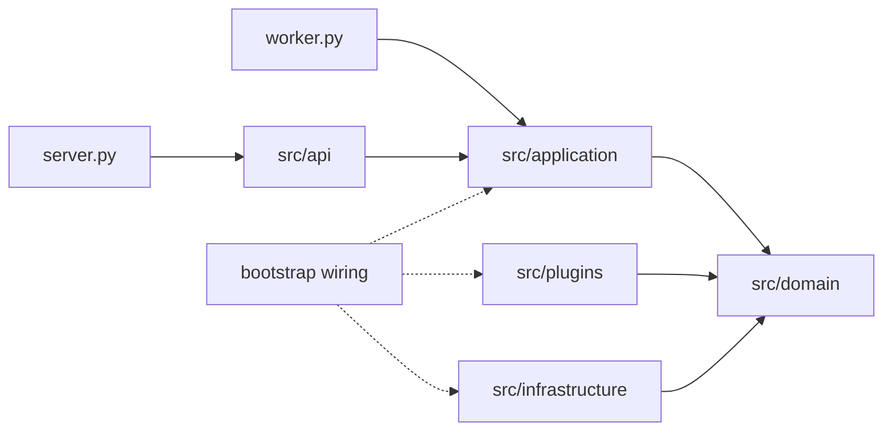

# SVG 架構導讀

本版採用 SVG 的實體 package：root `server.py`／`worker.py`，外緣 `bootstrap/`，以及 `src/api`、`services`、`application`、`domain`、`plugins`、`infrastructure`、`config`、`utils`、`shared_models`。

實線中的 domain 方向表示靜態依賴；執行期 application 呼叫已注入的策略與 adapter。bootstrap 負責建構及注入，不是每個 HTTP request 的必經鏈。services 僅負責 technical runtime operations，與 application 不互相承載業務責任。完整圖將這幾種關係分開呈現。

每個 API/worker 程序各自持有 event loop、lifespan、client pool、thread executor、facade 與模型實例。共享任務與容量需使用 RabbitMQ/Redis，不靠 Python 全域物件。async 適合 I/O，thread 適合阻塞 SDK；純 Python CPU、GPU 或強制終止需求需獨立 process/remote adapter。

SOLID 透過責任分層、Protocol、明確 composition、窄介面及契約測試實踐。純資料可用 dataclass，transport 用 Pydantic，純計算可用函式，不要求所有能力共用一個繼承基底。checker/mypy 不證明全部行為。

初始化依功能 `requires` 拓撲，失敗回滾；關閉先 drain dispatcher、取消 active kernel、排空實體 thread，再清理初始化資源。取消 await 不能殺死 thread，SDK 需自己的 timeout。Redis lease 失效取消 cooperative 工作並等待 cleanup，外部副作用仍須 fencing/冪等。

通用平台不預設 PdM、Fab/Tool 模型、合併階層或診斷流程。`application/hierarchy.py` 是擴充點，plugins 只有空 package。身份與資料隔離是 permission/tenant/owner 基礎，並非完整 RBAC/ABAC 或逐 kernel entitlement。

完整 [設計規格](software-design.md)、[module 功能規範](module-spec.md)、[搬移對照](package-migration.md)、[部署說明](product-platform.md)、[驗證紀錄](validation.md) 與 [決策](adr/README.md) 共同構成工程交付。
