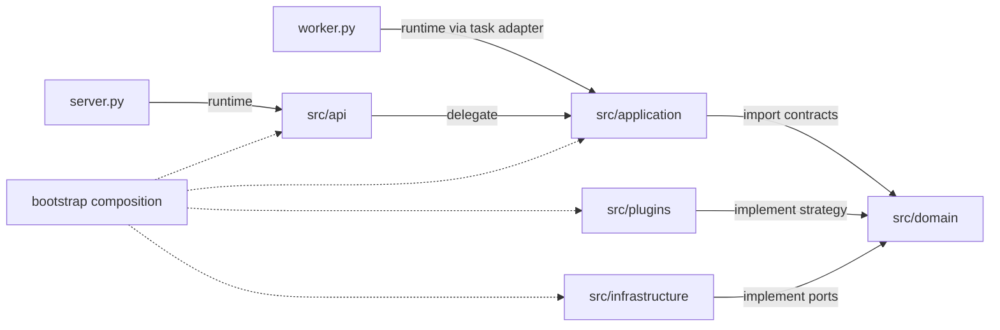

# 通用 Python Backend 架構導讀

本專案是通用 Python Backend Server 藍圖。範本提供啟動、HTTP、背景任務、身分與資料隔離、儲存介面及可插拔計算契約；產品的資料模型、流程、設定階層與策略選擇由後續應用自行定義。此文件及 [軟體設計規格](software-design.md) 描述現行基線；[原始參考](references/README.md) 保存設計來源，並非實作規範。

## 分層與組裝

入口為根目錄 `server.py`／`worker.py`。`bootstrap/` 是外緣 composition root，負責載入設定、建構資源、選擇可信實作及注入依賴。九個頂層 package 的責任如下：

| Package | 責任 |
| --- | --- |
| `src/api` | HTTP 路由、transport schema、身分解析及錯誤轉換。 |
| `src/services` | lifespan、受控並行、容量協調、runtime health 與技術性 logging。 |
| `src/application` | 使用案例、任務 handler 註冊及跨介面共用的應用流程。 |
| `src/domain` | 純模型、政策、strategy 與 outbound ports。 |
| `src/plugins` | 實作 domain 策略的可信插件；預設只有空 package。 |
| `src/infrastructure` | 資料庫、訊息、鎖定、安全及下游介面的技術 adapter。 |
| `src/config` | 設定模型、環境載入及常數。 |
| `src/utils` | 不依賴應用狀態的純工具。 |
| `src/shared_models` | 共用中性 DTO、schema 與型別。 |

圖中的 runtime／delegate 表示執行呼叫，import／implement 表示向 domain 的契約依賴或實作；這些關係不能當作同一種 import graph。application 在執行期透過已注入的契約呼叫策略及 adapter。虛線表示組裝關係，並非每次請求的呼叫鏈。`services` 提供技術性 runtime 支援；它不承載產品使用案例，也不強制所有請求經過它。

## Application Factory 與程序生命週期

Application Factory 指 `server.create_app()`：依設定建立 FastAPI application，註冊路由與 lifespan。這裡的 factory 是軟體建構模式。`server.py` 控制啟動選項；每個 Uvicorn worker 在自身程序內執行 lifespan，沒有跨程序共用的 Python「主執行緒資源」。

每個 API／背景 worker 程序各自持有 event loop、client pool、thread executor、facade 與插件實例。共享任務與容量使用 RabbitMQ／Redis，不靠全域 Python 物件；純 API 可選 disabled task backend，不建立背景工作，保留多 API 程序能力。async 適合 I/O；thread 適合可自行設定逾時的阻塞 SDK；純 Python CPU、GPU 或需要強制終止的工作應選擇獨立 process／remote adapter，現行範本不提供通用 process／GPU 執行器。

初始化依功能 `requires` 拓撲排序，失敗時回滾；關閉依序 drain dispatcher、取消 active kernel、排空實體 thread，再清理初始化資源。取消 await 不能殺死 thread。Redis lease 失效時取消 cooperative 工作並等待 cleanup；外部副作用仍須應用自行定義 fencing、冪等與復原契約。

## 擴充責任與目前狀態

新增應用沿 `domain/<capability>`、`application/<capability>`、`api/<capability>` 與相應 plugins／infrastructure 協作，再由 `bootstrap/` 明確註冊。`application/hierarchy.py` 只有擴充位置；`registry.py` 依已註冊的任務名稱查找 handler；`orchestration.py` 接入現有 kernel 背景使用案例。它們沒有預設的設定合併、策略自動選擇或多步驟 pipeline。

API schema 負責 HTTP 外層格式；queue adapter 解碼傳輸 envelope；TaskRegistry 只解析 handler 名稱。新增 handler 必須在 application 邊界驗證其專屬輸入 schema，並透過 domain 執行資料不變量與政策；不可把「訊息已解碼」視為應用資料已通過驗證。現行 kernel 使用通用 JSON payload，檢查名稱、版本、授權、JSON 大小與容量，尚無通用的逐 kernel 輸入／輸出 schema registry。

身分與資料隔離是 permission／tenant／owner 基礎，並非完整 RBAC／ABAC 或逐 kernel entitlement。SOLID 透過責任分層、Protocol、明確 composition、窄介面及契約測試實踐；不要求所有能力共用繼承基底，靜態 checker／mypy 也不證明全部行為。

將平台衍生為訓練與模型推論系統時，依 [ML System 設計](ml-system-design.md)新增持久工作、獨立執行器、MLflow、核准與部署契約。該文件描述目標應用架構，相關 ML 能力尚未加入通用基線。

完整 [設計規格](software-design.md)、[模組功能規範](module-spec.md)、[開發手冊](developer-guide.md)、[微服務契約設計與演進指南](microservice-contracts.md)、[術語](glossary.md)、[搬移對照](package-migration.md)、[部署說明](product-platform.md)、[驗證紀錄](validation.md) 與 [決策](adr/README.md) 共同構成工程交付。
