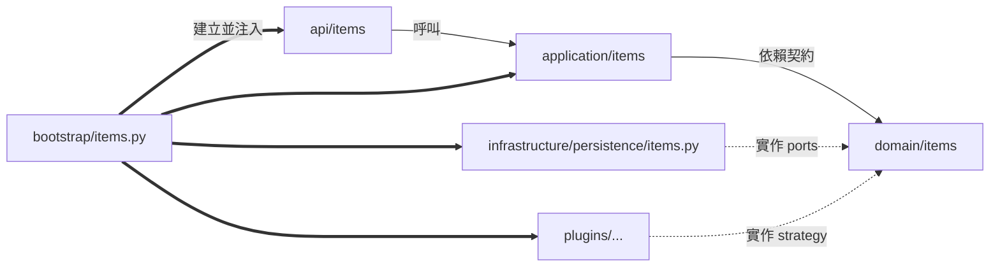

# 業務團隊開發手冊：在平台上新增應用能力

| 項目 | 內容 |
| --- | --- |
| 文件版本／日期 | DG-001 v1.1／2026-10-26 |
| 適用對象 | 在本平台上開發業務功能的各業務團隊 Backend 工程師、Reviewer |
| 對應基線 | [軟體架構設計規格](software-design.md) v1.3、[模組功能規範](module-spec.md)、[術語](glossary.md) |
| 審核狀態 | 已完成內容核對及隔離範例驗證；v1.0 歷史證據見第 11 節；現行重跑指令及交付見第 12 節 |
| 文件定位 | **操作手冊**。規範性條文以 module-spec 與 `scripts/check_boundaries.py` 為準；兩者衝突時以程式與規範為準並回報平台團隊 |

本平台是通用 Python Backend 藍圖，**不預載產品專屬模型與流程**；identity/jobs/exports/kernels 仍提供共用平台模型與政策。各業務團隊以「應用能力（capability）」為單位加入功能：同一個 capability 名稱橫跨數個分層 package，最後在 `bootstrap/` 明確組裝。本手冊用中性範例 `items` 示範完整流程，請將 `items` 換成你的能力名稱。

---

## 1. 五分鐘總覽

### 1.1 一句話原則

> **業務規則寫在 `domain`，流程寫在 `application`，技術細節寫在 `infrastructure`／`plugins`，HTTP 寫在 `api`，把它們接起來的程式只寫在 `bootstrap`。**

### 1.2 新增能力的檔案落點

```text
src/
  domain/items/                 ① 純業務核心：models.py, errors.py, policy.py, ports.py
  application/items/            ② 使用案例：service.py（必要時 tasks.py）
  infrastructure/persistence/   ③ 外部系統 adapter：items.py（依技術分類，不建 items/ 子目錄亦可）
  plugins/<inference|heuristics>/ ④ 選用：可替換演算法（SolutionKernel 實作）
  api/items/                    ⑤ HTTP：schemas.py, dependencies.py, routers.py, errors.py
  config/items.py               ⑥ 選用：能力專屬設定（獨立 env 前綴）
bootstrap/items.py              ⑦ 組裝：ModuleDefinition + lifespan
bootstrap/wiring.py             ⑧ 共用檔：加入一行選入你的能力
tests/test_items_*.py           ⑨ 測試
```

> [!IMPORTANT]
> **不要**新增頂層 package（例如 `src/items/` 或 `src/business/`）。`check_boundaries.py` 會拒絕不在九個宣告層內的 source。也**不要**把業務流程放進 `src/services/`；該層只承載技術性 runtime 能力。

### 1.3 依賴方向與審查責任



| 你的程式在 | 可以 import | 不可以 import |
| --- | --- | --- |
| `domain` | 標準函式庫、`domain`、`shared_models` | **任何第三方套件**（含 Pydantic）、其他所有層 |
| `application` | 標準函式庫、`application`、`domain`、`utils`、`shared_models` | 第三方套件、`api`、`infrastructure`、`plugins`、`services`、`config`、`bootstrap` |
| `infrastructure` | `infrastructure`、`domain`、`config`、`utils`、`shared_models`、SDK | `api`、`application`、`plugins`、`services`、`bootstrap` |
| `plugins` | `plugins`、`domain`、`utils`、`shared_models`、審查過的科學套件 | FastAPI、PyMongo、Redis、httpx 等傳輸／儲存套件；`application`、`infrastructure` |
| `api` | `api`、`application`、`domain`、`services`、`utils`、`shared_models`、FastAPI／Pydantic | `infrastructure`、`plugins`、`config`、`bootstrap`（僅 `src/api/dependencies.py` → `bootstrap.container` 例外） |
| `bootstrap` | 全部 | 不得寫業務演算法 |

> [!WARNING]
> `domain` 與 `application` 是**純層**：外部依賴只允許標準函式庫，內部可依上表使用允許的 package。範例用 dataclass 定義模型、Protocol 定義 port；HTTP transport schema 與設定驗證分別放在 `api`、`config`。


### 自動守門與人工審查的界線

`scripts/check_boundaries.py` 以 AST 驗證已宣告的實體層與靜態 import 方向：例如 domain／application 不得引入第三方套件，API 不得直接引入 infrastructure／plugins。唯一 bootstrap import 例外是 `src.api.dependencies` 可引入 `bootstrap.container`，不是所有 API dependency 檔案都可取用 bootstrap。

checker 不驗證 capability ownership、facade 公開範圍、查詢的 tenant／owner 條件、Protocol 注入、payload 語意、資源 cleanup 或動態執行副作用。下文的多團隊公開契約與設計慣例，必須透過測試及 reviewer 檢查；CI import 守門通過不等於所有 SOLID 與資料安全要求均已證明。

---

## 2. 採用的設計模式

以 **Ports & Adapters、Application Service、Composition Root／建構式注入** 作為新增能力的共通骨架；其餘模式依功能需要選用。能力不必同時具有資料庫、背景任務、kernel、獨立 facade 或每一層的空檔案。

### 2.1 共通骨架

| 模式 | 責任與適用位置 | 平台參考 | 團隊實作原則 |
| --- | --- | --- | --- |
| **Hexagonal／Ports & Adapters** | `domain` 表達模型、政策與外部能力需求；`infrastructure` 實作外部 I/O；`api` 接收 HTTP | `domain/identity/ports.py`、`infrastructure/persistence/identity.py` | 有外部依賴時先定義窄介面，再由 bootstrap 注入 adapter。純核心政策保持無 I/O。 |
| **Application Service／Use Case** | `application/<capability>/` 協調操作、授權、domain 與 ports | [`KernelService`](../src/application/kernels/service.py)、[`JobService`](../src/application/jobs/service.py) | 依操作意圖與責任劃分使用案例。可由一個 service 提供數個相關操作；不要求每個公開方法各建一個類別或檔案。HTTP 與背景入口重用相同操作與授權。 |
| **Composition Root＋建構式注入（DI）** | `bootstrap/` 選擇具體外部依賴，組裝 service、router、handler 與策略 | [`bootstrap/identity.py`](../bootstrap/identity.py) | application 接收所需窄介面或一般設定值，不接收 Runtime、ModuleContext 或 resources mapping。domain 值物件可由使用案例正常建立；「集中組裝」不限制這類純物件的建立。 |

`server.create_app()` 使用 **Application Factory Pattern** 建立整個 FastAPI application。新增 `items` 這類能力時，只增加相應分層模組與 `ModuleDefinition`，不必另建一個 FastAPI app，也不新增頂層 `src/items/` 或 `src/applications/`。部署是否拆成獨立服務是另一項架構決策。

### 2.2 按需要選用的模式

| 模式 | 何時採用 | 實作與限制 |
| --- | --- | --- |
| **Repository** | 使用案例需要儲存與查詢具 ownership 的資料 | 在 `domain/<capability>/ports.py` 定義需求，在 `infrastructure/persistence/` 實作。契約須明確攜帶需要的資料範圍，例如 `tenant_id`、已驗證 `Principal` 或 scoped query 值物件；不強制所有方法的參數順序相同。adapter 落實 tenant 與所選 owner policy，不能只依賴 router。 |
| **Strategy** | 同一契約需要替換演算法、模型或規則實作 | 穩定的不變條件與核心政策仍在 domain。可替換運算可實作 [`SolutionKernel`](../src/domain/strategy.py)，放 `plugins/heuristics/` 或 `plugins/inference/`，由 bootstrap 明確選入；application 不選擇具體實作類別。 |
| **Facade** | 能力對外提供多個服務，或需要穩定公開入口 | 透過 `ModuleExports.services` 輸出 use case 或 facade，避免暴露 adapter。單一 service 已足夠時可直接輸出，不必增加僅作轉發的 facade。參考 [`IdentityServices`](../src/application/identity/facade.py)。 |
| **Command＋Registry** | 操作需要背景執行 | async handler 以 `<capability>.<task>` 明確註冊，驗證 payload、重新解析受保護操作的有效身份，再委派 use case。持久冪等與副作用完成語意由該能力定義。參考 [`TaskRegistry`](../src/application/registry.py)、[`KernelJobHandler`](../src/application/orchestration.py)。 |
| **Async Context Manager／Exit Stack** | 取得必須釋放的 client、模型、檔案或其他資源 | 在 bootstrap lifespan 登記 cleanup，處理啟動失敗並反序釋放資源。共通 client 應由 context 取得；需要額外資源時才由能力建立並持有。 |
| **Exception Translation** | 外部 I/O 或入口需要轉換錯誤語意 | adapter 將 SDK 例外轉成能力的安全錯誤；API 將可預期錯誤轉成 HTTP 回應。不要把原始連線資訊或 SDK 訊息傳至 client。參考 [`identity_http_error`](../src/api/auth.py)。 |

優先使用 Protocol 與組合，避免以 `BaseService`／`BaseRepository` 包辦無關責任。繼承本身並非禁止：例外階層或具明確替換契約的合理繼承仍可使用；審查重點是責任、耦合與可替換性。`dataclass(frozen=True, slots=True)` 是本手冊的模型示範，並非 AST checker 強制的所有模型形式。

本手冊的 items 範例將 Repository 放 Domain，是既有示範的選擇，並非要求所有 workflow interface 都放 Domain。新 Application Port 可由消費它的 capability 擁有；Adapter 不繼承／import Application Protocol，bootstrap 以 structural typing 組裝，行為另用共用 contract tests 驗證。ML 特定落點依 [v0.2 Port Ownership](ml-system-design.md#55-正式-port-ownership)；本段不更動下方可執行範例。

以下做法不符合目前的平台契約：

- 將 Runtime、ModuleContext 或 resources mapping 傳入 application／domain 作為 Service Locator。
- import 時建立連線、載入模型或啟動 thread；以程序全域變數宣稱跨 worker 共用狀態。
- domain 模型直接依賴儲存 SDK 或自行執行 `save()`／`find()` 等外部 I/O。
- 由 HTTP、資料庫或 queue 提供任意 import 字串，再自動掃描／載入未明確選入的能力。

---

## 3. 逐步範例：新增 `items` 能力

以下為文件專用的中性 `items` 教學能力，未加入正式註冊清單。它示範「同 tenant 預設只讀自己資料，`items.read_all` 才能讀同 tenant 其他 owner」的明確政策；其他應用須自行定義 scope。驗證範圍與結果見第 11 節。

先建立三個 Python package，並為後續新增的子 package 加上無 I/O 的 `__init__.py`：

```bash
mkdir -p src/domain/items src/application/items src/api/items
touch src/domain/items/__init__.py src/application/items/__init__.py src/api/items/__init__.py
```

請依需求建立下列檔案；選用 kernel、背景任務或設定時才增加相應模組，不需複製全部空檔。

### 步驟 ①：domain — 模型、錯誤、政策、ports

`src/domain/items/models.py`

```python
from dataclasses import dataclass
from datetime import datetime


@dataclass(frozen=True, slots=True)
class Item:
    """An item owned by one user inside one tenant."""

    item_id: str
    tenant_id: str
    owner_id: str
    name: str
    created_at: datetime
```

`src/domain/items/errors.py`

```python
class ItemError(Exception):
    """Base class for item capability errors."""


class InvalidItem(ItemError):
    """Raised when item input violates a domain invariant."""


class ItemNotFound(ItemError):
    """Raised when an item does not exist or is not visible to the caller."""


class ItemStorageUnavailable(ItemError):
    """Raised when the item store cannot be reached."""
```

`src/domain/items/policy.py`（純函式，無 I/O）

```python
from src.domain.items.errors import InvalidItem

MAX_NAME_LENGTH = 200


def normalize_name(raw: str) -> str:
    """
    Enforce the item name invariant.

    :param raw: The caller-supplied name.
    :return: The trimmed name.
    :raises InvalidItem: If the name is empty or too long.
    """
    name = raw.strip()
    if not name or len(name) > MAX_NAME_LENGTH:
        raise InvalidItem("Item name must contain 1 to 200 characters")
    return name
```

`src/domain/items/ports.py`

```python
from typing import Protocol

from src.domain.items.models import Item


class ItemRepository(Protocol):
    """Tenant-scoped persistence required by item use cases."""

    async def add(self, item: Item) -> None: ...

    async def get(self, tenant_id: str, item_id: str, *, owner_id: str | None) -> Item | None: ...
```

### 步驟 ②：application — 使用案例

`src/application/items/service.py`

```python
from datetime import UTC, datetime
from uuid import uuid4

from src.application.identity.policy import require_permission
from src.domain.identity.models import Principal
from src.domain.items.errors import ItemNotFound
from src.domain.items.models import Item
from src.domain.items.policy import normalize_name
from src.domain.items.ports import ItemRepository


class ItemService:
    """Item use cases shared by HTTP routes and background handlers."""

    def __init__(self, repository: ItemRepository) -> None:
        self._repository = repository

    async def create(self, principal: Principal, name: str) -> Item:
        """
        Create an item owned by the calling principal.

        :param principal: The authenticated caller.
        :param name: The requested item name.
        :return: The stored item.
        :raises AuthorizationDenied: If ``items.write`` is missing.
        :raises InvalidItem: If the name violates the domain policy.
        """
        require_permission(principal, "items.write")
        item = Item(
            item_id=uuid4().hex,
            tenant_id=principal.tenant_id,
            owner_id=principal.user_id,
            name=normalize_name(name),
            created_at=datetime.now(UTC),
        )
        await self._repository.add(item)
        return item

    async def get(self, principal: Principal, item_id: str) -> Item:
        """
        Return one item visible to the caller.

        :param principal: The authenticated caller.
        :param item_id: The item identifier.
        :return: The item.
        :raises AuthorizationDenied: If ``items.read`` is missing.
        :raises ItemNotFound: If the item is absent or hidden by tenant/owner policy.
        """
        require_permission(principal, "items.read")
        item = await self._repository.get(
            principal.tenant_id,
            item_id,
            owner_id=None if "items.read_all" in principal.permissions else principal.user_id,
        )
        if item is None:
            raise ItemNotFound("Item does not exist")
        return item
```

重點：

- 權限檢查在 use case，**不是**在 router；HTTP 與背景任務因此共用同一道防線。
- `tenant_id` 一律取自已驗證的 `Principal`，不信任 HTTP body 傳入的 tenant／owner。
- `items.read` 與 `items.read_all` 都是精確權限；read_all 只放寬同 tenant 的 owner 條件。跨 tenant 或不可見 owner 統一回 404，不洩漏資料是否存在。

### 步驟 ③：infrastructure — adapter

`src/infrastructure/persistence/items.py`

```python
from collections.abc import Iterator
from contextlib import contextmanager
from typing import Any

from pymongo import ASCENDING
from pymongo.asynchronous.database import AsyncDatabase
from pymongo.errors import PyMongoError

from src.domain.items.errors import ItemStorageUnavailable
from src.domain.items.models import Item


@contextmanager
def storage_errors() -> Iterator[None]:
    """Translate driver errors so SDK details never cross the domain boundary."""
    try:
        yield
    except PyMongoError:
        raise ItemStorageUnavailable("Item storage is unavailable") from None


class MongoItemRepository:
    """MongoDB adapter enforcing tenant and the selected owner scope."""

    def __init__(self, database: AsyncDatabase[dict[str, Any]]) -> None:
        self._items = database["items"]

    async def ensure_indexes(self) -> None:
        """Create idempotent indexes; safe to run in every process."""
        with storage_errors():
            await self._items.create_index([("tenant_id", ASCENDING), ("owner_id", ASCENDING)])

    async def add(self, item: Item) -> None:
        with storage_errors():
            await self._items.insert_one(
                {
                    "_id": item.item_id,
                    "tenant_id": item.tenant_id,
                    "owner_id": item.owner_id,
                    "name": item.name,
                    "created_at": item.created_at,
                }
            )

    async def get(self, tenant_id: str, item_id: str, *, owner_id: str | None) -> Item | None:
        query: dict[str, Any] = {"_id": item_id, "tenant_id": tenant_id}
        if owner_id is not None:
            query["owner_id"] = owner_id
        with storage_errors():
            document = await self._items.find_one(query)
        if document is None:
            return None
        return Item(
            item_id=document["_id"],
            tenant_id=document["tenant_id"],
            owner_id=document["owner_id"],
            name=document["name"],
            created_at=document["created_at"],
        )
```

> [!NOTE]
> adapter 依**技術**分類放在 `persistence/`、`messaging/`、`downstream/`、`locking/`。呼叫外部 HTTP 服務的 adapter 放 `downstream/`，並透過 bootstrap 注入 `ModuleContext.http_client`，不要自行建立 `httpx.AsyncClient`。

### 步驟 ④（選用）：plugins — 可替換演算法

只有需要替換演算法／模型／規則時才使用 Strategy；固定不變條件仍留在 domain。以下計數僅展示契約，不是預載產品規則。檔案為 `src/plugins/heuristics/items_scoring.py`，實作 [`SolutionKernel`](../src/domain/strategy.py)：

```python
from src.domain.jobs.models import Payload
from src.domain.kernels.models import InvalidKernelInput, KernelContext, KernelSpec


class ItemScoringKernel:
    """A replaceable scoring strategy registered as ``items.scoring``."""

    spec = KernelSpec(version="1.0.0", kind="rule", resource_group="compute")

    async def execute(self, payload: Payload, context: KernelContext) -> Payload:
        """
        Score one item description.

        :param payload: A JSON object validated by this kernel's own schema.
        :param context: Principal, request ID and fencing token.
        :return: A JSON object result.
        """
        text = payload.get("text")
        if not isinstance(text, str):
            raise InvalidKernelInput("Kernel input requires a text string")
        return {"score": len(text.split())}
```

在 bootstrap import `ItemScoringKernel`，於同一份 `ModuleExports` 增加 `kernels={"scoring": ItemScoringKernel()}`；保留既有的 `services`／`tasks`／`datasets`，不要以另一個 yield 覆蓋原有 exports。全名會成為 `items.scoring`，並由 `bootstrap.plugin_loader` 驗證契約。

- 放在 `src/plugins/heuristics/`（規則）或 `src/plugins/inference/`（AI／ML）。
- `execute` 必須是 `async`；阻塞 I/O 使用注入的有界 thread runner；純 Python CPU／GPU 或硬性終止需求使用專用 process／remote adapter。async 宣告不會自動讓 CPU 計算平行。
- `resource_group` 必須存在於 `APP_RESOURCE_LIMITS`；對外 HTTP 需 `APP_KERNEL_API_ENABLED=true`。
- 模型載入／釋放寫在 bootstrap lifespan，**不在** import 時載入。

此 schema 驗證發生在插件內。現行 `KernelService` 會將插件執行期間多數例外包成 `KernelExecutionFailed`，因此本例內部拋出的 `InvalidKernelInput` 經通用 kernel HTTP 路徑時會成為執行失敗（500），背景路徑記 failed；不會因例外名稱就自動回 422。若產品需要可預期的輸入 422，請在自己的具型別 API／application 入口，於呼叫 kernel 或入隊前完成 schema 驗證與錯誤轉換；不要為單一 kernel 修改平台共用 handler。

### 步驟 ⑤：api — HTTP 邊界

`src/api/items/schemas.py`

```python
from datetime import datetime
from typing import Self

from pydantic import BaseModel, ConfigDict, Field

from src.domain.items.models import Item


class CreateItemRequest(BaseModel):
    model_config = ConfigDict(extra="forbid")

    name: str = Field(min_length=1, max_length=200)


class ItemResponse(BaseModel):
    item_id: str
    name: str
    created_at: datetime

    @classmethod
    def from_domain(cls, item: Item) -> Self:
        return cls(item_id=item.item_id, name=item.name, created_at=item.created_at)
```

`src/api/items/dependencies.py`

```python
from typing import Annotated

from fastapi import Depends, HTTPException

from src.api.dependencies import RuntimeDependency
from src.application.items.service import ItemService


def get_item_service(runtime: RuntimeDependency) -> ItemService:
    """Resolve the item facade published by the ``items`` module."""
    service = runtime.modules.get("items")
    if not isinstance(service, ItemService):
        raise HTTPException(503, "Item services are unavailable")
    return service


ItemServiceDependency = Annotated[ItemService, Depends(get_item_service)]
```

`src/api/items/errors.py`

```python
from fastapi import HTTPException

from src.domain.items.errors import (
    InvalidItem,
    ItemError,
    ItemNotFound,
    ItemStorageUnavailable,
)


def item_http_error(error: ItemError) -> HTTPException:
    """Map item domain errors to safe HTTP responses."""
    if isinstance(error, ItemNotFound):
        return HTTPException(404, str(error))
    if isinstance(error, InvalidItem):
        return HTTPException(422, str(error))
    if isinstance(error, ItemStorageUnavailable):
        return HTTPException(503, "Item storage is unavailable")
    return HTTPException(500, "Item operation failed")
```

`src/api/items/routers.py`

```python
from fastapi import APIRouter, status

from src.api.auth import PrincipalDependency
from src.api.items.dependencies import ItemServiceDependency
from src.api.items.errors import item_http_error
from src.api.items.schemas import CreateItemRequest, ItemResponse
from src.domain.items.errors import ItemError

router = APIRouter(tags=["items"])


@router.post("", response_model=ItemResponse, status_code=status.HTTP_201_CREATED)
async def create_item(
    body: CreateItemRequest,
    principal: PrincipalDependency,
    service: ItemServiceDependency,
) -> ItemResponse:
    try:
        item = await service.create(principal, body.name)
    except ItemError as error:
        raise item_http_error(error) from None
    return ItemResponse.from_domain(item)


@router.get("/{item_id}", response_model=ItemResponse)
async def get_item(
    item_id: str,
    principal: PrincipalDependency,
    service: ItemServiceDependency,
) -> ItemResponse:
    try:
        item = await service.get(principal, item_id)
    except ItemError as error:
        raise item_http_error(error) from None
    return ItemResponse.from_domain(item)
```

- router 會被自動掛在 `/api/v1/items`，router 自己**不要**再加 `prefix="/items"`。
- 權限錯誤 `AuthorizationDenied` 由平台共用 handler 自動轉 403，不需自行處理。

> [!CAUTION]
> 平台的 [`src/api/exceptions.py`](../src/api/exceptions.py) **只認得平台內建的錯誤類型**。若不在 router 轉換能力自己的 domain 例外，它會被當成未預期錯誤，回傳 `500 internal_error` 並寫入 error log。請一律使用上方 `item_http_error` 的轉換方式，**不要**為了自己的能力去修改共用的 `exceptions.py`。

### 步驟 ⑥（選用）：能力專屬設定

平台的 `Settings` 使用 `APP_` 前綴且忽略未知變數；能力設定請建立獨立模型與前綴。

`src/config/items.py`

```python
from pydantic_settings import BaseSettings, SettingsConfigDict


class ItemsSettings(BaseSettings):
    """Deployment switches owned by the items capability."""

    model_config = SettingsConfigDict(env_prefix="ITEMS_", env_file=".env", extra="ignore")

    enabled: bool = False
```

設定只在 bootstrap 讀取，再以一般值傳入建構式；domain／application 不得自行讀環境變數。`ItemsSettings()` 會獨立讀取自己的環境變數與 `.env`，不會自動繼承測試中 `Settings(_env_file=None)` 的讀取政策。測試應使用明確的 `modules=(definition,)` 注入，或在組裝測試明確控制 `ITEMS_` 環境。

### 步驟 ⑦：bootstrap — 組裝能力

`bootstrap/items.py`

```python
from collections.abc import AsyncIterator
from contextlib import asynccontextmanager

from bootstrap.components import ModuleContext, ModuleDefinition, ModuleExports
from src.api.items.routers import router
from src.application.items.service import ItemService
from src.config.settings import Settings
from src.infrastructure.persistence.items import MongoItemRepository
from src.infrastructure.persistence.mongo import MongoResource


def build_items_module(settings: Settings) -> ModuleDefinition:
    """
    Describe the items capability without performing any I/O.

    :param settings: Validated platform settings.
    :return: The module definition selected by ``bootstrap.wiring``.
    """

    @asynccontextmanager
    async def lifespan(context: ModuleContext) -> AsyncIterator[ModuleExports]:
        mongo = context.resources.get("mongodb")
        if not isinstance(mongo, MongoResource):
            raise RuntimeError("The items capability requires MongoDB")
        repository = MongoItemRepository(mongo.database)
        await repository.ensure_indexes()
        yield ModuleExports(services=ItemService(repository))

    return ModuleDefinition(
        name="items",
        requires=("identity",),
        routers=(router,),
        lifespan=lifespan,
    )
```

- `requires=("identity",)`：本例使用平台本地 identity，因此明確宣告啟動依賴；identity 未啟用時會在**開連線前**明確失敗，而不是執行期才 503。
- 若需要其他能力的服務，宣告於 `requires`，再從 `context.dependencies["<name>"]` 取得，**只把窄介面**傳入你的 use case。
- 需要額外資源（例如外部 client、模型）時，在 lifespan 內以 `AsyncExitStack` 先登記 cleanup 再開啟。

### 步驟 ⑧：wiring — 明確選入（一般能力的共用註冊點）

在 [`bootstrap/wiring.py`](../bootstrap/wiring.py) 的 `build_modules()` 中，於 `# Add approved cross-layer application initializers here.` 之後加入：

```python
    items_settings = ItemsSettings()
    if items_settings.enabled:
        from bootstrap.items import build_items_module

        modules.append(build_items_module(config))
```

並在檔案頂端加入 `from src.config.items import ItemsSettings`。API（`server.py`）與 worker（`worker.py`）都透過 `build_modules()` 取得清單，**加這一處兩邊同時生效**，請確保兩者部署相同版本與相同環境變數。

### 步驟 ⑨（選用）：背景任務

先完成前述同步 HTTP 範例，再依本節**替換**能力的公開服務、依賴函式與 bootstrap 組裝。本節以唯讀任務 `items.read` 示範背景入口；worker 委派相同的 `ItemService.get()`，因此會重新套用 `items.read`、tenant 與 owner 可見性政策。

任務 handler 只收到 payload，不會自動取得 HTTP 身分。提交端只能從已驗證的 `Principal` 填入 `tenant_id`／`user_id`；worker 透過 identity 重新讀取有效帳號與目前權限，不將 JWT 放入訊息。

#### ⑨-A application：唯讀 handler 與提交使用案例

新增 `src/application/items/tasks.py`：

```python
from collections.abc import Awaitable, Callable

from src.application.items.service import ItemService
from src.domain.identity.models import Principal
from src.domain.items.errors import InvalidItem
from src.domain.jobs.models import Payload

PrincipalResolver = Callable[[str, str], Awaitable[Principal]]


class ItemReadHandler:
    """Resolve current identity and reuse the item read use case in a worker."""

    def __init__(self, service: ItemService, resolve: PrincipalResolver) -> None:
        self._service = service
        self._resolve = resolve

    async def __call__(self, payload: Payload) -> Payload:
        tenant_id = payload.get("tenant_id")
        user_id = payload.get("user_id")
        item_id = payload.get("item_id")
        if not (
            isinstance(tenant_id, str)
            and tenant_id
            and isinstance(user_id, str)
            and user_id
            and isinstance(item_id, str)
            and item_id
        ):
            raise InvalidItem("Invalid item task payload")
        principal = await self._resolve(tenant_id, user_id)
        item = await self._service.get(principal, item_id)
        return {
            "item_id": item.item_id,
            "name": item.name,
            "created_at": item.created_at.isoformat(),
        }
```

新增 `src/application/items/jobs.py`：

```python
from src.application.identity.policy import require_permission
from src.application.items.service import ItemService
from src.application.jobs.service import JobService
from src.domain.identity.models import Principal
from src.domain.jobs.models import JobSnapshot


class ItemReadJobService:
    """Authorize an item read before placing it on the task queue."""

    def __init__(self, service: ItemService, jobs: JobService) -> None:
        self._service = service
        self._jobs = jobs

    async def submit_read(self, principal: Principal, item_id: str) -> JobSnapshot:
        await self._service.get(principal, item_id)
        require_permission(principal, "jobs.read")
        return await self._jobs.submit(
            "items.read",
            {
                "tenant_id": principal.tenant_id,
                "user_id": principal.user_id,
                "item_id": item_id,
            },
            tenant_id=principal.tenant_id,
            owner_id=principal.user_id,
        )
```

這裡先檢查目前的資料可見性，再入隊，避免把未授權請求直接送進 worker。`JobService.submit()` 本身只負責任務註冊與調派，**不會**自動執行能力的權限檢查。此範例也要求 `jobs.read`，讓提交者能讀取回傳的 job URL；worker 執行時仍會重新授權，提交後帳號停用、撤權或資料變更可能使任務失敗。

#### ⑨-B application：用 facade 公開兩個使用案例

原先 `ModuleExports.services` 直接公開一個 `ItemService`。現在能力需要同時公開同步讀寫與背景提交，才增加一個窄 facade。新增 `src/application/items/facade.py`：

```python
from dataclasses import dataclass

from src.application.items.jobs import ItemReadJobService
from src.application.items.service import ItemService


@dataclass(frozen=True, slots=True)
class ItemServices:
    """Public application services exported by the items capability."""

    items: ItemService
    read_jobs: ItemReadJobService
```

此 facade 不持有 Runtime、Mongo adapter 或資源 mapping；它只公開組裝好的使用案例。沒有背景功能時，維持原先直接公開 `ItemService` 即可。

#### ⑨-C bootstrap：替換組裝檔案

將 `bootstrap/items.py` **完整替換**為：

```python
from collections.abc import AsyncIterator
from contextlib import asynccontextmanager

from bootstrap.components import ModuleContext, ModuleDefinition, ModuleExports
from src.api.items.routers import router
from src.application.identity.facade import IdentityServices
from src.application.items.facade import ItemServices
from src.application.items.jobs import ItemReadJobService
from src.application.items.service import ItemService
from src.application.items.tasks import ItemReadHandler
from src.config.settings import Settings
from src.infrastructure.persistence.items import MongoItemRepository
from src.infrastructure.persistence.mongo import MongoResource


def build_items_module(settings: Settings) -> ModuleDefinition:
    """Describe the items capability without opening any connection."""
    if not settings.expose_job_api:
        raise ValueError("The items background example requires APP_EXPOSE_JOB_API=true")

    @asynccontextmanager
    async def lifespan(context: ModuleContext) -> AsyncIterator[ModuleExports]:
        mongo = context.resources.get("mongodb")
        if not isinstance(mongo, MongoResource):
            raise RuntimeError("The items capability requires MongoDB")
        identity = context.dependencies["identity"]
        if not isinstance(identity, IdentityServices):
            raise RuntimeError("The items capability requires identity services")
        jobs = context.jobs
        if jobs is None:
            raise RuntimeError("The items capability requires job services")
        repository = MongoItemRepository(mongo.database)
        await repository.ensure_indexes()
        service = ItemService(repository)
        yield ModuleExports(
            services=ItemServices(service, ItemReadJobService(service, jobs)),
            tasks={"read": ItemReadHandler(service, identity.resolve_principal)},
        )

    return ModuleDefinition(
        name="items",
        requires=("identity",),
        routers=(router,),
        lifespan=lifespan,
    )
```

`context.jobs` 是平台交付給 composition root 的調派服務；只把具體需要的 `JobService` 傳給提交使用案例，不把整個 `ModuleContext` 傳入 application。任務的本地名稱 `read` 會自動註冊為 `items.read`。API 與 worker 必須由同一版 `build_modules()` 選入這個能力。

#### ⑨-D api：替換 dependencies，增加背景提交路由

將 `src/api/items/dependencies.py` **完整替換**為以下內容。原有同步路由仍透過 `ItemServiceDependency` 取得主服務，新增路由透過 `ItemReadJobServiceDependency` 取得背景提交使用案例：

```python
from typing import Annotated

from fastapi import Depends, HTTPException

from src.api.dependencies import RuntimeDependency
from src.application.items.facade import ItemServices
from src.application.items.jobs import ItemReadJobService
from src.application.items.service import ItemService


def get_item_services(runtime: RuntimeDependency) -> ItemServices:
    """Resolve the public facade exported by the items capability."""
    services = runtime.modules.get("items")
    if not isinstance(services, ItemServices):
        raise HTTPException(503, "Item services are unavailable")
    return services


ItemServicesDependency = Annotated[ItemServices, Depends(get_item_services)]


def get_item_service(services: ItemServicesDependency) -> ItemService:
    return services.items


def get_item_read_jobs(services: ItemServicesDependency) -> ItemReadJobService:
    return services.read_jobs


ItemServiceDependency = Annotated[ItemService, Depends(get_item_service)]
ItemReadJobServiceDependency = Annotated[ItemReadJobService, Depends(get_item_read_jobs)]
```

在既有 `src/api/items/schemas.py` **新增**：

```python
class ItemReadRunRequest(BaseModel):
    model_config = ConfigDict(extra="forbid")

    item_id: str = Field(min_length=1, max_length=128)
```

此檔原有的 `BaseModel`、`ConfigDict`、`Field` import 與同步 HTTP schemas 均保留；request 不接受 tenant／user 欄位。

將 `src/api/items/routers.py` **完整替換**為：

```python
from fastapi import APIRouter, Response, status

from src.api.auth import PrincipalDependency
from src.api.items.dependencies import ItemReadJobServiceDependency, ItemServiceDependency
from src.api.items.errors import item_http_error
from src.api.items.schemas import CreateItemRequest, ItemReadRunRequest, ItemResponse
from src.api.jobs.schemas import JobResponse
from src.domain.items.errors import ItemError

router = APIRouter(tags=["items"])


@router.post("", response_model=ItemResponse, status_code=status.HTTP_201_CREATED)
async def create_item(
    body: CreateItemRequest,
    principal: PrincipalDependency,
    service: ItemServiceDependency,
) -> ItemResponse:
    try:
        item = await service.create(principal, body.name)
    except ItemError as error:
        raise item_http_error(error) from None
    return ItemResponse.from_domain(item)


@router.get("/{item_id}", response_model=ItemResponse)
async def get_item(
    item_id: str,
    principal: PrincipalDependency,
    service: ItemServiceDependency,
) -> ItemResponse:
    try:
        item = await service.get(principal, item_id)
    except ItemError as error:
        raise item_http_error(error) from None
    return ItemResponse.from_domain(item)


@router.post("/runs", response_model=JobResponse, status_code=status.HTTP_202_ACCEPTED)
async def submit_item_read(
    body: ItemReadRunRequest,
    response: Response,
    principal: PrincipalDependency,
    jobs: ItemReadJobServiceDependency,
) -> JobResponse:
    try:
        job = await jobs.submit_read(principal, body.item_id)
    except ItemError as error:
        raise item_http_error(error) from None
    response.headers["Location"] = f"/api/v1/jobs/{job.job_id}"
    return JobResponse.model_validate(job)
```

呼叫 `POST /api/v1/items/runs`，body 為 `{"item_id": "<已有的 item ID>"}`；成功接受回傳 202 與 `Location: /api/v1/jobs/<job_id>`。這代表任務已接受，不代表執行成功。同步權限不足回 403、資料不存在或不可見回 404；提交之後的 worker 失敗透過 job 的 `status`／`error` 呈現。

#### ⑨-E 部署與安全語意

- 在前述 identity／Mongo 設定之外，需設定 `APP_EXPOSE_JOB_API=true`；不開放 jobs HTTP 時，能力必須自行設計結果交付入口，此範例會在建立描述時拒絕該設定。呼叫者須持有精確的 `items.read` 與 `jobs.read` 權限；`items.read_all` 只影響 Item 的跨 owner 可見性。
- `GET /api/v1/jobs/{id}` 以 job 的 tenant／owner 保護結果。`jobs.read_all` 允許讀取**同 tenant 其他 owner** 的 job，不能跨 tenant；它也可能讓持有者看到任務結果中的資料快照，發放時須符合資料存取政策。不要把 `jobs.read_all` 當成所有使用者的預設權限。
- 單程序 memory 模式適合本機功能驗證；多個 API／worker 程序協作需採專案既有 distributed 調派與共用結果儲存設定。請依部署文件設定 RabbitMQ／Redis；API 與 worker 使用同版程式與一致的能力、identity、資料庫設定。
- payload 與結果必須是 JSON object；不放 JWT、密碼、DB session、datetime 物件。本節使用 ISO 字串回傳時間。RabbitMQ 只允許受信任 producer 存取；payload 中的 tenant/user 是已通過 API 驗證的委派資料，不能用來替代 broker 的存取控制，也不得直接接受 HTTP 呼叫者指定。
- worker 的 `resolve_principal()` 重新確認帳號 active 與目前權限，**不會**重新驗證原登入 session。JWT 到期或登出不會取消已入隊任務；若產品需要 session 撤銷即停止任務，需另行設計任務授權與取消契約。
- 任務可能重送。本例只有讀取，重送不會建立重複資料；資料在兩次讀取間可能改變，故不保證相同結果快照。若新增寫入或外部副作用，必須加入持久冪等鍵／唯一約束與衝突語意，並測試重送；隨機 UUID 與 job ID 本身不提供這項保證。平台不保證 exactly-once。
- 不要吞掉 `asyncio.CancelledError`。補測提交前拒絕未授權／不可見資料、不入隊；worker 執行時撤權／停用失敗；job tenant／owner 隔離與讀取重送。


### 步驟 ⑩：啟用範例並操作 HTTP

先完成①～⑧並建立 `tests/test_items.py`。只需要同步 HTTP 時跳過⑨；需要背景讀取時，⑨列為「完整替換」的檔案使用該版本，schemas 則依指示追加，不要同時保留兩套 router 或 bootstrap。

1. 從專案根目錄啟用 `.venv`，依 [README](../README.md) 安裝 `.[dev]` 的鎖定依賴。此範例不新增第三方套件。
2. 若尚無 `.env`，複製 `.env.example`；依 README 產生獨立的 JWT secret 與 MongoDB 密碼。不要覆寫既有 `.env`。在自己的 `.env` 加入 `ITEMS_ENABLED=true`；採用⑨時再設定 `APP_EXPOSE_JOB_API=true`。
3. Compose **不會自動把 `.env` 中所有能力設定傳進容器**。建立範例專用的 `compose.items.yaml`，將開關明確傳給 API 與 worker：

```yaml
services:
  api:
    environment:
      ITEMS_ENABLED: "${ITEMS_ENABLED:-false}"
      APP_EXPOSE_JOB_API: "${APP_EXPOSE_JOB_API:-false}"
  worker:
    environment:
      ITEMS_ENABLED: "${ITEMS_ENABLED:-false}"
      APP_EXPOSE_JOB_API: "${APP_EXPOSE_JOB_API:-false}"
```

4. 基底 Compose 已提供 MongoDB／identity、RabbitMQ／Redis 與 API／worker 設定；能力啟用後，以同一組檔案啟動：

```bash
docker compose -f compose.yaml -f compose.items.yaml config --quiet
docker compose -f compose.yaml -f compose.items.yaml up --build -d
docker compose -f compose.yaml -f compose.items.yaml logs api worker
```

5. 為範例建立新的管理員，密碼由互動輸入，不放命令列：

```bash
docker compose -f compose.yaml -f compose.items.yaml exec api \
  python manage.py create-admin --tenant-id TENANT --username USERNAME \
  --permission items.read --permission items.write
```

平台管理員本身已有 `jobs.read`；若透過受控註冊建立一般範例使用者，需明確給 `items.read`／`items.write`，採用⑨時另給 `jobs.read`。只有測試或產品政策需要同 tenant 跨 owner 查詢時才授予 `items.read_all`，不要假設名稱或管理員身分提供隱含通行。權限管理限制見第 4 節。

6. 開啟 `http://127.0.0.1:8000/docs`，以 `/api/v1/identity/login` 登入，將回傳 token 用於 Authorize。依序操作：

| 操作 | 輸入 | 預期 |
| --- | --- | --- |
| `POST /api/v1/items` | `{"name":"first"}` | 201；保存回傳的 `item_id`。 |
| `GET /api/v1/items/{item_id}` | 同一使用者 | 200；同 tenant 他人且無 `items.read_all` 時回 404。 |
| `POST /api/v1/items/runs`（⑨） | `{"item_id":"<剛取得的 ID>"}` | 202、`Location` 與 owned job metadata。 |
| `GET /api/v1/jobs/{job_id}`（⑨） | 使用 `jobs.read` 的同一使用者 | queued/running → succeeded 或 failed；成功不代表永久保存。 |

若選擇 host 啟動 API 而非 Compose，必須自行提供一致的 `ITEMS_ENABLED`、MongoDB、identity、JWT 與資料庫連線設定，再執行 `python server.py --reload`。memory 模式只啟一個 API 程序，工作在該程序內執行。獨立 worker 需要 distributed／RabbitMQ／Redis，不能以 `python worker.py` 代替 Taskiq receiver：

```bash
APP_TASK_BACKEND=distributed APP_RESOURCE_BACKEND=redis \
python -m taskiq worker worker:broker --workers 2 --max-async-tasks 8 \
  --ack-type when_saved --wait-tasks-timeout 10
```

上式沿用已有環境設定與秘密；API 與 worker 的資料庫、queue、能力開關及 namespace 必須一致。調整 API 多程序前另依 [部署規範](product-platform.md) 檢查 `APP_WORKERS` 與 distributed 設定；不要合用多 worker 與 reload。


---

## 4. 權限命名與開通

- 格式：`<capability>.<action>`，須符合 `^[a-z][a-z0-9_]*(?:\.[a-z][a-z0-9_]*)+$`，例如 `items.read`、`items.write`、`items.read_all`。
- 權限在 **use case** 用 [`require_permission`](../src/application/identity/policy.py) 檢查；跨擁有者讀取請另訂精確的 `<capability>.read_all` 並在 repository 套用 owner 過濾。
- 平台內建管理員權限**不含**業務權限。開通方式：

```bash
python manage.py create-admin --tenant-id TENANT --username USERNAME \
  --permission items.read --permission items.write
```

> [!WARNING]
> 管理員只能授予自己擁有的權限，也不能修改自己的權限。若既有管理員缺少新能力的權限，目前**沒有** CLI 可直接補發，需以 `create-admin --permission ...` 建立具新權限的管理員，再由其透過 `PATCH /api/v1/identity/users/{id}` 授權他人。上線前請把此流程納入維運手冊。

---

## 5. 測試要求

| 層級 | 測什麼 | 作法 |
| --- | --- | --- |
| domain | 不變條件、純政策 | 直接呼叫函式，無 mock |
| application | 權限、流程、錯誤語意、tenant 隔離 | 以手寫 fake 實作 Protocol（不需 Mongo） |
| infrastructure | 查詢條件含 tenant／owner、SDK 錯誤轉換 | 測試替身 collection；需要時加真 Mongo 整合測試（`integration` marker） |
| api | 狀態碼、schema、錯誤轉換 | `dependency_overrides` 覆寫 `get_item_service` 與 `current_principal` |
| bootstrap | 組裝、rollback、缺少依賴 | `create_app(settings, modules=(definition,))` |

建立 `tests/test_items.py`。以下 application 與 API 測試範例（沿用 [`tests/test_exports.py`](../tests/test_exports.py) 的作法；不需 MongoDB，可直接執行）：

```python
import pytest
from httpx import ASGITransport, AsyncClient

from bootstrap.components import ModuleDefinition
from server import create_app
from src.api.auth import current_principal
from src.api.items.dependencies import get_item_service
from src.api.items.routers import router
from src.application.items.service import ItemService
from src.config.settings import Settings
from src.domain.identity.models import Principal
from src.domain.items.errors import ItemNotFound
from src.domain.items.models import Item

OWNER = Principal("a" * 32, "tenant-a", "owner", frozenset({"items.read", "items.write"}))
OTHER = Principal("b" * 32, "tenant-b", "other", frozenset({"items.read"}))


class FakeItemRepository:
    """In-memory implementation of the ItemRepository Protocol."""

    def __init__(self) -> None:
        self.items: dict[tuple[str, str], Item] = {}

    async def add(self, item: Item) -> None:
        self.items[(item.tenant_id, item.item_id)] = item

    async def get(self, tenant_id: str, item_id: str, *, owner_id: str | None) -> Item | None:
        item = self.items.get((tenant_id, item_id))
        if item is not None and owner_id is not None and item.owner_id != owner_id:
            return None
        return item


async def test_other_tenant_cannot_read_item() -> None:
    service = ItemService(FakeItemRepository())
    item = await service.create(OWNER, "first")
    with pytest.raises(ItemNotFound):
        await service.get(OTHER, item.item_id)


async def test_peer_owner_cannot_read_item() -> None:
    service = ItemService(FakeItemRepository())
    item = await service.create(OWNER, "first")
    peer = Principal("c" * 32, OWNER.tenant_id, "peer", frozenset({"items.read"}))
    with pytest.raises(ItemNotFound):
        await service.get(peer, item.item_id)


async def test_read_all_still_scoped_to_tenant() -> None:
    service = ItemService(FakeItemRepository())
    item = await service.create(OWNER, "first")
    reader = Principal(
        "d" * 32, OWNER.tenant_id, "reader", frozenset({"items.read", "items.read_all"})
    )
    assert await service.get(reader, item.item_id) == item
    outsider = Principal(
        "e" * 32, "tenant-b", "outsider", frozenset({"items.read", "items.read_all"})
    )
    with pytest.raises(ItemNotFound):
        await service.get(outsider, item.item_id)


async def test_routes_map_domain_errors() -> None:
    service = ItemService(FakeItemRepository())
    settings = Settings(_env_file=None, environment="test")
    app = create_app(settings, modules=(ModuleDefinition("items", routers=(router,)),))
    app.dependency_overrides[get_item_service] = lambda: service
    app.dependency_overrides[current_principal] = lambda: OWNER
    transport = ASGITransport(app=app)
    async with AsyncClient(transport=transport, base_url="http://test") as client:
        missing = await client.get("/api/v1/items/unknown")
        invalid = await client.post("/api/v1/items", json={"name": "   "})
    assert missing.status_code == 404
    assert invalid.status_code == 422
```

這些測試只驗證 use case／HTTP 邊界，不是 Mongo、JWT session 或 lifespan 的端到端證據。路由測試以不含 `requires` 的測試用 `ModuleDefinition` 掛上 router，並以 `dependency_overrides` 注入 fake service 與身份，因此不需啟動 identity 或 MongoDB。

**依能力實際使用的邊界至少驗證**：tenant／owner 隔離、缺少權限、無效輸入、儲存不可用；有 HTTP 時核對相應的 403／404／422／503，有副作用任務時測試持久冪等與重送。純計算能力不必為了清單新增不存在的 HTTP 或儲存層。

---

## 6. 命名規則

| 對象 | 規則 | 範例 |
| --- | --- | --- |
| capability 名稱 | `^[a-z][a-z0-9_]*$`，各層一致 | `items`、`capability_a` |
| 保留名稱 | 不可使用 `jobs`、`identity`、`kernels`、`exports`；也請避免 `platform`（平台任務 namespace） | — |
| 任務本地名稱 | 同上規則，不可含 `.`；全名自動成為 `<cap>.<task>` | `read` → `items.read` |
| kernel 本地名稱 | 同上；全名 `<cap>.<kernel>` | `scoring` → `items.scoring` |
| HTTP 路徑 | 自動為 `/api/v1/<cap>/...` | `/api/v1/items/{item_id}` |
| Mongo collection | 以 capability 為前綴，避免跨團隊衝突 | `items`、`items_audit` |
| 環境變數 | `<CAP>_` 前綴，不使用 `APP_` | `ITEMS_ENABLED` |
| 權限 | `<cap>.<action>` | `items.write` |

---

## 7. 多團隊協作與交付責任

### 7.1 能力所有權與平台審查

每個能力指定一個負責團隊，維護其公開契約、測試、資料與維運文件。檔案仍按既有技術分層放置，不能用另一套頂層 feature package 取代分層。

| 變更範圍 | 典型位置 | 主要責任與審查 |
| --- | --- | --- |
| 能力核心與入口 | `src/domain/<capability>/`、`src/application/<capability>/`、`src/api/<capability>/` | 能力團隊負責；公開介面變更由受影響消費團隊共同審查。 |
| 能力 adapter、策略、設定與組裝 | `src/infrastructure/<adapter_kind>/<capability>.py`、`src/plugins/<kind>/<capability>.py` 或對應子 package、`src/config/<capability>.py`、`bootstrap/<capability>.py` | 能力團隊負責；資源生命週期、權限與外部服務整合須明確。 |
| 能力測試與契約文件 | `tests/test_<capability>*.py` 或能力測試 package、能力 API／payload／資料文件 | 能力團隊維護；新增 Python package 時加入無 I/O 的 `__init__.py`。 |
| 明確選入能力 | `bootstrap/wiring.py` | 一般新增能力通常只需修改這個平台共用檔；由平台維護者審查啟動依賴與部署開關。 |
| 共通 runtime、入口與聚合公開檔 | `src/services/`、`server.py`、`worker.py`、`manage.py`、`bootstrap/container.py`、`src/api/exceptions.py`、`src/domain/models.py`、`src/domain/ports.py`、`src/application/use_cases.py` | 平台團隊審查；不要為單一能力將業務流程或特例加入共通層。 |
| 中性跨能力型別 | `src/shared_models/`、`src/utils/` | 平台與受影響團隊共同審查；具能力 ownership 的 entity 留在其 domain。 |
| 新第三方依賴與部署改動 | `pyproject.toml`、`requirements.lock`、Dockerfile、Compose、CI | 能力團隊提出需求，平台審查依賴相容性、授權、鎖定版本及執行資源。不能以「只改 wiring」省略必要部署變更。 |

以上是協作政策；目前 repository 並未自動從檔案路徑強制團隊 ownership。若組織需要強制 reviewer，另行設定 GitHub CODEOWNERS 與 branch protection。

### 7.2 跨能力呼叫與公開契約

- 消費能力在自己的 domain 定義所需的窄 Protocol，由 bootstrap 取得提供能力的 `ModuleExports.services` facade，再注入使用案例。消費方應依穩定公開契約，不依對方內部 adapter 或具體組裝。
- 在 `ModuleDefinition.requires` 宣告啟動依賴；bootstrap 從 `context.dependencies["<provider>"]` 取得服務。`requires` 決定啟動順序與可取得的 facade，不自動實施授權、物件封裝或業務交易。
- 不直接讀寫另一能力的 collection，不從其 infrastructure adapter 取得資料。由資料擁有能力提供 use case 或明確資料契約；跨能力資料一致性、結果保存與部分失敗另訂完成語意。
- 不建立互相 `requires` 的循環。若兩個能力相互依賴，先釐清共同流程由誰協調，必要時新增獨立協調能力或抽出穩定契約。
- 靜態 checker 允許同一層內部 import，因此不能代替跨能力公開邊界審查。單純「import 檢查通過」不代表依賴另一團隊的內部實作是可接受契約。

`ModuleExports.services` 只提供程序內 facade。能力拆成獨立 process／deployment 前，消費方保留自己定義的窄 Protocol，先以 local adapter 轉接 facade，再由 bootstrap 換成 HTTP／message remote adapter；wire schema、資料 ownership、相容版本、冪等、服務身分與 rollout 依[微服務契約設計與演進指南](microservice-contracts.md)治理。

### 7.3 版本、資料與操作交付

每個能力交付前，應與消費／維運團隊確認：

1. **公開契約**：HTTP request／response、facade 輸入輸出、錯誤碼、權限名稱、tenant／owner policy；明確列出相容與破壞性變更。`/api/v1` 是目前掛載路徑，不代表平台自動維護契約相容性。
2. **非同步契約**：任務名稱、payload／結果 schema、身份欄位、重送與持久冪等策略、timeout、取消及結果保存需求。API 與 worker 使用相容版本與設定；舊訊息仍可能留在 queue。
3. **kernel 契約（若有）**：`KernelSpec.version`、輸入／輸出 schema 與資源需求。平台每個 kernel namespace 目前只有一個版本，沒有自動版本路由、雙版本 rollout 或模型驗簽服務。
4. **資料 ownership 與 migration**：collection 名稱以能力 namespace 區分，記錄索引、schema 演進、備份與回復方法。相容且冪等的索引初始化可依例子放在 lifespan；資料遷移與一次性管理操作使用獨立管理入口，不假設多程序 lifespan 只執行一次。
5. **部署與操作**：能力開關、必要秘密與外部依賴、權限開通、健康檢查、觀測需求與關閉程序。設定範例不得含真實密碼或 token。
6. **測試與交接**：依第 5 節測試責任提供可重現指令，說明需外部服務的條件及尚未驗證的限制。

需要資料匯出時，優先評估既有 `ExportSource` 與 `ModuleExports.datasets` 契約，依 [`module-spec.md`](module-spec.md) 定義來源、欄位與權限；不要讓 client 指定任意 collection 或查詢。參考 [`tests/test_exports.py`](../tests/test_exports.py)。

---

## 8. Pull Request 檢查清單

複製到 PR 描述中逐項勾選：

```markdown
### 架構
- [ ] 新檔案只位於 domain / application / api / infrastructure / plugins / config / bootstrap / tests
- [ ] domain／application 無第三方套件，內部 import 符合各層允許矩陣
- [ ] use case 以建構式接收 Protocol，沒有收 Runtime／ModuleContext／resources
- [ ] 能力在 bootstrap/wiring.py 明確選入；其他共用檔／依賴／部署變更已由平台 reviewer 審查

### 安全與資料
- [ ] tenant_id 取自 Principal，沒有信任 HTTP 傳入的 tenant
- [ ] repository 強制 tenant／所選 owner policy，具同 tenant 他人及 read_all 測試
- [ ] use case 內有 require_permission；權限名稱為 <cap>.<action>
- [ ] 錯誤訊息與 log 不含密碼、token、連線字串或完整業務 payload

### 錯誤處理
- [ ] adapter 把 SDK 例外轉成 domain 例外
- [ ] router 把能力 domain 例外轉成 HTTPException（未依賴共用 exceptions.py）

### 背景任務（若有）
- [ ] payload 為 JSON object，含 tenant_id / user_id，且在 handler 驗證
- [ ] submit 時同時傳入 tenant_id 與 owner_id
- [ ] 提交前及執行時均驗權；若有副作用已驗持久冪等；未吞掉 CancelledError

### 品質閘門
- [ ] python scripts/check_boundaries.py
- [ ] ruff check . && ruff format --check .
- [ ] mypy src bootstrap scripts server.py worker.py manage.py
- [ ] pytest（含跨 tenant、403、422、503 測試）
```

---

## 9. 常見錯誤速查

| 症狀 | 原因 | 修正 |
| --- | --- | --- |
| `check_boundaries` 報 `application may import only standard-library...` | application 用了 Pydantic 或 SDK | 改用 dataclass／Protocol；SDK 移到 infrastructure |
| `only src.api.dependencies may import bootstrap.container` | router 直接 import bootstrap | 改用 `RuntimeDependency` 或能力自己的 dependency 函式 |
| 啟動時 `Required module is not registered: identity` | 能力宣告 `requires=("identity",)` 但未啟用 identity | 設定 `APP_IDENTITY_ENABLED=true`（需 Mongo 與 JWT secret） |
| 啟動時 `Invalid or reserved module name` | 名稱含大寫／連字號，或使用保留字 | 改為 snake_case 非保留名稱 |
| API 回 `500 internal_error` 而非預期的 404／422 | 能力的 domain 例外沒有在 router 轉換 | 參考步驟 ⑤ 的 `item_http_error` |
| 能力 URL 回 404 | 未在 wiring 選入或 `ITEMS_ENABLED=false`，router 沒有掛載 | 檢查開關與 API／worker 設定；空白平台不會提供該路由 |
| API 回 `503 Item services are unavailable` | router 已掛載，但公開服務缺失或型別與 dependencies 不符 | 同步範例輸出 ItemService；採⑨時完整替換為 ItemServices facade 與對應 dependencies |
| worker 回 `Unknown task: items.read` | worker 與 API 版本或環境變數不一致 | 兩邊部署同版本、同設定 |
| 回 `403 permission_denied` | 使用者缺少 `items.read`／`items.write` 等精確權限（無 wildcard） | 依第 4 節開通 |

---

## 10. 相關文件

- [ML System 開發方向與架構設計](ml-system-design.md)：以本平台實作訓練、MLflow、核准、部署與推論的目標設計及分階段驗收
- [模組功能規範](module-spec.md)：各層與 `ModuleDefinition`／`ModuleExports` 的規範性定義
- [微服務契約設計與演進指南](microservice-contracts.md)：跨 process／deployment 的 HTTP、command、event、資料與相容性治理
- [軟體架構設計規格](software-design.md)：生命週期、並行、任務、失敗語意
- [術語](glossary.md)：Application Factory、Capability、Tenant 等定義
- [產品與部署說明](product-platform.md)：環境變數、部署與權限
- [ADRs](adr/README.md)：架構決策與待決事項（OD-01～OD-05 與新應用直接相關）


## 11. v1.0 歷史交付審核與範例驗證紀錄

本手冊 v1.0 於 2026-10-24 對照當時 PBP-SAD-001 v1.2 工作樹完成審核。以下為當時結果，原始證據保持不變。`items` 僅在隔離副本由文件程式碼區塊原樣提取，沒有加入正式 application 註冊清單；不以文件中的測試宣告替代實際執行證據。

| 驗證版本 | 依賴邊界／Ruff／格式 | strict Mypy | 文件內測試 | 額外審查測試 |
| --- | --- | --- | --- | --- |
| 同步 HTTP 範例（①～⑧） | 通過 | 118 個來源檔通過 | 4 passed | 14 passed |
| 選用背景讀取（含⑨） | 通過 | 121 個來源檔通過 | 4 passed | 25 passed |

兩版測試數各自計算，包含共用案例，不代表相加後有 47 個獨立平台測試。額外案例涵蓋 tenant／owner／read_all、缺權／無效輸入／儲存錯誤、Mongo query 條件、API 錯誤內容、ModuleCatalog 的 API／worker 組裝、提交前拒絕不入隊、owned metadata、worker 重新解析／撤權／停用、唯讀重送及 HTTP 202／Location。

選用 kernel 另以真實 `PluginBinding`／loader 與 memory coordinator 驗證 binding、有效執行、無效 schema 拒絕，以及通用 KernelService 的例外包裝行為，4 項檢查通過。這些契約檢查另列，不計入上表 pytest 數字。

Compose 5.1.2 的 `config --quiet` 及 JSON 設定檢查通過：API 與 worker 都收到 `ITEMS_ENABLED=true`、`APP_EXPOSE_JOB_API=true`，既有 identity／Mongo／distributed 設定維持有效。檢查使用暫時的隨機 dummy 值，未啟動容器、未在此輪實跑新應用的真 MongoDB／RabbitMQ 端到端流程，也沒有重跑整套平台 pytest。真正整合與目標部署仍由能力團隊依自己的契約驗收。先前平台 Docker 實跑紀錄見 [平台驗證](validation.md)。

文件測試的 service／HTTP 使用 fake repository 與 dependency override；額外 adapter／組裝測試使用明確替身，不宣稱已證明真實資料庫效能、JWT 登入端到端、跨主機 HA 或正式環境容量。文件中的部署指令可用於接入，但不得將設定解析通過當成容器實跑通過。

完整 [審核證據](evidence/developer-guide-2026-10-24/README.md) 保存命令、結果、提取 mapping、驗證時文件 SHA-256 及交付版 code-fence 雜湊；交付版只追加文字審核結果與修正文義，Python／YAML 區塊與通過驗證版本相同。


## 12. 現行基線重跑與新專案採用

DG-001 v1.1 對應 PBP-SAD-001 v1.3，保留本手冊 22 個 Python 程式碼區塊；新增工程驗證與停用背景工作規範。歷史證據不自動代表新基線通過，實際本輪結果見 [validation](validation.md) 與 [handover](handover.md)。

在已安裝鎖定開發環境的專案根目錄執行：

```bash
python scripts/verify_guide.py
```

腳本建立兩份新的隔離副本，依明確對應原樣提取同步與背景範例，僅修改該副本的能力檔案及 wiring；執行邊界、Ruff、格式、Mypy、文件內測試與已保存的授權／背景回歸案例。程式碼區塊數量或對應不符會拒絕執行，結果保存在 work/guide-validation/<run-id>/，不將教學能力加入正式專案。此指令不啟動外部服務；真容器新能力驗收另見交付證據。

純同步能力可選 APP_TASK_BACKEND=disabled；此時 context.jobs 為 None，不能匯出 tasks 或開啟 job 查詢。步驟⑨使用背景工作，必須選 memory（僅開發單程序）或 distributed（共享工作）；步驟⑨-C 已示範拒絕缺少 job service。背景 worker 只接受 distributed。

建立新產品時，保留目前分層與 bootstrap 註冊方式，依序完成：乾淨環境安裝 → 驗證空白基線 → 新增能力各層 → 明確 wiring → 契約／授權測試 → wheel／image 建置 → 實際依賴整合。新增能力允許修改明確註冊及必要依賴／部署設定；不應為單一能力修改共通 runtime 行為。使用第三方 SDK、持久副作用或既有 schema 時，依 [CONTRIBUTING](../CONTRIBUTING.md) 提供依賴、冪等及 migration 證據。
