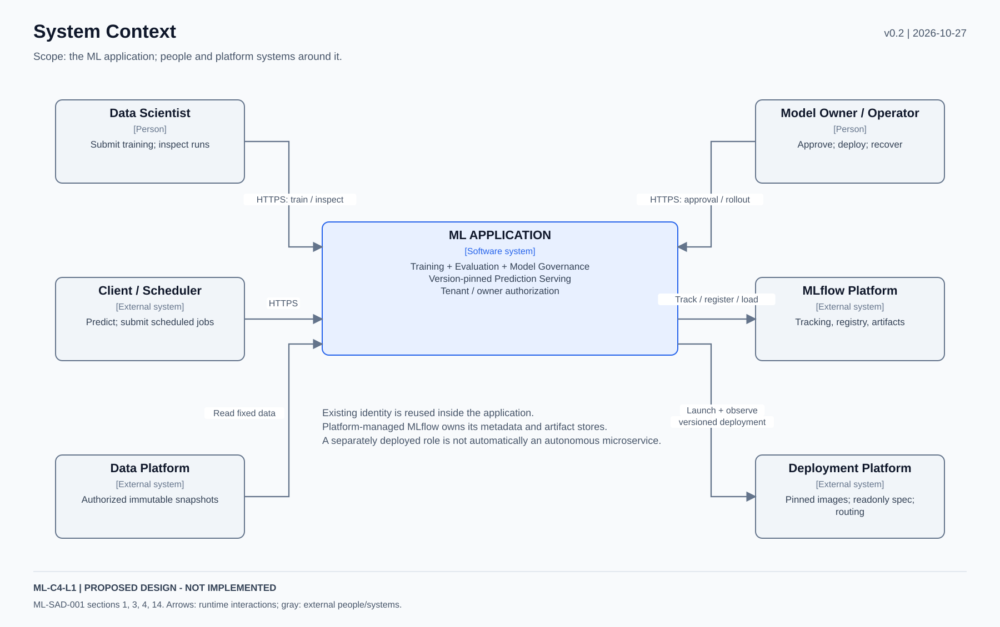
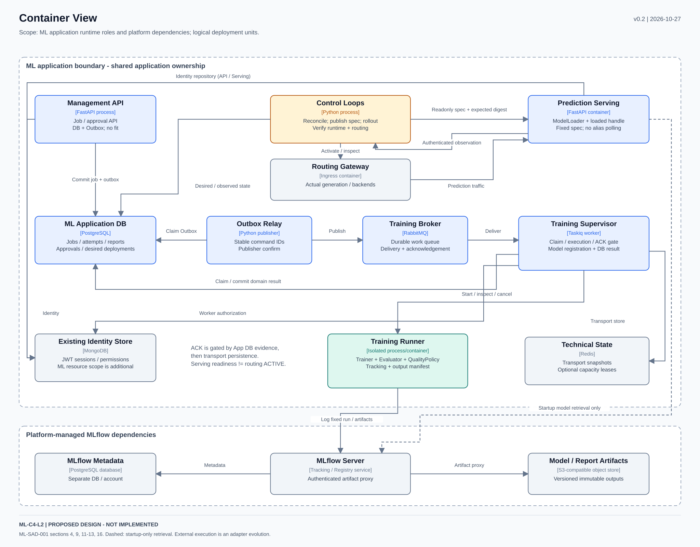
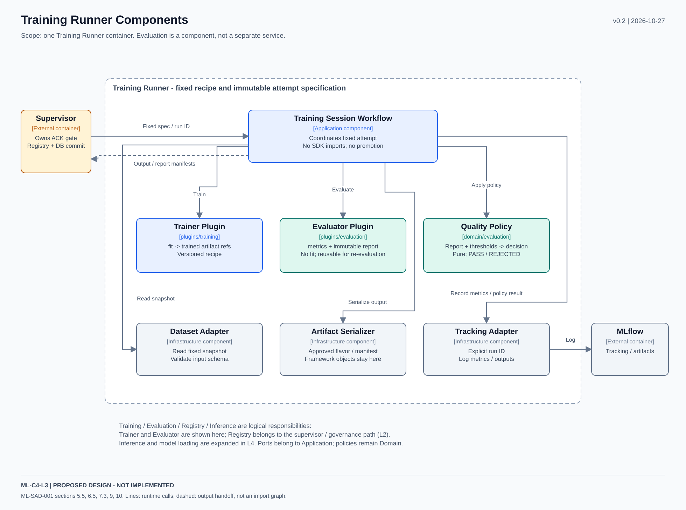
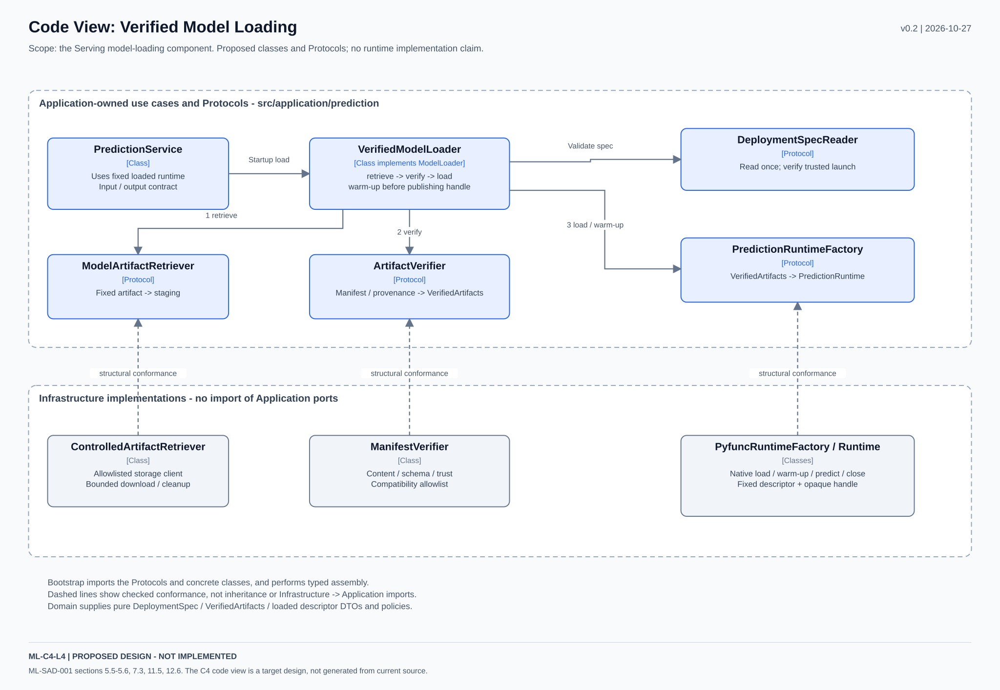

# ML System v0.2：C4 L1～L4 正式附件

| 項目 | 內容 |
| --- | --- |
| 圖集版本／日期 | ML-C4-001／0.2，2026-10-27 |
| 對應規格 | [ML-SAD-001 v0.2](../../ml-system-design.md) |
| 狀態 | 目標設計，未實作；SVG 為原生可編輯的向量來源，不是現有程式自動產生的圖 |
| 原圖範圍 | 本 repository 沒有審查提及的四張舊 C4 SVG；本輪依 v0.2 重繪，未聲稱已逐圖比對外部原件 |
| 檢查 | SVG XML 解析、實際 raster render 與目視檢查；版本／SHA256SUMS 隨本目錄保存 |

既有 `backend-platform.svg` 與使用者原始參考保持原樣。C4 層級是系統、container、component、code 的不同縮放；L3 以單一 container 為 scope，L4 只展開最需要說明的 component，不強迫列出所有類別。[C4 diagrams](https://c4model.com/diagrams)、[Component scope](https://c4model.com/diagrams/component)

## 1. 圖面索引與追溯

| 圖號 | SVG | Scope／文件章節 | 語意 |
| --- | --- | --- | --- |
| ML-C4-L1 | [System Context](c4-l1-context.svg) | ML 應用、使用者與平台系統；§1、3、4、14 | 系統責任與外部依賴 |
| ML-C4-L2 | [Container View](c4-l2-containers.svg) | 管理、控制、Relay、broker、Supervisor、Runner、Serving 與 stores；§4、9、11～13、16 | 可部署角色及明確通訊／儲存 |
| ML-C4-L3 | [Training Runner Components](c4-l3-training-runner.svg) | 單一 Training Runner；§5.5、6.5、7.3、9、10 | Trainer／Evaluator／QualityPolicy 與 I/O adapter 的分工 |
| ML-C4-L4 | [Serving Loader Code](c4-l4-serving-loader.svg) | Serving 的 ModelLoader component；§5.5～5.6、7.3、11.5、12.6 | Application Protocol、協調類別與 structural conformance |

L2 的 Routing Gateway 是目標部署的 ingress／reverse proxy，不是新業務 use case。框內各角色仍由同一產品擁有 App DB；獨立部署不代表各自是自治微服務。平台管理的 MLflow 使用獨立 metadata DB／artifact store。

## 2. 四項邏輯責任如何落到實作

| 邏輯責任 | 程式位置與執行角色 | 圖面 |
| --- | --- | --- |
| Training | Application Training Workflow；`plugins/training` Trainer，由 Supervisor／Runner 執行 | L2／L3 |
| Evaluation | `application/evaluation` Evaluator contract／service、`plugins/evaluation` metrics、`domain/evaluation` QualityPolicy | L3；無新增 evaluation container |
| Model Registry | `application/model_registry`＋MLflow adapter；Supervisor 註冊、治理路徑核准／部署 | L1／L2；不是 Trainer／Evaluator 的副作用 |
| Inference | `application/prediction`＋ModelLoader／Runtime adapters；獨立 Serving | L2／L4 |

Dataset、Deployment、Identity 是支援責任；不因先前四項邏輯分類就把它們省略。Evaluation 未從系統消失，而是保留程式邊界並先與 Training Runner 共部署。重新評估固定模型可重用相同 Evaluator，不呼叫 fit。

## 3. 讀圖規則

- 圖上的實線表示標示的執行／資料關係，不是 Python import graph。
- L2 虛線表示 Serving 啟動時取得固定模型，預測 hot path 不逐次依賴 registry。
- L3 虛線表示 output／report handoff；QualityPolicy 是純計算，不呼叫 tracking／storage。
- L4 虛線只表示 bootstrap 檢查的 structural conformance，不是繼承或 Infrastructure import Application。
- 顏色輔助辨識；名稱、kind 與文字標籤承擔語意，狀態皆為 proposed。

## 4. 圖面預覽

## 5. 版本維護

同一 PR 更新主文件、圖面、交付 schema、相容矩陣與測試追溯；更新本目錄的 SHA256SUMS。正式發佈後保留版本路徑，破壞性架構更新建立新圖集，不覆蓋歷史 evidence。

本圖集可供實作審查；沒有將框內類別／adapter 描述成已存在的程式，也沒有替代 ML-T26～40 的實作驗收。
