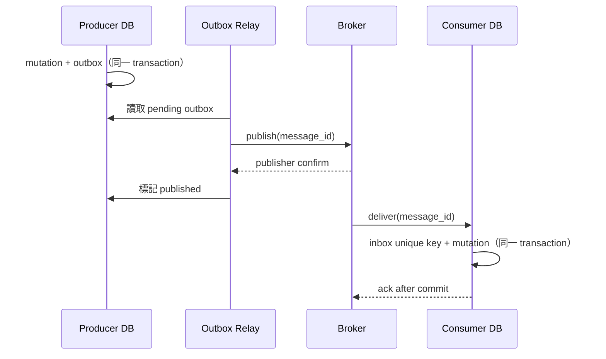

# 微服務契約設計與演進指南

| 項目 | 內容 |
| --- | --- |
| 文件編號／版本 | MSC-001／1.0 |
| 更新日期 | 2026-10-26 |
| 適用對象 | 架構師、Backend／Platform 工程師、API 與事件契約 Reviewer |
| 適用範圍 | 同步 HTTP、非同步 command／event、資料 ownership、服務身分、相容性與發布治理 |
| 對應基線 | [架構導讀](architecture.md)、[模組規範](module-spec.md)、[開發手冊](developer-guide.md)、[軟體設計規格](software-design.md) |
| 文件狀態 | 未來服務化的設計與審查規範；不代表本文所列元件均已實作 |

本專案目前是可演進的 modular monolith。`ModuleDefinition`、`ModuleExports`、domain ports、API／worker 分離及 RabbitMQ adapter 提供服務抽離接縫；它們仍以同一份 Python distribution、設定、資料資源及程序內 facade 運作。本文說明如何在實際需要獨立部署時，把這些接縫轉成可版本化、可驗證、可回滾的跨服務契約。

本文不預設產品領域、資料模型或工作流程。範例使用 `consumer`、`provider`、`resource` 等中性名稱。本版聚焦 HTTP 與 message-driven API；gRPC／Protobuf 契約需另訂 field-number、wire-type、service-method 相容及 breaking-change 規則，未納入本文範圍。

> [!IMPORTANT]
> Python `Protocol` 與 `ModuleExports.services` 是程式內契約，不是 HTTP 或訊息 wire contract。只有具機器可讀 schema、owner、版本、相容政策及部署證據的介面，才能作為獨立微服務契約。

---

## 1. 核心設計原則

1. **先定 bounded capability 與資料 owner，再決定部署單位。** Kubernetes Deployment、repository 或 package 邊界本身不會形成自治服務。
2. **消費者擁有所需的 port，提供者擁有 wire contract。** 消費者只定義最小需求；提供者維護 OpenAPI／AsyncAPI／message schema 與行為承諾。
3. **公開 schema 是 source of truth。** 不以 Wiki、Python entity、ORM model、共享 database 或口頭約定代替可驗證契約。
4. **相同 major 版本只做已驗證的相容變更。** Producer、consumer 和 queue 中的舊資料可能同時存在，rolling deployment 必須支援版本重疊。
5. **每筆可變資料只有一個寫入 owner。** 其他服務經 API、event projection 或 materialized view 取得資料，不直接讀寫 owner 的 collection。
6. **傳輸採 at-least-once 心智模型。** Publisher confirm、consumer acknowledgement、Redis job snapshot 都不能提供端到端 exactly-once；重要副作用靠持久冪等、outbox／inbox 與對帳控制。
7. **身分與追蹤資料不能互相替代。** `traceparent`、request ID、correlation ID 只供觀測；tenant、actor 與權限必須由已驗證的 identity context 取得。
8. **失敗語意屬於契約。** Timeout、可重試性、錯誤碼、DLQ、補償、保存期限及取消行為必須與正常回應一起設計。

### 1.1 契約類型選擇

| 需求 | 建議契約 | 使用條件 |
| --- | --- | --- |
| 即時查詢、短時間 command | HTTP API | Caller 需要立即結果，且 deadline 內可以完成 |
| 長時間 command | HTTP `202 Accepted`＋operation resource，或 async command | 必須提供 operation ID、查詢狀態、取消與保存期限 |
| 要求一個 owner 執行動作 | Command queue | 一個 logical owner；重送、冪等與結果契約明確 |
| 廣播已發生的不可變事實 | Event exchange／stream | 可有零至多個 consumer；每個 subscriber 擁有自己的 queue |
| 跨服務長流程 | Saga／Process Manager＋event | 明確狀態、逾時與補償；不使用跨服務共享交易 |
| 大型 binary／模型／匯出檔 | Object storage reference＋digest | Broker 只傳 metadata、權限、大小、版本與有效期限 |

同步與非同步可以組合，例如 HTTP 接收 command、回傳 `202`，再以 operation resource 或 event 回報完成狀態。不要為了「使用微服務」強迫所有互動改成事件。

---

## 2. 服務抽離門檻

只有在至少一項條件成立，且團隊能承擔獨立維運責任時，才把 capability 抽成服務：

- 需要獨立擴縮，例如 CPU／GPU kernel 與一般 API 的資源模型不同。
- 需要獨立發布節奏或故障隔離。
- 已形成明確 bounded context、資料 owner 與維護團隊。
- 安全、網路或法規要求獨立信任邊界。
- 單體內協調成本已高於分散式系統的維運成本。

抽離前必須回答：

| 問題 | 最低交付內容 |
| --- | --- |
| 誰擁有契約？ | Owner team、reviewer、on-call／事件處理責任 |
| 誰擁有資料？ | Database／collection、migration、retention、備份與刪除政策 |
| 誰是 consumer？ | 已知 consumer 清單、用途、版本及聯絡窗口 |
| 如何授權？ | Human identity、workload identity、scope／permission、tenant policy |
| 如何失敗？ | Deadline、timeout、retry owner、DLQ／補償、部分失敗語意 |
| 如何防重？ | HTTP idempotency 或 message inbox／outbox 的持久唯一鍵 |
| 如何觀測？ | SLI、trace propagation、log 欄位、告警與 runbook |
| 如何升級與回滾？ | N／N-1 相容證據、dual-read／dual-publish 時間窗、EOL |

若以上答案仍依賴「共享同一個 Python object／database／secret／queue」，該 capability 尚未成為自治服務。

---

## 3. 契約 ownership 與檔案配置

正式導入契約工具時，建議在 repository 建立下列結構；不要先建立沒有 owner 或內容的空目錄：

```text
contracts/
  http/<service>/
    openapi.yaml
  async/<service>/
    asyncapi.yaml
  schemas/<capability>/<message>/
    v1.schema.json
  examples/
    <contract>-v1-valid.json
    <contract>-v1-invalid.json
  compatibility.yaml
```

每份 contract artifact 至少記錄：

- 唯一名稱、owner、provider／producer 與已知 consumers。
- 狀態：`proposed`、`active`、`deprecated` 或 `retired`。
- Major／minor 版本、發布日期、支援期限及取代版本。
- 資料分類、PII／secret 禁止欄位、保存與刪除政策。
- 認證方式、必要 scope／permission、tenant／owner 規則。
- SLO、timeout、重試、冪等及 ordering 語意。
- Schema digest 或不可變 artifact 版本。

提供者 repository 維護契約的 source of truth；中央 catalog 只做索引與發現。已發布版本保持不可變，修正破壞性內容時發布新版本。

---

## 4. 從程序內 facade 演進為 remote adapter

目前 [`ModuleExports.services`](../bootstrap/components.py) 會把 Python facade 放入 `ModuleContext.dependencies`。這適合同一程序，但跨 process 後不能使用。採用 **Consumer-owned Port＋Local/Remote Adapter＋Composition Root**：

```python
# src/domain/consumer/ports.py
from dataclasses import dataclass
from typing import Protocol


@dataclass(frozen=True, slots=True)
class ReferenceSnapshot:
    reference_id: str
    revision: int


class ReferenceReader(Protocol):
    async def get(
        self, tenant_id: str, reference_id: str
    ) -> ReferenceSnapshot | None: ...
```

演進步驟：

1. Consumer 在自己的 domain 定義所需的窄 port 與 consumer-owned model。
2. 單體期間由 bootstrap 建立 `LocalProviderAdapter`，把 provider facade 轉為該 port。
3. Provider 先發布 OpenAPI／message contract，並通過 provider contract tests。
4. 在 `src/infrastructure/downstream/` 建立 `HttpProviderAdapter` 或 message adapter，實作相同 port。
5. Local 與 remote adapter 跑相同的 behavioral contract tests。
6. Bootstrap 依 deployment profile 選擇 local 或 remote adapter；consumer use case 不變。
7. 觀測 remote 路徑穩定後移除 local bridge 與不再使用的 `requires`。

禁止下列做法：

- Consumer import provider 的 repository、ORM／Mongo model、application service 或 infrastructure adapter。
- 將 provider 的 domain entity 發布成跨服務共享 Python package。
- 把 `ModuleContext`、`Runtime`、`dependencies` 或 `resources` mapping 傳入 application 當 service locator。
- 以共用 database 查詢取代 remote adapter。

---

## 5. 同步 HTTP 契約

### 5.1 OpenAPI 是機器可讀真源

每個 HTTP 服務應提交並發布 OpenAPI artifact。FastAPI 啟動後的 `/openapi.json` 必須與 repository 中的版本一致；CI 對 main 或最近發布版執行 semantic diff。

契約至少包含：

- Method、path、path／query/header 參數及 content type。
- Request／response schema、required、nullable、default、format、單位與大小上限。
- 所有成功與錯誤 status、穩定 error code、可重試性及 `Retry-After`。
- 認證 scheme、scope／permission、tenant 來源與 owner policy。
- Pagination、排序、filter、ETag／條件更新等一致性語意。
- Idempotency key、operation ID、timeout／deadline 與 rate limit 行為。

Transport DTO 不等於 domain entity。服務可以產生 client，但 consumer adapter 仍須把 wire DTO 轉成自己的 model，避免 wire schema 滲入核心政策。

### 5.2 錯誤契約

錯誤回應必須提供機器可判斷的 code，不得要求 consumer 解析人類訊息。目前 `/api/v1` 使用專案既有 error envelope；它已是公開契約，不能在同一 major 直接更換格式。新 major 或新服務可評估採用 RFC 9457 `application/problem+json`：

```json
{
  "type": "https://contracts.example.invalid/problems/resource-conflict",
  "title": "Resource conflict",
  "status": 409,
  "code": "resource_conflict",
  "instance": "/operations/01J...",
  "request_id": "01J..."
}
```

`detail` 只提供安全、可採取行動的資訊；不輸出 stack trace、SDK 原始錯誤、連線字串、token 或資料內容。

### 5.3 Timeout、retry 與 idempotency

- Caller 的 deadline 必須小於自身上游 deadline，並保留回傳與 cleanup 預算。
- Connect／read／write／pool timeout 分別設定；每個 downstream 使用自己的連線池及 concurrency bulkhead。
- Retry 只由一層負責，避免 gateway、service 與 SDK 同時重試造成放大。
- 只重試暫時性錯誤及安全／冪等操作。非冪等 mutation 必須有持久 `Idempotency-Key`。
- Validation、authentication、authorization 與永久 business conflict 不重試。
- 使用 bounded exponential backoff＋jitter、最大嘗試次數及總 deadline。

HTTP mutation 的建議唯一鍵為 `(tenant_id, operation, idempotency_key)`。保存 request hash、狀態與 terminal response：

- 同 key、同 request hash：回傳原結果或既有 operation。
- 同 key、不同 request hash：回 `409 Conflict`。
- 兩個同時到達的 duplicate：只有一個取得唯一鍵並執行。

---

## 6. 非同步 command 與 event 契約

### 6.1 Command 與 event 分離

| 類型 | 語意 | Owner 與 routing |
| --- | --- | --- |
| Command | 要求某一能力執行動作 | 恰好一個 logical owner；送往 owner 的 service queue |
| Event | 已發生且不可變的事實 | Producer 發布；每個 subscriber 使用自己的 queue |

不同服務不得共用 competing-consumer command queue。否則某個服務可能取走自己不支援的 handler／版本。Event 也不能直接送到單一共用 queue，否則 consumer 彼此競爭後只會有一方看到事件。

建議 topology：

```text
command routing key: <provider>.<operation>.v1
command queue:       <provider>.commands.v1

event routing key:   <provider>.<fact>.v1
subscriber queue:    <consumer>.<provider>-events.v1
```

現行單一 `backend.jobs.execute` 與 `APP_QUEUE_NAME` 可繼續支援 modular monolith；第一個異質服務 worker 上線前必須先改成 service-owned topology，且 publisher 不再依本機 handler registry 判斷遠端服務能力。

### 6.2 Envelope 與 payload schema 分開版本

Envelope 版本只描述共同 metadata；每種 command／event 的 payload 另有 contract identifier 與 major version。以下為 command 範例：

```json
{
  "schema_version": 1,
  "message_id": "01J...",
  "message_type": "provider.operation.execute.v1",
  "payload_schema": "provider.operation.command.v1",
  "source": "consumer-api",
  "requested_at": "2026-10-26T08:30:00Z",
  "tenant_id": "tenant-1",
  "actor_id": "user-1",
  "correlation_id": "01J-correlation...",
  "causation_id": "01J-parent...",
  "traceparent": "00-4bf92f3577b34da6a3ce929d0e0e4736-00f067aa0ba902b7-01",
  "payload": {
    "reference_id": "ref-123",
    "expected_revision": 7
  }
}
```

Event 使用已發生事實的過去式名稱，例如 `provider.operation.completed.v1`，並以 `occurred_at` 表示事實發生時間；不可把 event 名稱當成要求 owner 執行的 command。

規則：

- `message_id` 是 delivery 去重基礎；`request_id`／`correlation_id` 只供關聯，不能代替冪等鍵。
- `causation_id` 指向直接觸發此訊息的 request／message，便於追查事件鏈。
- `tenant_id`／`actor_id` 是 admission metadata；consumer 仍須驗證 producer 身分與授權，不相信 payload 內同名欄位。
- `traceparent`／`tracestate` 只供 tracing，不參與授權。
- Trace context 是 transport metadata；AMQP 實作應明確定義與 message headers 的映射。Redelivery／replay 建立新的 consumer span，依 tracing policy 使用 span link 關聯原 context，不把舊 `traceparent` 持續當作新的 active parent；持久業務關聯使用 correlation／causation ID。
- 訊息不包含 JWT、密碼、session、database handle、Python exception 或其他可重用秘密。
- Payload 和結果必須限制 encoded size；大型內容改傳 object reference、digest、size、content type 及有效期限。
- 未明訂 ordering key／aggregate revision 時，不保證全域順序。

AsyncAPI 可描述 channel、operation、security 與 AMQP binding；JSON Schema 驗證每種 payload。若採 CloudEvents，仍需另訂產品 payload schema、routing、重送與授權語意。

### 6.3 Retry、DLQ 與 replay

每種 message type 必須分類：

- **Transient**：依 policy 做有限次 backoff／jitter retry。
- **Permanent schema／policy error**：不無限重試，送 DLQ 並告警。
- **Unknown version／message type**：隔離，不以 generic handler 猜測執行。
- **Dependency outage**：保留 delivery 或延遲重試，但必須有容量與最大等待政策。

DLQ 必須有 owner、告警、查詢、資料保留、修復判準與受控 replay runbook。Replay 使用原 `message_id` 或保留原 ID 並新增 replay metadata，不能產生看似全新的副作用。

---

## 7. Schema 版本與相容性

### 7.1 版本政策

- HTTP major 可放在 URL，例如 `/api/v1`；service release version 與 API major 分開管理。
- Message type 或 payload schema major 放在穩定名稱，例如 `provider.operation.completed.v1`。
- Minor／patch 只包含通過 compatibility gate 的 additive change。
- Consumer 至少保存 N／N-1 fixtures；是否同時支援更多版本依 queue retention、離線 consumer 與稽核需求決定。
- 同一 major 的 consumer 必須依契約處理未知 optional 欄位；若現有 client 做不到，新增欄位仍視為 breaking。

### 7.2 相容性矩陣

| 變更 | HTTP request | HTTP response | Command／event payload | 判定 |
| --- | --- | --- | --- | --- |
| 新增真正 optional 欄位 | 通常相容 | 需 consumer 忽略未知欄位 | 需 consumer 忽略未知欄位 | 以雙向 fixture 證明 |
| 新增 required 欄位 | Breaking | Breaking | Breaking | 新 major／新 message version |
| 刪除、改名或改型別 | Breaking | Breaking | Breaking | 新 major |
| optional 改 required | Breaking | Breaking | Breaking | 新 major |
| 收緊 validation／縮小範圍 | Breaking | 可能 breaking | Breaking | 新版本，不原地修改 |
| 改單位、時區或欄位語意 | Breaking | Breaking | Breaking | 新欄位或新 major |
| Enum 新增值 | 可能 breaking | 可能 breaking | 可能 breaking | Consumer 需 unknown fallback |
| 新 endpoint／新 event type | 通常相容 | 通常相容 | 不影響未訂閱 consumer | 仍需 owner 與 access policy |
| 改 status、error code、retry 語意 | Breaking | Breaking | — | 版本化並更新 policy |
| 重送、延遲、亂序 | — | — | Consumer 必須處理 | Inbox、revision、時效政策 |

Backward compatibility 表示新 consumer 可以讀舊資料；forward compatibility 表示舊 consumer 可以讀新資料。Rolling deployment 常需要兩者。

### 7.3 安全部署順序

現行 [`decode_request()`](../src/infrastructure/messaging/envelope.py) 只接受 envelope `schema_version == 1`。加入 v2 時必須：

1. Consumer 先 dual-read v1／v2，並接受 v1 加入的可選欄位。
2. 所有 consumer 部署完成並有指標證明後，producer 才開始發布 v2。
3. 依 queue retention、retry／DLQ 與離線 consumer 時間窗保留 v1 reader。
4. Producer 停止 v1 後持續觀測；確認沒有 v1 backlog 才移除 reader。
5. Retire 舊 artifact，保留 migration／replay 工具及稽核紀錄。

不可先讓 producer 發出現有 consumer 會拒絕的版本。

---

## 8. 持久冪等、Outbox 與 Inbox

現有 worker 會在 Redis terminal snapshot 存在時略過部分重送，並在 terminal snapshot 保存後才 ack。這能降低重複執行，但 Redis TTL snapshot 不是永久 inbox；Mongo mutation、Redis snapshot、RabbitMQ publish 與外部副作用也不是同一交易。

### 8.1 Producer transactional outbox

1. 在 owner database 的同一個 local transaction 寫 domain mutation 與 outbox record。
2. Outbox record 包含 message ID、type、payload schema、payload、發生時間與 publish 狀態。
3. Relay 讀取未發布 records，送至 broker 並等待 publisher confirm。
4. Confirm 後標記 published；relay crash 可能重送，所以 consumer 仍需 inbox。

### 8.2 Consumer transactional inbox

1. 驗證 envelope、schema、producer identity 與 tenant authorization。
2. 在 consumer database 以 `(consumer_name, message_id)` 建唯一鍵。
3. 在同一個 local transaction 寫 inbox record 與業務 mutation。
4. Commit 成功後才 ack。
5. 唯一鍵衝突表示重送：讀取既有結果，安全地 ack，不重做副作用。



對外部不可交易副作用，將 `message_id` 傳給下游當 idempotency key。下游不支援冪等時，保存 intent／result、提供查詢與 reconciliation，並設計可接受的補償。這形成受控的 effectively-once outcome，不宣稱端到端 exactly-once。

跨服務流程採 Saga／Process Manager，明確記錄每一步狀態、deadline、可重試錯誤及補償。不要以 shared transaction、distributed lock 或 dual write 隱藏一致性問題。

---

## 9. 資料 ownership

每個服務對其資料具有唯一寫入權責：

- 擁有 database／schema／collection、migration、index、備份、retention 及刪除流程。
- 使用獨立最小權限 database credential；即使共用 Mongo cluster，也不共用 root 帳號或任意 collection 權限。
- 其他服務不得直接查詢 collection、建立跨服務 join 或參與 owner 的 local transaction。
- 跨服務 reference 使用穩定 ID；需要查詢時使用 API，需要本地讀取時訂閱 event 建 projection。
- Event 只發布 consumer 需要的最少資料，並定義資料更正、刪除、重建 projection 與 schema migration。
- `tenant_id`、owner 與 scope 由資料 owner 再次強制；不信任 HTTP body、query 或 message payload 自行聲稱的範圍。

Projection 是 consumer 擁有的衍生資料，可重建且不得反向成為 source of truth。涉及刪除或個資更正時，契約必須包含 projection 同步與稽核方式。

---

## 10. Identity 與服務信任

Human identity 與 workload identity 分開治理：

- Human access token 表示使用者／委派授權；服務間背景工作使用 workload identity、mTLS 或短效 service credential。
- 只有明確 delegated call 才轉送使用者 token；一般服務呼叫不無條件轉送原 bearer token。
- Provider 必須重新驗證 caller、issuer、audience、algorithm、expiry、not-before、scope／permission 與 tenant policy。
- 若使用 JWT，建議 identity provider 非對稱簽章並透過 JWK Set／`kid` 輪替；consumer 只持有公開驗證材料。
- 若使用 opaque token，透過受保護的 introspection endpoint 查詢有效狀態與授權 metadata。
- Token、secret、完整 claims 及敏感 payload 不進入 queue、log、trace baggage 或錯誤回應。

目前 `JwtTokenCodec` 使用共用 HS256 secret，且本地 identity 每次認證查詢 session／user。抽離 identity 前必須選擇 asymmetric issuer＋JWKS 或 introspection；禁止讓所有服務直接讀 identity database。現有 [`PrincipalAuthenticator`](../src/domain/identity/ports.py) 是替換 local／remote identity adapter 的接縫。

---

## 11. Resilience 與過載控制

每個 remote dependency 建立獨立 policy：

| 項目 | 必須定義 |
| --- | --- |
| Deadline／timeout | Caller budget、connect/read/write/pool timeout、cleanup 預算 |
| Retry | Owner、錯誤分類、最大次數、backoff、jitter、總時間上限 |
| Idempotency | HTTP key 或 message ID、唯一鍵範圍、結果保存期限 |
| Bulkhead | Connection pool、async concurrency、queue／thread 容量 |
| Circuit breaker | Open 條件、half-open probe、fallback 與觀測指標 |
| Load shedding | Admission limit、`429`／`503`、`Retry-After`、queue quota |
| Cancellation | 是否 cooperative、下游是否仍可能完成、結果如何對帳 |

Circuit breaker、retry 與 fallback 都放在 remote adapter／platform policy 邊界，不進入純 domain。Fallback 不能繞過授權、回傳過期敏感資料或把「未知」偽裝成成功。

---

## 12. Observability 契約

服務邊界必須傳遞 W3C `traceparent`／`tracestate`，並保留現有 request／job correlation。建議統一欄位：

- `service.name`、`service.version`、environment、instance／pod。
- HTTP route／operation 或 message type，避免把高基數實際 path 當 label。
- `trace_id`、`span_id`、request ID、message ID、correlation ID、causation ID。
- Tenant 可用受控、低敏感度識別；不得記 token、密碼、完整 payload 或個資。

最低 SLI：

- HTTP RED：rate、errors、duration，以及 downstream timeout／circuit 狀態。
- Publish confirm latency／failure、consume duration、queue depth／oldest age。
- Retry、DLQ、replay、schema reject、unknown version。
- Outbox pending age、inbox duplicate count、reconciliation backlog。
- Auth failure、permission denial與重要管理異動；安全稽核事件與一般 application log 分開治理。

現有 JSON log 的 request ID／job ID 只提供 correlation，尚未形成 distributed trace。Trace context 也不得作為身份或資料完整性證明。

---

## 13. CI 契約閘門

契約從文件約定提升為可交付能力時，CI 至少執行：

1. Lint OpenAPI、AsyncAPI 與 JSON Schema，驗證所有 examples。
2. 啟動 provider，比較實際 `/openapi.json` 與 committed contract。
3. 與 main／最近發布 artifact 做 semantic breaking-change diff；同 major 的 breaking change 直接失敗。
4. Producer serialization fixture 必須通過 schema；consumer decoder 必須讀取所有支援版本的 golden fixtures。
5. 驗證 consumer 容忍未知 optional 欄位，並拒絕未知 major／不合法內容。
6. Provider contract tests 與 consumer-driven contract tests 同時執行。
7. Local／remote adapter 跑相同 port behavioral tests。
8. 測試 duplicate／concurrent duplicate、redelivery、亂序、延遲、poison message、DLQ 與 replay。
9. 測試 producer 在 transaction／publish 間 crash，以及 consumer 在副作用／ack 間 crash。
10. 檢查 command queue owner 唯一、event subscriber 各自有 queue，禁止跨服務直接 import provider internals。
11. 掃描 schema、example、log 與 message fixture，確保沒有 secret／token／敏感資料。

目前專案 CI 尚未安裝 OpenAPI／AsyncAPI semantic diff、schema registry 或 consumer-driven contract 工具。採用工具時必須固定版本、加入 hash lock、在 pre-commit 提供快速 lint，並在 CI 執行完整相容與整合測試；不可把本指南描述為已完成的自動閘門。

### 13.1 建議 PR 證據

契約 PR 應附：

- Contract owner、provider、consumers 與變更原因。
- Artifact diff 與相容性報告。
- Data classification、auth／tenant policy。
- Timeout、retry、idempotency、ordering、retention。
- 部署順序、dual-version 期間、feature flag、回滾方式與 EOL。
- Contract／integration／failure tests 的實際命令及結果。

---

## 14. 發布、棄用與回滾

採 **expand → migrate → contract**：

1. **Expand**：先讓 provider／consumer 接受舊版及新版，增加 optional storage／schema。
2. **Migrate**：部署 consumer dual-read，之後 producer 切換；必要時回填 projection。
3. **Observe**：監控舊版流量、queue、DLQ、schema reject 及所有已知 consumer。
4. **Contract**：EOL 到期且無舊資料／consumer 後，移除舊路徑、欄位與 reader。

棄用公告包含 owner、替代契約、最後發布日、EOL、migration guide 與 consumer 確認。回滾映像必須仍能讀當前資料與 message schema；只回滾 container 而不評估資料／queue 相容性是不完整的回滾。

---

## 15. 建議演進順序

1. 為現有 capability 建立 ownership map；CI 禁止跨 capability 使用對方私有 model／adapter。
2. 定義 consumer-owned port，先用 local adapter 清除直接 facade 耦合。
3. 提交 OpenAPI／AsyncAPI／JSON Schema 與 examples，建立 compatibility gate。
4. 分離 database credential、migration ownership、queue、routing key、Redis prefix 與容量預算。
5. 建立 remote adapter、service identity、timeout／retry／bulkhead 及 observability。
6. 有持久副作用時建立 idempotency、outbox／inbox、DLQ／replay 與 reconciliation。
7. 以 Strangler Pattern 切換一個低耦合 consumer，保留可回滾 local path。
8. 通過 staging 的負載、故障、rolling upgrade、N／N-1 與回滾演練後，才移除 local implementation。

本專案第一個適合獨立部署的候選是 kernel execution worker：API／RabbitMQ／worker 已有接縫，也具 CPU／GPU 資源隔離價值。Identity 應在 token trust model 完成後再抽離；Export 應由資料 owner 產生，或由 orchestrator 經版本化 API／object storage 協調，不能跨服務直接讀 database。

---

## 16. 微服務契約完成定義

服務宣布可獨立部署前，逐項確認：

- [ ] Bounded capability、owner team、provider／consumers 與 on-call 已記錄。
- [ ] Consumer-owned port 不依 provider 的 domain／application／infrastructure package。
- [ ] OpenAPI／AsyncAPI／JSON Schema 與 examples 已提交、發布及固定版本。
- [ ] HTTP／message error、timeout、retry、cancellation 與 retention 已定義。
- [ ] Breaking-change diff、provider／consumer tests、N／N-1 fixtures 已通過。
- [ ] Command queue 由單一服務擁有；event subscriber 使用各自 queue。
- [ ] Database、credential、migration、backup、retention 與 deletion ownership 已隔離。
- [ ] Human／workload identity、scope、tenant／owner policy 在 provider 端重新驗證。
- [ ] 重要 mutation／副作用具持久 idempotency；需要時完成 outbox／inbox。
- [ ] Trace propagation、metrics、worker health、DLQ／outbox 告警與 runbook 已完成。
- [ ] Rolling upgrade、broker／database 故障、duplicate、亂序與 replay 已演練。
- [ ] Deployment profile、資源限制、NetworkPolicy、PDB／autoscaling 與 graceful shutdown 已驗證。
- [ ] Deprecation、EOL、回滾及資料相容流程已由受影響團隊接受。

任何一項仍依賴共享 private implementation 時，應維持 modular monolith 或先補齊契約，不以新增網路 hop 取代設計工作。

---

## 17. 權威規格與延伸閱讀

- [OpenAPI Specification](https://spec.openapis.org/oas/)：HTTP API 的機器可讀契約；團隊應固定工具鏈支援的版本。
- [AsyncAPI Specification](https://www.asyncapi.com/docs/reference/specification/v3.0.0)：message-driven API、channel、operation 與 protocol binding。
- [JSON Schema Draft 2020-12](https://json-schema.org/draft/2020-12)：JSON payload schema 與驗證。
- [CloudEvents 1.0.2](https://github.com/cloudevents/spec/blob/v1.0.2/cloudevents/spec.md)：通用 event metadata 格式；採用時仍需產品 payload 契約。
- [RFC 9110 — HTTP Semantics](https://www.rfc-editor.org/rfc/rfc9110.html)：HTTP method、status 與 idempotent semantics。
- [RFC 9457 — Problem Details for HTTP APIs](https://www.rfc-editor.org/rfc/rfc9457.html)：標準化 HTTP 錯誤格式。
- [RabbitMQ Consumer Acknowledgements and Publisher Confirms](https://www.rabbitmq.com/docs/confirms)：publish confirm 與 consumer ack 的不同責任。
- [W3C Trace Context](https://www.w3.org/TR/trace-context/)：`traceparent`／`tracestate` 跨服務傳遞。
- [RFC 8725 — JWT Best Current Practices](https://www.rfc-editor.org/rfc/rfc8725.html)、[RFC 7517 — JWK](https://www.rfc-editor.org/rfc/rfc7517.html)、[RFC 7662 — OAuth Token Introspection](https://www.rfc-editor.org/rfc/rfc7662.html)：token 驗證、key distribution 與 introspection。

本文的 package 落點與一般 application 實作方式仍以[模組規範](module-spec.md)及[開發手冊](developer-guide.md)為準；現行 runtime、任務與 failure semantics 以[軟體設計規格](software-design.md)為準。
