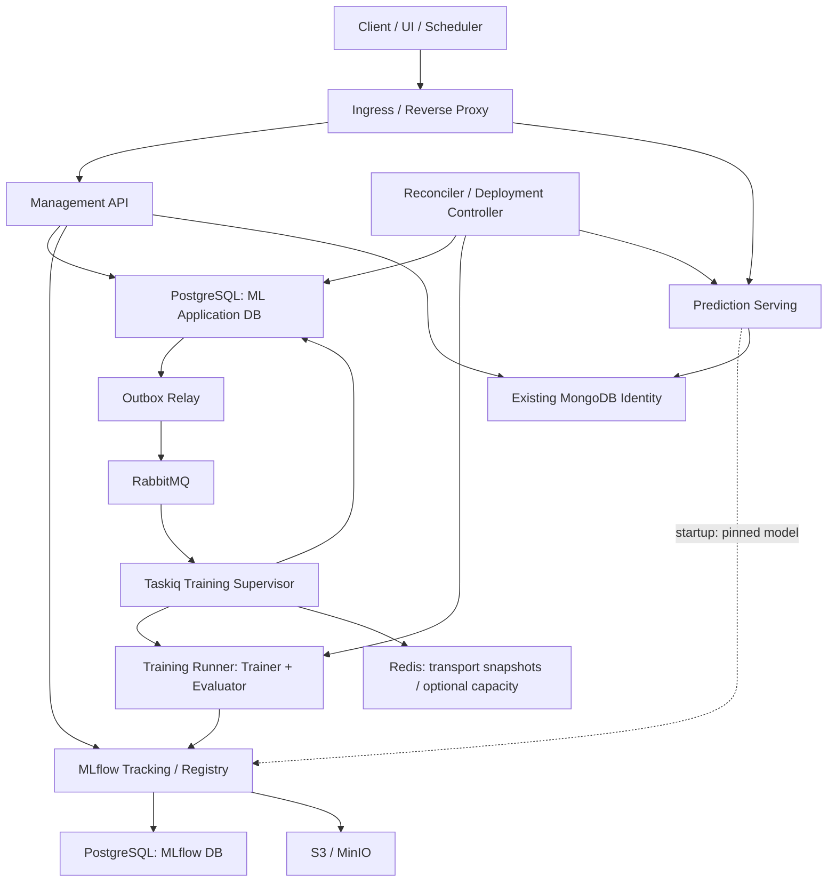
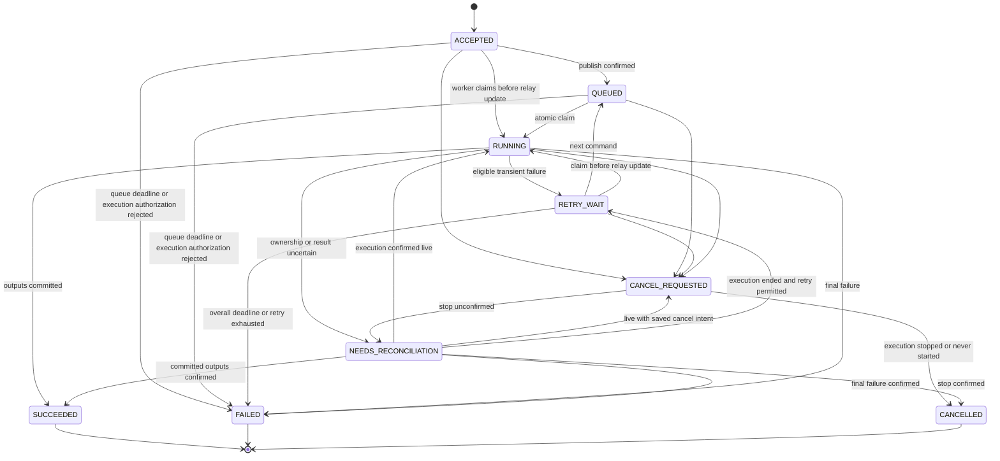
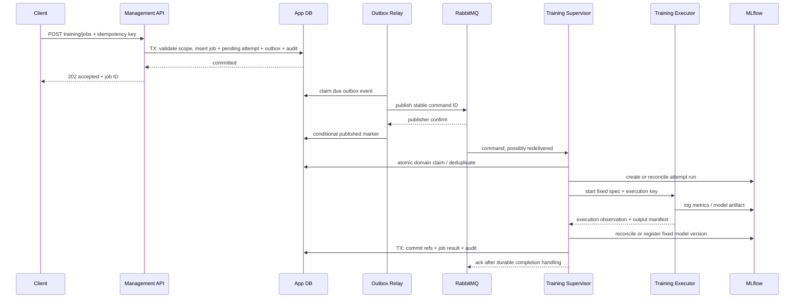

# ML System 開發方向與架構設計規格

| 文件控制 | 內容 |
| --- | --- |
| 文件編號／版本 | ML-SAD-001／0.2 |
| 日期 | 初稿 2026-10-26；v0.2 修訂 2026-10-27，Asia/Taipei |
| 狀態 | 開發設計提案；本文件未新增 ML 功能、依賴、資料表或部署服務 |
| 適用對象 | 架構、Backend、Data Science、Data Engineering、Platform、測試與維運團隊 |
| 程式參照基線 | `08490e84cc88d2ff7300cb97fd23e93ea0e33a1a`；依現有原始碼核對，文件提案不構成新版本執行驗證快照 |
| 平台設計基線 | [PBP-SAD-001 v1.3](software-design.md)、[模組規範](module-spec.md)、[DG-001 v1.1](developer-guide.md) |
| 文件目的 | 指引如何由本專案衍生 ML System，定義責任、契約、生命週期、實作順序與驗收條件 |
| 實作與驗證狀態 | 既有平台結果見 [validation.md](validation.md)；本文件中的 ML API、設定、檔案與驗收案例均為待實作設計 |
| v0.2 補強 | 正式 Port Ownership、ACK Execution Contract、DeploymentSpec Delivery、Evaluator 邊界與版本化 C4 附件 |
| 本輪符合性核對 | [基線符合性審查](ml-system-compliance-review.md)區分實測平台能力、設計要求與尚未實作的 ML 契約 |

「必須」表示採用本設計後的契約要求；「建議」表示有明確替代方案的預設選擇；「後續」表示有需求時才導入。文件版本與 Python distribution、HTTP API、訊息、模型及部署版本分別管理。本文件不取代通用平台規範，也不宣稱 ML 系統已完成生產驗收。

## 閱讀路徑

- 架構與技術選型：[第 1 節起](#1-目標範圍與第一版假設)，涵蓋第 1～5 節。
- 模型、資料庫與介面實作：[第 6 節起](#6-domain-模型與狀態機)，涵蓋第 6～8 節。
- 訓練、可靠性與部署生命週期：[第 9 節起](#9-訓練提交執行與完成流程)，涵蓋第 9～13 節。
- 安全、環境、維運與交付：[第 14 節起](#14-身份安全與資料治理)，涵蓋第 14～18 節。
- 開發順序、驗收與待定事項：[第 19 節起](#19-開發工作分解與里程碑)，涵蓋第 19～22 節。

## 1. 目標、範圍與第一版假設

### 1.1 目標

以既有 Backend Template 建立可維護的 ML 應用：使用者提交訓練，系統在獨立運算環境處理，將參數、指標與模型保存至 MLflow，經明確評估與核准後部署，再由獨立 Serving runtime 提供可追溯版本的預測。

第一條交付路徑為：

```text
受保護的 Training API
  → 持久 TrainingJob + Outbox
  → RabbitMQ / Taskiq
  → 獨立訓練 process
  → MLflow Run / Artifact / Model Version
  → 評估結果與人工核准
  → 固定模型版本的 Deployment
  → 獨立 Prediction API
```

### 1.2 第一版設計假設

| 項目 | 預設方向 |
| --- | --- |
| 初始工作負載 | CPU、scikit-learn、表格分類；Iris 僅為測試與示範 fixture |
| 程式組織 | 同一 repository，沿用九個 `src` 分層與明確 bootstrap |
| 工作調派 | 沿用 Taskiq／RabbitMQ；Redis 保留技術快照及選用容量協調 |
| 訓練隔離 | 第一版以固定入口啟動獨立 subprocess；容器限制由部署提供 |
| 訓練併行 | 初始每個 training worker 一個運算工作，再依量測調整 |
| 長期紀錄 | PostgreSQL 保存 ML 應用資料；MLflow 使用獨立 database |
| 既有身份 | 先沿用 MongoDB identity／JWT；PostgreSQL identity 遷移另立工作 |
| Artifact | 團隊整合環境使用 S3 相容儲存；本機可用 MinIO |
| Serving | 第一版每個 serving 部署固定一個 endpoint／一個模型版本；由 replica 擴展 |
| 發佈 | 人工核准、明確部署、rolling deployment；不自動將新模型上線 |
| 使用者範圍 | 保留既有 tenant／owner 隔離，單租戶部署也必須通過隔離測試 |

以上為可開始細部設計的預設，不是經容量測試證明的產品限制。改用其他 ML framework 時，需驗證其模型格式、資源需求及 runtime 相容性。

### 1.3 範圍界線

第一版涵蓋資料版本參照、訓練提交與取消、工作查詢、實驗追蹤、模型版本、評估、核准、部署與預測。Feature Store、HPO、多步驟 DAG、自動重訓、分散式訓練、GPU、串流推論、Canary 與 AI Agent 執行契約依需求另增。

Production 的判定依據是契約、權限、SLO、容量與故障復原驗收；Kubernetes 並非必要前提。一般 ML 訓練與預測介面也不自動涵蓋 Agent 的工具授權、對話狀態或長流程補償。

## 2. 既有專案適用性與差距

| 面向 | 現有依據 | 沿用方式／必要補強 |
| --- | --- | --- |
| HTTP 與 lifespan | [server.py](../server.py)、[路由掛載](../src/api/routers.py) | 沿用 Application Factory、錯誤格式、request ID；新增 ML 路由與角色 factory |
| 明確組裝 | [ModuleCatalog](../bootstrap/components.py)、[wiring](../bootstrap/wiring.py) | 沿用依賴排序、rollback；依程序選取不同能力與資源 |
| 向內依賴 | [邊界檢查](../scripts/check_boundaries.py) | Domain／Application 不加入 ML SDK；擴充 plugin 的 MLflow 禁止匯入規則 |
| 任務提交 | [JobService](../src/application/jobs/service.py) | 現有每次提交產生 UUID；需新增持久 command identity 與重送契約 |
| 分散式任務 | [dispatcher](../src/infrastructure/messaging/distributed.py)、[worker](../bootstrap/worker.py) | 保留 broker 與 ack 機制；避免重送覆寫終態，加入 domain claim／對帳 |
| 工作歷史 | [RedisJobStore](../src/infrastructure/messaging/redis_store.py) | 現有 TTL 快照保留為技術狀態；新增持久 ML repository |
| 運算隔離 | [BoundedThreadExecutor](../src/services/concurrency.py) | 用於有界阻塞 SDK；新增可監督的獨立訓練執行器 |
| Kernel | [SolutionKernel](../src/domain/strategy.py)、[KernelService](../src/application/kernels/service.py) | 可橋接推論；新增 model／schema／deployment 版本，不把訓練塞入通用 kernel lifecycle |
| Plugin | [plugin loader](../bootstrap/plugin_loader.py) | 目前只驗證已選入的 async SolutionKernel；Trainer 契約與 artifact 驗證另做 |
| Identity | [identity bootstrap](../bootstrap/identity.py)、[Settings](../src/config/settings.py) | 現有啟用 identity 必須 MongoDB；新增 ML 權限與資源 scope |
| 健康檢查 | [health](../src/services/health.py) | 目前不驗 worker heartbeat、模型載入或 warm-up；各角色新增 probe |
| 工程工具 | [工程基線](engineering-baseline.md)、[CI](../.github/workflows/ci.yml) | 沿用 locks／lint／typing／測試；增加 ML 映像、依賴與真服務整合 |

目前 generic handler 直接在 async worker 內被 await；同步 `fit()` 若寫在 handler 內，會阻塞該 event loop。現有 thread executor 的取消會等待實體 thread 完成，無法提供訓練硬終止。這些是擴充時要處理的具體限制。

平台預設 job timeout 為 60 秒、kernel timeout 為 30 秒、Redis snapshot retention 為 3600 秒。ML profile 必須另訂長任務參數。Redis lease 支援續租，其 lease 秒數不是訓練執行期限。

## 3. 架構決策與替代方案

下表是本 ML 應用的設計決策，不改寫平台既有 ADR。

| ID | 採用方向 | 理由與替代條件 |
| --- | --- | --- |
| ML-D01 | 由模板衍生產品，保留通用預設空白 | ML 能力明確選入；可回饋上游的改動限於中性契約及工程工具 |
| ML-D02 | 同 repo、角色分開部署 | 重用 use cases，同時隔離訓練與推論資源；跨 repo 依團隊需求再拆 |
| ML-D03 | 保留 Taskiq／RabbitMQ | 不因範例使用 Celery 就遷移；Celery 須有同步任務生態或操作需求作為依據 |
| ML-D04 | TrainingJob 與 queue JobSnapshot 分離 | domain 狀態、歷史與重試不能依賴短期 transport 快照 |
| ML-D05 | Job 與 Outbox 同一 PostgreSQL 交易 | 接受工作後可持續發布；consumer 仍需去重與條件式領取 |
| ML-D06 | 以 TrainingExecutor 隔離運算 | 第一版 local process，未來替換成 container／Kubernetes adapter |
| ML-D07 | MLflow 僅承擔 tracking／registry／artifact 整合 | 排隊、核准與部署政策由應用管理 |
| ML-D08 | 部署固定版本，alias 作管理參照 | 每個部署可重現；alias 更動不直接觸發記憶體切換 |
| ML-D09 | 優先 rolling deployment | 重用成熟 process lifecycle；熱切換須另驗競爭、記憶體及 in-flight 行為 |
| ML-D10 | 角色專用依賴與映像 | API、training、serving、MLflow 不共用完整 ML 安裝集合 |
| ML-D11 | 先保留 MongoDB identity | 降低第一版平台變動；接受多一個儲存服務的維運成本 |
| ML-D12 | 各邊界使用明確、版本化 DTO | SDK、DataFrame、NumPy／Tensor 不穿透到純 Application／Domain |
| ML-D13 | Application 擁有 workflow ports | 新 ML port 歸消費它的 use case；adapter 以 structural typing 配合，維持 infrastructure 不 import application |
| ML-D14 | Evaluator 與 Trainer 分開 | 評估策略可替換、可重新評估固定模型，不新增獨立 evaluation container |
| ML-D15 | ACK 需 application evidence gate | `when_saved` 不代表 App DB commit；兩種 execution mode 各有正式允許 ACK 的證據 |
| ML-D16 | Spec 以不可變交付物啟動 runtime | Controller 發布固定 JSON 與預期 digest；Serving 不自行選 latest／alias，readiness 與 routing 分別對帳 |

若改用 MongoDB 保存 TrainingJob，也必須提供同等的原子寫入、唯一約束、claim 與 Outbox 保證。既有 Compose 是 standalone MongoDB；不能直接假設跨 collection 交易可用，多文件交易的部署要求見 [MongoDB Transactions](https://www.mongodb.com/docs/manual/core/transactions/)。

## 4. 系統、程序與資料所有權

### 4.1 邏輯架構

圖中箭頭表示執行與資料流，不是 Python import 方向。



MLflow 的 backend store 保存實驗與模型 metadata，artifact store 保存大型檔案；MLflow 不會取代應用工作資料庫。[MLflow Backend Stores](https://mlflow.org/docs/latest/self-hosting/architecture/backend-store/)

正式 C4 L1～L4 附件與編號、範圍、圖文追溯見 [v0.2 圖集](diagrams/ml-system-v0.2/README.md)。§4.1 是支援理解的動態資料流，不能取代 C4 的靜態系統／container／component／code 邊界。Repository 未包含審查提及的四張舊 C4 SVG；本輪新增圖集是依 v0.2 重新繪製的目標設計，不宣稱逐圖比對原件。

### 4.2 部署角色

| 角色 | 必要資源與責任 | 不應載入的資源 |
| --- | --- | --- |
| management API | 身份、ML DB、提交／查詢／核准、registry metadata client | 訓練模型與 GPU context |
| outbox relay | ML DB、broker publisher、有限批次與 backoff | 訓練 framework、模型 |
| training supervisor | domain claim、executor、工作 heartbeat、結果收斂 | 線上 Serving 模型快取 |
| training process | 固定 recipe、資料快照、Trainer、Evaluator、quality policy、tracking／artifact client | FastAPI runtime 與管理 API server |
| reconciler | 過期 ownership、外部 execution、MLflow 對帳、狀態收斂 | 未經核准的重新訓練／自動 promotion |
| deployment controller | 固定 deployment spec、程序／容器發佈及 observed state | 任意使用者傳入的命令 |
| prediction serving | 指定 deployment、驗證器、已載入模型、受保護 HTTP | broker consumer、training pipeline、promotion 寫入權限 |
| MLflow server | 自有 metadata DB、artifact store、認證與存取政策 | 應用 TrainingJob 狀態機 |

初期 relay、reconciler 與 deployment controller 可由同一控制程序執行不同有界 loop；不可綁在每個 Uvicorn worker lifespan 自動啟動，避免多份排程。每個 loop 均須具備 claim／lease 及可重入語意。

這些角色仍屬同一 ML 產品的模組化應用，共用由該產品擁有的 App DB；可以分開部署與擴展，但不因此宣稱每個 capability 都是自治微服務。未來跨團隊抽離時，依 [微服務契約指南](microservice-contracts.md)移交資料 ownership 並建立 wire contract，不讓獨立服務直接共寫私有資料表。

### 4.3 權威來源

| 資料 | 權威來源 | 其他系統的角色 |
| --- | --- | --- |
| Job、attempt、取消、retry 決策 | ML Application DB | Redis 僅是 transport 快照 |
| Dataset 使用版本與授權 | DatasetVersion 紀錄及固定 snapshot | MLflow 記錄其 lineage 參照 |
| Run、參數與訓練指標 | MLflow | App DB 保存 run ID 與必要摘要 |
| 評估決策 | App DB 的 EvaluationResult／policy version | 完整報告可放 artifact store |
| 模型版本 metadata | MLflow Registry；App DB 維護受控 binding | 不直接查改 MLflow SQL schema |
| 核准紀錄、desired deployment | App DB | alias 為可對帳的管理投影 |
| 實際可用模型／流量 | runtime 與 routing 的 observed state | App DB 收斂觀察結果 |
| 權重與 pipeline bytes | versioned artifact objects | DB 保存 digest／manifest 參照 |

可共用 PostgreSQL server，但 `ml_app`、`mlflow_metadata` 應有不同 database、帳號、migration 與備份責任。應用不得把 MLflow 私有 SQL table 當公開 repository。

## 5. 程式碼組織、依賴與組裝

### 5.1 建議檔案落點

以下是待新增的目錄與檔名，不表示它們目前存在。每個實際 package 需有適當 `__init__.py`。

```text
src/
  domain/
    datasets/              models.py, policy.py, errors.py
    training/              models.py, policy.py, errors.py
    evaluation/            models.py, policy.py, errors.py
    model_registry/        models.py, policy.py, errors.py
    deployments/           models.py, policy.py, errors.py
    prediction/            models.py, policy.py, errors.py
  application/
    datasets/              ports.py, service.py, facade.py
    training/              ports.py, service.py, tasks.py, reconciliation.py, facade.py
    evaluation/            ports.py, service.py, facade.py（第一版內部能力）
    model_registry/        ports.py, service.py, reconciliation.py, facade.py
    deployments/           ports.py, service.py, reconciliation.py, facade.py
    prediction/            ports.py, service.py, loading.py, facade.py
  api/
    datasets/              routers.py, schemas.py, dependencies.py, errors.py
    training/              routers.py, schemas.py, dependencies.py, errors.py
    model_registry/        routers.py, schemas.py, dependencies.py, errors.py
    deployments/           routers.py, schemas.py, dependencies.py, errors.py
    prediction/            routers.py, schemas.py, dependencies.py, errors.py
  infrastructure/
    persistence/           PostgreSQL repositories / unit of work
    messaging/             outbox publisher / stable command adapter
    execution/             local_process.py, kubernetes.py（後續）
    mlflow/                tracking.py, registry.py, artifacts.py
    data_sources/          approved dataset adapters
    serving/               spec_reader.py, artifact_retriever.py, verifier.py, pyfunc_runtime.py
    deployment/            spec_publisher.py, container_rollout.py, observations.py
  plugins/
    training/              sklearn_trainers.py（版本化 Trainer）
    evaluation/            classification.py（版本化 Evaluator）
    heuristics/            僅放啟發式策略，不放一般 Trainer
    inference/             optional custom inference strategies
  config/
    ml.py                  role-specific ML settings
bootstrap/
  datasets.py / training.py / evaluation.py / model_registry.py / deployments.py / prediction.py
  ml_config.py             assemble platform + ML settings
  ml_wiring.py             explicit role-specific catalogs
  ml_api.py                management Application Factory
  ml_worker.py             Taskiq broker composition
  ml_training_runner.py    fixed child-process composition entry
  ml_control_loop.py       relay / reconciliation process composition
  ml_serving.py            serving Application Factory
tests/
  test_training_*.py / test_evaluation_*.py / test_mlflow_*.py / test_prediction_*.py
  test_deployments_*.py / test_ml_system_integration.py
```

不新增 `src/training`、`src/serving` 或第二套 `src/ml_system` 頂層 package。`src` 仍是可 import 的實際 package。`src/domain/models.py` 已存在，因此採用 `model_registry` 能力名稱，避免檔案與 package 衝突。

### 5.2 依賴規則

1. Domain 用 dataclass／Enum 與純政策定義業務不變條件；初始 ML capabilities 不預設建立 `domain/*/ports.py`。只有 Domain 自己消費的穩定抽象才歸 Domain，不 import Pydantic、MLflow、pandas、sklearn、Taskiq 或 DB SDK。
2. Application 在所屬 capability 的 `ports.py` 定義 workflow 所需的窄 Protocol；不接收整個 Runtime、Settings 或 ModuleContext。
3. API 使用 Pydantic 驗證 HTTP，再轉成 domain command；queue handler 也必須驗證自己的 command，不能只依賴 HTTP。
4. Plugins 以 structural typing 實作 Trainer／Evaluator／策略，不 import application。MLflow 記錄與儲存由 application 使用例及注入 adapter 處理。
5. Infrastructure 實作外部 I/O，不 import plugins 或 application。需要同時建立 Trainer 與 tracker 的程式放 bootstrap。
6. Bootstrap 明確選擇實作，不從 HTTP／queue 中的 import path、pickle 路徑或任意程式碼動態選類別。
7. PostgreSQL、MLflow、Serving SDK 不放入 shared_models，也不藉 re-export 繞過 checker。

### 5.3 對既有組裝契約的接法

`ModuleDefinition`、`ModuleExports.services/tasks` 與 `requires` 可繼續使用；ML 角色 catalog 由 `bootstrap/ml_wiring.py` 明確建立，通用 `build_modules()` 的預設清單維持中性。ML application factories 可將選好的 definitions 傳入既有 `create_app(..., modules=...)`，或重用其生命週期機制。

`ModuleContext.role` 目前只有 `api`／`worker`。管理 API 與 Serving 都可先使用 `api` 的技術生命週期，透過不同 catalog 選取資源；部署角色與 logging role 另行明確標示。若要擴充 role Literal，須列為平台契約變更並補相容測試。

現有 API DI 只有 `src/api/dependencies.py → bootstrap.container` 的特定例外。ML facade 應由既有 `Runtime.modules` 取出並型別化，不讓每個 capability dependency 檔直接 import bootstrap。

目前 router 自動掛 `/api/v1/{definition.name}`；第 8 節沿用此規則。若產品要提供 `/api/v1/models` 或 `/api/v1/predict` 別名，需另訂明確掛載規則及相容性測試，不能無意間產生重複 prefix。

建議依賴圖為 datasets → identity、evaluation → datasets、model_registry → identity／evaluation、training → identity／datasets／evaluation／model_registry、deployments → identity／model_registry。Prediction 只載入 identity 與固定 DeploymentSpec 所需 ports，不因讀部署描述就組裝完整控制層。Evaluation 接收已解析的 model／dataset refs，不反向 requires training 或 model_registry；registry 以 origin refs 記錄訓練來源，避免循環。

### 5.4 必要平台接縫與產品程式的區別

| 範圍 | 待變更項目 | 驗證要求 |
| --- | --- | --- |
| 中性平台接縫 | stable command 發布、去重／不覆寫終態、角色資源與自訂 health 接入 | 原有 memory／disabled／distributed 行為及既有 guide 不退化 |
| ML capability | entities、schema、use cases、MLflow／DB／executor adapters、Trainer | ML 契約、授權、故障與端到端測試 |
| 工程工具 | 角色 locks／image／package smoke；plugin 禁止 MLflow／DB 整合 import | lock 更新、AST 邊界回歸與角色安裝測試 |
| 文件與維運 | API、migration、runbook、容量及來源 manifest | 文件與實際命令同步，保留受驗 source／image digest |

目前 lock updater 只產生既有 build／runtime／dev locks，尚不支援本設計的角色 locks；需在同一個受審查流程擴充，不另建未管理的第二套 resolver。

### 5.5 正式 Port Ownership

Port 歸屬由「誰消費這個能力」決定，不由 adapter 使用哪個 SDK 決定。執行、發布、追蹤、載入與工作交易都是 Application workflow 需求；純 TrainingPolicy、QualityPolicy、DeploymentPolicy 留在 Domain，並非外部 I/O port。既有平台的 `domain/jobs/ports.py` 等契約保留原位，本輪不要求遷移舊 API。

| Port | 正式擁有位置 | 消費者 |
| --- | --- | --- |
| TrainingUnitOfWork、TrainingJobRepository | `application/training/ports.py` | 提交、claim、狀態收斂使用例 |
| TrainingCommandPublisher、TrainingExecutor | `application/training/ports.py` | Relay／Training Workflow |
| Trainer、ExperimentTracker、CommandAckGate | `application/training/ports.py` | 訓練、tracking 及 ACK eligibility 使用例 |
| DatasetRepository | `application/datasets/ports.py` | 固定資料版本解析 |
| Evaluator、EvaluationRepository | `application/evaluation/ports.py` | metrics／report 與評估結果保存 |
| ModelRegistry | `application/model_registry/ports.py` | 版本註冊、查詢及受控 alias |
| DeploymentRepository、DeploymentExecutor、DeploymentSpecPublisher、RuntimeObservationReader | `application/deployments/ports.py` | spec 發布、rollout、routing 對帳 |
| DeploymentSpecReader、ModelArtifactRetriever、ArtifactVerifier | `application/prediction/ports.py` | 驗證固定 spec、取得並驗證 artifact |
| ModelLoader、PredictionRuntimeFactory、PredictionRuntime | `application/prediction/ports.py` | 組裝載入流程、建立已載入 runtime、執行預測 |

表內路徑皆以 `src/` 為根；Domain 持有 ports 使用的公開純 DTO／業務政策，實作不得把 SDK 型別放入 DTO。若未來 Domain Service 本身需要窄抽象，需記錄真正消費者、語意與 ownership 後才能新增 Domain Port，不能只為了 DIP 把接口集中到 Domain。

Infrastructure／Plugins 不繼承也不 import Application Protocol：以相同的參數、回傳 DTO 與錯誤／取消語意提供方法，由 bootstrap 的具型別建構參數或 assignment 觸發 Mypy 結構型別檢查。`isinstance(..., Protocol)` 不能證明完整語意；共同行為測試仍必要。[Python Protocol](https://docs.python.org/3.11/library/typing.html#typing.Protocol)

### 5.6 ML Import Dependency Matrix

| 匯入者 | 可依賴的內層 | 不可依賴 |
| --- | --- | --- |
| `domain/<ml capability>` | domain 公開 DTO／policy、shared_models、stdlib | application、plugins、infrastructure、framework／SDK |
| `application/<ml capability>` | 自己／其他能力的公開 application port／facade、domain、shared_models、utils、stdlib | plugins、infrastructure、config、services、bootstrap、ML SDK |
| `plugins/training`／`plugins/evaluation` | domain 公開 DTO、utils、shared_models、受審查科學套件 | application、infrastructure、MLflow、broker／DB／HTTP SDK |
| `infrastructure/<ml adapter>` | domain 公開 DTO、config、shared_models、utils、必要 SDK | application、plugins、API、bootstrap、其他能力私有 repository |
| `api/<ml capability>` | application 公開服務／DTO、domain、既有 API DI | 直接建立 adapter／Trainer／模型，或新增任意 bootstrap import |
| `bootstrap/ml_*` | 所需 ports、具體實作與 typed assembly | 業務演算法、根據外部字串選 import |

這是既有 layer matrix 上的 ML 能力政策。現有 checker 尚未把 MLflow 加入 plugin SDK denylist，也不檢查 capability private ownership；WP-10 必須增加對應靜態與反例測試，不能因本表存在就宣告已強制執行。

## 6. Domain 模型與狀態機

### 6.1 身份與版本識別

| 名稱 | 意義與不變條件 |
| --- | --- |
| `training_job_id` | 一次邏輯提交；API 重送沿用相同 ID |
| `attempt_id` | 一次實際運算嘗試；自動重試建立新 attempt |
| `command_id` | 穩定訊息識別；同一 Outbox 事件重送不得改 ID |
| `transport_job_id` | generic dispatcher 技術識別；可映射 command ID，不等同 TrainingJob |
| `execution_id` | 執行器回傳的 process／container／cluster job 識別 |
| `mlflow_run_id` | attempt 的 tracking 參照；外部建立不確定時先對帳 |
| `recipe_id`／`recipe_version` | 後端核准的訓練配方與參數 schema 版本 |
| `dataset_id`／`dataset_version` | 不可變資料版本與授權參照 |
| `ModelVersionRef` | registry scope、registered name、version、run、artifact manifest digest |
| `deployment_id` | 一份不可變部署 spec；rollback 建立新 deployment |
| `endpoint_id`／`generation` | 對外邏輯端點與單調增加的 desired revision |
| `kernel_implementation_version` | 既有 kernel 程式版本；與 registry model version 分別管理 |

新應用 ID 建議使用 UUID hex，保持現有 32 位 hex 技術 job 路由的相容性；model version 使用 registry 回傳值，不假設一定從 1 開始或可作全域排序。

### 6.2 TrainingJob

必要內容包括 tenant／owner／submitter、不可變 TrainingSpec、request fingerprint、狀態、phase、目前 attempt、row revision、時間、取消意圖、結果參照與安全錯誤碼。`TrainingSpec` 固定 recipe、dataset、feature schema、hyperparameters、split、seed、resource profile、code／image digest 及 output contract。



狀態更新使用 expected revision／attempt ownership 條件。Relay 只能從尚未啟動的狀態更新為 QUEUED，不能覆蓋 RUNNING。Worker 在 DB 交易中取得有效 attempt 後才開始副作用。

Phase 與狀態分開，初版 phase 為 `preparing`、`training`、`evaluating`、`logging`、`registering`。`SUCCEEDED` 表示訓練輸出、評估報告與受控 ModelVersionRef 已保存；品質 policy 可另外判定 REJECTED，仍保留成功完成的訓練紀錄。評估程式執行失敗與模型品質不達標須使用不同錯誤／結果。

終態不重新開啟。使用者重試終態工作時建立帶有 `retry_of_job_id` 的新 TrainingJob；非終態的自動重試由同一工作建立新 attempt。`NEEDS_RECONCILIATION` 不是失敗或成功，不允許在舊 execution 可能存活時盲目再啟動。

### 6.3 TrainingAttempt 與執行所有權

Attempt 包含 attempt number、狀態、execution key／ref、run ID、owner token、heartbeat、deadline、phase checkpoint、output manifest、exit reason 與開始／結束時間。狀態為 PENDING、STARTING、RUNNING、SUCCEEDED、FAILED、CANCELLED、LOST。提交／自動重試交易預先建立 PENDING attempt 與固定 ID，command 引用該 ID；worker claim 才將其轉為 STARTING，不能由重送自行新增另一 attempt。

同一 TrainingJob 最多有一個有效執行 owner。Heartbeat 過期只表示需確認，不能證明 process 已死亡。舊 worker 的更新必須因 ownership／revision 不符而被拒絕；外部 artifact 等副作用另需不可變命名及對帳。

取消意圖獨立持久保存；reconciler 確認 execution 存活時，若有取消意圖就恢復取消流程，不得以 RUNNING 覆蓋該意圖。未啟動的 PENDING attempt 可在取消交易中關閉。

### 6.4 DatasetVersion 與 FeatureSchema

DatasetVersion 保存受控 source binding、固定 snapshot／object version、內容或 manifest digest、schema、label、時間範圍、資料產生流程與 owner policy。SQL 查詢文字或可變 URI 本身不構成可重現快照。

FeatureSchema 定義欄位、型別、順序、單位、範圍、缺值、類別字典、tensor shape（需要時）、schema version 與 preprocessing version。Training／Serving 使用相同轉換契約；HTTP Pydantic schema 只是 transport 邊界。

### 6.5 Model、Evaluation 與 Promotion

Model binding 將應用 model ID／tenant／scope 映射至 registry 名稱，避免使用者直接指定任意 URI。ModelVersionRef 保存固定版本及 provenance。EvaluationResult 保存評估資料、指標、報告 digest、baseline、policy version、PASS／REJECTED／ERROR 與理由。

PromotionApproval 綁定確切 model version、artifact digest、evaluation digest、policy version、環境、核准者及有效狀態。任何被核准內容改變都必須重新核准。候選模型可同時有多個；不能用一個可變 `candidate` alias 代替候選清單。

Evaluation 是獨立的程式能力，不是第一版的新 container。Training Workflow 呼叫 EvaluationService；Evaluator 只計算 metrics 與不可變 EvaluationReport，Domain `evaluation/policy.py` 的 QualityPolicy 依固定門檻／baseline 產生 PASS／REJECTED 決策；Model Registry／Promotion 使用該固定 EvaluationResult 判斷可否核准。

Report 必須帶 model artifact digest、dataset／split digest、Evaluator ID／version、metric schema、產生時間與 report digest。Evaluator 不執行 fit、不決定 production alias，也不隱含核准。品質不達標是有效評估結果；程式／資料處理錯誤才是 evaluation ERROR。

對已註冊模型重新評估時，使用相同 EvaluateModel 使用例與新的 report ID，輸入固定 ModelVersionRef 及評估資料版本，不能呼叫 Trainer 重新訓練或覆寫原始報告。第一版可先提供內部 use case／管理入口；長時間重新評估的 Job／API 於需要時沿相同 execution contract 擴充。新報告不自動改變已核准或已部署版本，任何撤銷／重新核准依明確政策處理。

### 6.6 Endpoint 與 Deployment

Endpoint 保存 tenant、契約、desired generation、desired deployment 與 observed deployment 集合。DeploymentSpec 固定 model ref、artifact digest、runtime image digest、schema、resource profile 與發佈策略；建立後不可改寫成另一模型。

部署狀態為 PENDING、PREPARING、READY、ACTIVATING、ACTIVE、SUPERSEDED、FAILED。READY 只表示新 runtime 就緒，ACTIVE 須有 routing 的實際觀察證據。Rollback 建立指向先前固定模型／映像的新 deployment 與新 generation，保留原始歷史。

## 7. 持久化、交易與窄介面

### 7.1 應用資料表

下列為邏輯 schema；實際 SQL／migration 在實作時建立。

| Table | 主要欄位／約束 |
| --- | --- |
| `training_jobs` | tenant、job ID、owner、spec JSON＋digest、state、phase、revision、current attempt、retry-of、時間 |
| `training_attempts` | tenant、job ID、attempt ID／number、ownership token、execution ref、run ID、heartbeat、deadline、checkpoint；attempt number 唯一 |
| `dataset_versions` | tenant、dataset ID／version、snapshot ref、digest、schema ref、scope；已使用版本不可原地改內容 |
| `model_bindings` | tenant、model ID、registry scope／name、owner；registry 映射必須唯一且受控 |
| `model_versions` | binding、registry version、run／attempt、artifact digest、schema、evaluation ref |
| `evaluation_results` | model ref、dataset ref、policy version、metrics 摘要、report ref／digest、結果 |
| `promotion_approvals` | model／evaluation digest、環境、actor、決策、理由、revision |
| `endpoints` | tenant、endpoint ID、contract、desired generation／deployment |
| `deployments` | endpoint、generation、不可變 spec、狀態、observed runtime／routing；generation 唯一 |
| `outbox_events` | command ID、aggregate、payload version、狀態、next-at、publish lease、attempt count；command ID 唯一 |
| `idempotency_records` | tenant＋actor＋operation＋key 唯一、request fingerprint、job／operation ref、原始回應、保留期限 |
| `audit_events` | actor、tenant、action、resource refs、before／after revision、request ID、時間與安全理由 |

跨資源外鍵必須包含 tenant scope 或提供等效的強制隔離，避免只靠 UUID 或 router filter。啟用 row-level security 可作額外防線，仍需 repository／application scope 測試。DB audit table 本身不等於不可竄改帳本。

### 7.2 交易邊界

| 操作 | 同一 App DB 交易 | 外部操作與補償 |
| --- | --- | --- |
| 接受訓練 | idempotency、TrainingJob、PENDING attempt、audit、Outbox | commit 後由 Relay 發布 |
| 領取工作 | 有條件 claim、attempt／owner、job revision | commit 後建立或對帳 run／execution |
| 自動重試 | 關閉舊 attempt、RETRY_WAIT、新 PENDING attempt／ID、下次 Outbox | 舊 execution 已結束後才允許新運算 |
| 註冊完成 | 固定 ModelVersionRef、job／attempt 成果、audit | MLflow 操作先完成或對帳，再保存結果 |
| 核准 | approval、被核准 digests、audit | 不隱含更新線上流量 |
| 建立部署 | 固定 spec、新 generation、audit、Outbox | controller 執行 rollout 並對帳 observed state |

App DB、RabbitMQ、MLflow 與 S3 不在同一個交易。設計使用 Outbox、有限重試、不可變輸出及 reconciliation 收斂，不宣稱 exactly-once。Outbox 的重複發布必須由 consumer 冪等處理。[Transactional Outbox](https://docs.aws.amazon.com/prescriptive-guidance/latest/cloud-design-patterns/transactional-outbox.html)

### 7.3 Port 契約

以下名稱與方法為設計介面，非目前可呼叫 API。Ownership 以 §5.5 為準；一般 I/O port 採 async，CPU Trainer／Evaluator 可為同步介面，在獨立 process 執行。

| Port | 操作語意 | 回傳與限制 |
| --- | --- | --- |
| `TrainingUnitOfWork` | 原子建立 job／idempotency／outbox、claim、條件式 transition | 明確 transaction scope；不只暴露任意 SQL session |
| `TrainingJobRepository` | scoped get/list、讀取 attempt、查詢待對帳工作 | Domain DTO；錯誤區分不存在與不可用 |
| `DatasetRepository` | resolve authorized immutable version、取出 snapshot descriptor | 不回傳任意 SQL／可執行 import |
| `TrainingCommandPublisher` | 以固定 command ID 發布版本化命令 | confirm 可不確定；不可自行產生新邏輯 job |
| `TrainingExecutor` | `start(spec, execution_key)`、`inspect(ref)`、`cancel(ref)` | typed ExecutionRef／Observation；cancel 回應區分 requested 與 confirmed stopped |
| `Trainer` | 固定資料／recipe 的 fit 與訓練輸出描述 | 不產生治理核准；framework 物件留在 plugin／runner，跨程序傳 manifest refs |
| `Evaluator` | `evaluate(model_ref, dataset_ref, evaluation_spec)` | metrics／report DTO；不 fit、不 promotion、不含 HTTP／MLflow 型別 |
| `EvaluationRepository` | 保存／讀取固定 report 與 quality decision | 新評估產生新 ID；不覆寫原報告或模型 |
| `ExperimentTracker` | 建立／對帳 run、明確 run ID 記錄、結束 run | 不使用共享隱含 active run 作為身份 |
| `ModelRegistry` | register／lookup fixed version、resolve／set managed alias | typed ModelVersionRef；不負責載入 RAM 模型 |
| `CommandAckGate` | 讀取並驗證 `AckEvidence` | 以 App DB 實況決定 eligibility；兩種 execution mode 見 §13.3 |
| `DeploymentSpecPublisher` | 發布不可變 JSON、digest、launch descriptor | §11.5 規範的受控交付；不接受 shell 字串 |
| `DeploymentSpecReader` | 一次性讀取、驗 schema／digest／expected identity | 不選 alias、不呼叫 registry 決定新版本 |
| `ModelArtifactRetriever` | 下載固定 artifact 至受控 staging root | 只負責取得 bytes／manifest，不反序列化模型 |
| `ArtifactVerifier` | 驗證完整 manifest、digest、來源、schema／runtime contract | 回傳 VerifiedArtifacts；失敗不啟動模型載入 |
| `DeploymentRepository` | desired spec、條件式 revision、observations | 不以 alias 取代 endpoint state |
| `DeploymentExecutor` | prepare／activate／inspect／retire | 第一期可為明確操作的受控本機／容器 adapter；不接受 shell 字串 |
| `RuntimeObservationReader` | 取得 authenticated instance observation 與實際 routing snapshot | 與 desired generation 比較；HTTP 200／pod Ready 本身不夠 |
| `ModelLoader` | `load(spec) -> PredictionRuntime` | 依序 retrieve → verify → runtime factory → warm-up；成功才交付 handle |
| `PredictionRuntimeFactory` | 從 VerifiedArtifacts 與固定 spec 建立 runtime | framework load／device 初始化；失敗清理 native resource |
| `PredictionRuntime` | loaded descriptor、predict、close | 已載入模型；不下載、不選版，framework 型別在 adapter 內轉換 |

不把所有操作合併成回傳 `Any` 的 ModelRepository。Port 所需的期限、取消與錯誤分類必須在契約測試中固定；實作不得悄悄吞掉 cancellation。

### 7.4 Migration 與資料相容性

PostgreSQL adapter 建議使用 SQLAlchemy 2 async／psycopg 與 Alembic；採用版本須經 lock 與實際相容性測試，亦可選等效 adapter。Migration 為獨立管理步驟，不在每個 worker lifespan 自動執行。

資料與 queue schema 採 expand／migrate／contract。舊訊息可能在新部署後才執行；未知 schema version 應安全拒絕並留下可處理紀錄。Rollback 先確認 schema 與 payload 相容，不能只回滾 image。MLflow DB migration 由 MLflow 部署流程負責。

## 8. HTTP 與訊息契約

### 8.1 API 清單

所有路徑均為待實作，沿用目前 capability prefix。Resource ID 由系統解析 tenant／scope；不接受呼叫者自訂 tenant 作為授權依據。

本文狀態圖以大寫顯示列舉名稱；HTTP wire value 採小寫 snake_case，例如 `NEEDS_RECONCILIATION` 對應 `needs_reconciliation`，在 OpenAPI／message schema 中固定。

| 方法與路徑 | 操作／回應 |
| --- | --- |
| `GET /api/v1/datasets/{dataset_id}/versions` | 查詢可使用的固定資料版本 |
| `POST /api/v1/training/jobs` | 持久接受訓練，回傳 202、job ID 與 Location |
| `GET /api/v1/training/jobs/{job_id}` | App DB 的權威工作狀態、phase、result refs |
| `GET /api/v1/training/jobs/{job_id}/attempts` | 受控執行嘗試與安全錯誤摘要 |
| `POST /api/v1/training/jobs/{job_id}/cancel` | 保存取消意圖；未停止時回傳 202 |
| `POST /api/v1/training/jobs/{job_id}/retries` | 終態工作建立帶 retry-of 的新 job，回傳 202 |
| `GET /api/v1/model_registry/models/{model_id}/versions` | 受控模型版本與 provenance |
| `GET /api/v1/model_registry/models/{model_id}/versions/{version}/evaluation` | 評估結果、policy 與報告參照 |
| `POST /api/v1/model_registry/models/{model_id}/versions/{version}/approvals` | 核准或拒絕固定版本／報告／環境；建立紀錄回傳 201 |
| `POST /api/v1/deployments/endpoints/{endpoint_id}/releases` | 建立固定 deployment spec，回傳 202 |
| `GET /api/v1/deployments/releases/{deployment_id}` | desired／observed 狀態、失敗原因與實際版本 |
| `POST /api/v1/deployments/endpoints/{endpoint_id}/rollbacks` | 指向先前核准版本的新 deployment，回傳 202 |
| `POST /api/v1/prediction/endpoints/{endpoint_id}/predict` | 固定 serving runtime 的同步預測，回傳 200 |

第一版 dataset snapshot 匯入、model binding 與 endpoint 建立可由受控管理程序完成，必須有相同 repository policy 與 audit。公開上傳、任意查詢或任意 URI 載入不在第一版 API 範圍。

### 8.2 訓練提交範例

Request 帶 `Authorization: Bearer <access_token>`、`Idempotency-Key` 與選用 `X-Request-ID`。以下 JSON 是契約範例，不是目前可呼叫的端點。

```json
{
  "recipe_id": "tabular.random_forest",
  "recipe_version": "1.0.0",
  "dataset_id": "24e5b6be32f54e668c9f9ab1de7aee20",
  "dataset_version": "2026-10-26.1",
  "feature_schema_version": "iris-features/v1",
  "hyperparameters": {"n_estimators": 100, "max_depth": 5},
  "split": {"strategy": "stratified", "test_fraction": 0.2},
  "seed": 42,
  "resource_profile": "cpu-small"
}
```

Recipe registry 決定允許的 hyperparameter、型別、範圍及 split 策略；禁止由 request 傳入 import path、命令、任意 artifact URI、MLflow experiment 名稱或不受控的 `n_jobs`。大型資料留在 snapshot store，queue 不承載 DataFrame、模型 bytes 或整份訓練集。

```json
{
  "job_id": "a17f23283b534ab8942d9e0e36e1c701",
  "status": "accepted",
  "status_url": "/api/v1/training/jobs/a17f23283b534ab8942d9e0e36e1c701"
}
```

202 表示 job 與發布意圖已 commit，不表示 broker 已收到或 worker 已啟動。Location 指向 status URL。Broker 暫停時可繼續接受有界積壓；達到租戶配額／Outbox 水位時，在交易前或交易內拒絕新增，不能無界承諾容量。

### 8.3 Idempotency 與重試 API

- Key 以 tenant＋actor＋operation 分域；長度、允許字元與保留期限由設定固定。
- 對驗證後的不可變 command 做 canonical fingerprint，包含所有會影響訓練的明確預設值；不含 request ID、時間與 token。
- 同 key、同 fingerprint 重播原始 202 內容與相同 job ID；本次 HTTP request ID 另放 header／log。
- 同 key、不同 fingerprint 回傳 409；並行相同提交依 DB unique constraint 收斂成一個 job。
- 對終態工作的手動 retry 使用新的 key 與新 job ID；保留 retry-of、原 spec 與改動差異。
- 保留期限到期後的行為必須寫入 API 文件；不能暗示 idempotency key 永久防重。

### 8.4 預測契約

端點契約使用具名欄位，依 model signature／feature schema 驗證。下例為初始表格模型，通用系統依 endpoint contract 選擇對應 schema。

```json
{
  "schema_version": "iris-features/v1",
  "instances": [
    {"sepal_length": 5.1, "sepal_width": 3.5, "petal_length": 1.4, "petal_width": 0.2}
  ]
}
```

```json
{
  "request_id": "req-example",
  "endpoint_id": "b7d8f123a9a14ca0bf66784f15d6b902",
  "deployment_id": "e924dac2a79943d084ab46b51a73fb6a",
  "model": {"model_id": "fbb2460b4b504371bff72441fb6bfd67", "version": "7"},
  "schema_version": "iris-features/v1",
  "predictions": [{"label": "setosa"}]
}
```

必須檢查有限數值、缺欄／多欄政策、batch／body 上限、型別／shape、輸出 JSON 相容性與列數。回應版本來自該次實際持有的 model handle，不在回應時重新 resolve alias。Run ID、完整 artifact 與使用者資料只在授權的管理紀錄中提供。

MLflow signature 可協助結構驗證；業務規則與輸出驗證由本系統負責。[MLflow Signatures](https://mlflow.org/docs/latest/ml/model/signatures/)

### 8.5 錯誤與 backpressure

沿用既有 `error: {code, message}` 與 `request_id` envelope。ML 錯誤映射在 capability API 層完成，不把 SQL／MLflow／SDK 原始例外回傳。

| 狀態碼 | 語意 |
| --- | --- |
| 401／403 | 未登入／沒有操作 permission |
| 404 | 資源不存在或不在可見 scope，避免跨租戶探測 |
| 409 | idempotency 衝突、revision 衝突、不允許的狀態轉移 |
| 422 | recipe、schema、參數、資料版本或輸入契約不符 |
| 429 | 租戶配額、提交頻率或預測 admission 超限；提供適用的 Retry-After |
| 503 | 必要 DB 不可用、模型未 ready、整體服務容量不可用 |
| 504 | 同步預測 deadline；訓練 timeout 則記錄在 Job 狀態 |

管理 mutation 使用 expected revision／generation；衝突不能以 last-write-wins 覆蓋核准或部署。Prediction 不因 broker backlog 失去 readiness。

### 8.6 Queue Command

ML command 放在現有 TaskRequest 的 JSON payload 內，有獨立的 `command_schema_version`；現有 envelope `schema_version` 不變更用途。任務名稱建議 `training.execute`。Payload 僅包含 command ID、job／attempt／tenant／actor 參照、expected spec digest 與 request correlation。

Worker 從 DB 重新取得 immutable spec 與有效 scope，確認 payload tenant 與紀錄相符；不把 payload 自報欄位當授權證據。訊息不含 JWT、密碼、S3 secret 或資料列。未知任務／版本與無效輸入需有安全隔離、告警及人工處置路徑。

## 9. 訓練提交、執行與完成流程

### 9.1 提交與發布



Relay 有界 claim 到期事件，確認發布後才標記 published。Confirm timeout 屬不確定狀況，保留事件並重送相同 ID。Relay crash 於 confirm 與 DB 更新之間會造成重複投遞，必須由 domain claim 去重。

### 9.2 穩定發布與現有 dispatcher 的修改要求

目前 `JobService.submit()` 每次產生 UUID，而 distributed dispatch 在每次發布前覆寫 QUEUED。不可只在 Outbox loop 重複呼叫這個方法。

建議新增中性的 stable command 發布接縫，由 Relay 明確提供 TaskRequest／command ID；若沿用 dispatcher，首次 snapshot 建立需為條件式，重送不得重設 RUNNING／終態。Memory backend 對重複 ID 的行為也需明確定義。另保留 domain claim，不能把 Redis 去重視為永久防重。

第一版必須選定並完成這個接縫，測試 confirm 不確定、重複發布及舊 terminal snapshot，才能接入真正訓練。不能只靠重試時改成新的 transport ID 來掩蓋問題。

### 9.3 Worker 的處理順序

1. 驗證 command、取得 DB job，重新確認 actor 與資料使用政策。
2. 以 revision／attempt 條件領取；已完成或已取消則回傳受控結果並安全 ack；另一有效 owner 執行中則不重複啟動。
3. 固定 dataset snapshot、recipe／image、split、seed 與 resource profile，保存 canonical spec digest。
4. 建立或對帳 attempt run，保存 run ID；不確定時先收斂，不直接建立第二份運算。
5. 由 executor 啟動固定 runner，保存 execution ref，持續 heartbeat／inspect／取消處理。
6. 執行訓練、評估、記錄與註冊；每個外部階段保存可恢復 checkpoint。
7. 對帳 model／artifact／report，原子保存結果及終態；最後依 adapter ack 契約完成 transport 工作。

Identity 的預設政策為提交時與開始執行時各驗一次，promotion／deployment 再驗當時權限。執行中停權是否立即取消由產品政策決定；不可默認既有 request 驗證可控制所有外部長工作。

### 9.4 第一版 subprocess 模式

Supervisor 呼叫 executor 後監督該 process 至結果處理完成，保持自己的 event loop 可回應 heartbeat、DB 與取消。固定 runner 建議為 `bootstrap.ml_training_runner`，以受控 spec 檔／IPC 傳入 descriptor，由 bootstrap 注入 Trainer、tracker 與 dataset adapter。不可用 `shell=True` 執行 request 字串。

模型 framework 與 fluent tracking context 只存在該隔離執行範圍。Parent 不以 pickle 傳遞 DB client／模型／loop。Process group／container 的子程序也需納入清理；本機 subprocess 只是 process 隔離，硬 CPU／RAM 限制仍需 OS／container 支援。

訓練輸出使用 attempt 專屬、不可變位置，回傳 manifest refs；不經 broker 傳遞模型物件。Parent crash 後不可憑 PID 猜測 ownership 或假定 child 已死亡，需驗證 process identity／container 狀態；無法確認則 NEEDS_RECONCILIATION。

### 9.5 外部 executor 演進模式

Kubernetes 等外部 execution 可在提交並保存穩定 execution ref 後 ack「啟動命令」，由 reconciler 追蹤至訓練完成。此時 generic queue 任務成功只表示啟動命令完成；TrainingJob 仍維持 RUNNING／phase，不向使用者顯示訓練成功。

`start(spec, execution_key)` 必須能以相同 key 查得同一外部執行，或提供明確對帳方式。若外部啟動不確定，先 inspect，不建立第二個 execution。模式切換需更新 ack、shutdown 與故障測試，不能只替換 CLI。

### 9.6 ACK 是獨立的 Execution Adapter Contract

TrainingSpec 固定 `execution_mode`：`supervised_local` 或 `external_submitted`。命令 publisher、worker 與 reconciler 必須同意該模式；不得依 handler 是否已 return 猜測訓練完成。§13.3 是正式 eligibility 規範，WP-03／04 與 external executor adapter 都必須通過相應 receiver／App DB 整合測試。

## 10. MLflow、資料與訓練配方

### 10.1 Tracking 與 Model Registry adapter

使用明確設定的 client／URI，不在每個 request 改全域 tracking URI。Experiment／registered model 名稱由受控 binding 解析。每個 run 帶 job、attempt、tenant、dataset version、recipe、code／image digest 等追蹤參照，tag 不放 secret 或完整個資。

Run 與模型註冊以明確 ID 連接；log model 時保存 signature、input example、preprocessing pipeline、依賴描述與模型格式。自動註冊／autolog 如有使用，必須納入冪等及 provenance 設計，不能產生未受控 version。

MLflow fluent tracking API 並非 thread-safe；並行工作需隔離 context，優先使用明確 run ID 的 client 呼叫。API、thread 與 child process 不共享隱含 active run。[MLflow Python API](https://www.mlflow.org/docs/latest/api_reference/python_api/mlflow.html)

同步 MLflow client I/O 由有界 executor 包裝，設定 SDK／network timeout；不能直接阻塞 async 控制 loop。模型 framework 物件與 flavor serializer 的配合由固定 runner 組裝，核心 use case 只處理訓練輸出／artifact manifest DTO，不把 SDK 物件藏進通用 JSON payload。

### 10.2 可重現的資料處理

Dataset adapter 取得已授權的固定 snapshot，檢查 digest／schema／label，再依固定 split 產生 training／validation／test。Preprocessing 只在 training split fit，與 estimator 一起保存；時間序列／群組資料採對應切分，不能把 Iris 的 random split 當所有資料的預設。

模型比較使用固定、可追溯的 evaluation dataset 與 policy；保留真正 held-out 測試的用途，避免反覆調參洩漏。亂數 seed、軟硬體與依賴紀錄提高可重現性，但不保證所有 GPU／平行演算法逐位元相同。[scikit-learn 常見問題](https://scikit-learn.org/stable/common_pitfalls)

Feature Store 只有在實際需要線上／離線一致特徵與 point-in-time 查詢時導入；第一版先固定 snapshot、feature schema 與 pipeline。

Training Workflow 在 fit 後呼叫獨立 Evaluator，將 metrics／report 交給 QualityPolicy，再保存固定 EvaluationResult；Model Registry／Promotion 只消費該結果，不重算或猜測品質。Evaluator plugin 放 `plugins/evaluation`，其 Protocol 放 `application/evaluation/ports.py`；一般 Trainer 放 `plugins/training`，`plugins/heuristics` 保留啟發式策略。這些子 package 仍位於既有 `plugins` 層內，並非新增頂層 layer。

### 10.3 Artifact、格式與環境

模型 manifest 應包含受控檔案清單、內容 digest、MLmodel／pipeline／code／依賴描述與 runtime contract。驗證時處理路徑穿越、超大解壓內容、非預期檔案與不受控 URI。Digest 應與受信任 producer／核准紀錄綁定；讓 artifact 自報 digest 或 trusted types 並不建立信任。

格式由 recipe 明確指定並鎖定支援版本。Pickle／cloudpickle 只載入可信來源；skops 仍需型別與內容檢查；ONNX 等格式亦需限制運算與資源。模型格式不取代 sandbox／最小權限。Training／Serving 環境需通過相容測試，scikit-learn 不支援任意跨版本載入模型。[模型保存與環境相容性](https://scikit-learn.org/stable/model_persistence.html)

不在 Serving 啟動時根據模型內的 requirements 任意連外安裝套件。以受驗映像與固定依賴載入模型；若 framework 需要不同環境，建立不同 runtime image／adapter。

### 10.4 Artifact 存取模式

團隊環境初始採 MLflow artifact proxy：MLflow server 持有 object store 權限，client 經受保護服務存取。若改為 client 直接存取 S3，需另外配置各角色最小權限，並測試 bucket／prefix／tenant 邊界。Proxy 本身也必須有資源授權，不能讓共用 server credentials 成為任意 artifact 入口。

`--artifacts-destination` 與 `--default-artifact-root` 用途不同；既有 experiment 亦可能保留舊 artifact location。部署與搬遷時依鎖定 MLflow 版本確認代理路徑與權限。[MLflow Artifact Proxy](https://mlflow.org/docs/latest/self-hosting/architecture/tracking-server/)

## 11. Promotion、部署與回滾

### 11.1 三個獨立決策

1. TrainingJob SUCCEEDED：運算、評估報告與受控版本已保存。
2. Promotion APPROVED：固定模型／報告通過指定環境政策與授權核准。
3. Deployment ACTIVE：指定 runtime 已就緒，routing 已觀察到正確 generation。

管理 UI 必須分別顯示，不能將三者合併為 SUCCESS。Approval 可人工執行，但必須走受控 application／管理程序並留紀錄，不能只要求操作者在 MLflow UI 改 tag。

### 11.2 Alias 使用規則

Alias 是可變 registry 參照，不是核准紀錄或實際流量證據。收到 alias 選版意圖時，管理服務只解析一次並固定 ModelVersionRef；之後以固定 version URI／artifact descriptor 部署。MLflow 提供 alias 管理，應用需自行實作發佈政策。[MLflow Registry Workflows](https://mlflow.org/docs/latest/ml/model-registry/workflow/)

本設計的 desired deployment 由 App DB 管理。單一環境／單一 endpoint 的 `champion` 可在 ACTIVE 後作為 registry 投影更新；更新失敗進入待對帳，不能把已健康的 Serving 假報為未部署。多 endpoint／region 可有不同 active version，必須明確定義各 alias scope，不能用全域 champion 聲稱全部已切換。

外部管理員直接改 alias 應被偵測並記錄；不自動改 desired deployment。從 MLflow UI 手動發佈若被產品允許，需有可對帳的操作程序。

### 11.3 Rolling deployment

1. 驗證 model／evaluation／approval digests 與目標 scope，建立固定 spec 與新 endpoint generation。
2. 啟動新 runtime，取得及驗證 artifact，載入模型、驗 schema、執行 warm-up。
3. 新 runtime 回報自己的 model ref、deployment、generation、image 與 readiness。
4. Controller 以 expected generation 啟動 routing 切換；舊 controller 的過期操作必須拒絕。
5. 觀察 routing 與 runtime，一致後記 ACTIVE；舊版本 drain in-flight 後退休。
6. 最後更新 registry alias 投影及 audit；保留待對帳工作。

部署失敗保留既有健康流量；從無模型開始的端點維持 unready。若 routing 已改、DB 寫入失敗，先讀取實際 routing／generation 對帳，不直接假定回滾成功。

### 11.4 Rollback 與模型保留

Rollback 使用先前核准的固定模型、runtime image 與 schema，建立新 deployment／generation，執行相同 readiness 與切流流程。不能只把 alias 改回，或覆寫舊 deployment row。

保留 active、可回滾與核准中的 artifact／image。清理程序先檢查所有 tenant／endpoint 參照與保留政策，再刪除未引用資料。刪除核准或 model version 不應讓現行部署失去所需物件。

### 11.5 DeploymentSpec Delivery Contract v1

#### 11.5.1 Owner、格式與版本

Controller 是唯一 spec 發布 owner，Serving 是唯讀 consumer。Wire schema 為 `ml.deployment-spec/v1`；schema、launch／observation 範例及語意規範見 [交付契約附件](contracts/ml-deployment-v1/README.md)。Python dataclass 不直接等同 wire schema。

Spec 固定 tenant、endpoint／deployment／generation、ModelVersionRef、artifact manifest digest、input／output schema digest、approval digest、resource profile、compatibility ID、OCI image ref／digest。第一版正式 rollout 使用 digest-pinned container；直接 Python process 僅作開發測試，不在無法觀察 image identity 時宣稱該檢查已通過。

`spec_digest` 是完整 spec 依 RFC 8785 JCS canonical UTF-8 計算的 SHA-256，放在受信任 launch descriptor，排除自我參照。Artifact digest、spec digest 與 image digest 識別不同物件，不可互換。[RFC 8785](https://www.rfc-editor.org/rfc/rfc8785)

#### 11.5.2 發布與交付

1. DB 保存固定 deployment／generation／approval、spec digest 與發布意圖。
2. `DeploymentSpecPublisher` 以 exclusive create／atomic publish 將 canonical JSON 發布至受控 `{deployment_id}/{digest}.json`；同 digest 已存在只接受相同內容，不覆寫舊路徑。
3. Runtime 取得唯讀掛載及 Controller 管理的 expected digest／ID／generation，必要 workload credential 另行交付，spec 不含 secret。
4. Controller 以固定 image／entrypoint 啟動，保存 instance／launch ref，從可信平台觀察實際 image digest；runtime 自報 spec 裡的 image 不算證據。
5. Runtime 回報綁定此次 boot／instance 的 observation，Controller 驗證後才啟動 routing activation。

檔案權限與 read-only mount 必須配置；若兩角色共用 UID 且可改檔，不能宣稱形成對抗性安全邊界。跨信任域用受驗簽章／控制面 attestation 補足來源信任。Kubernetes 可用固定版本的 immutable ConfigMap／artifact mount，但保留同一 wire／digest 契約，不改成 latest alias。

發布／啟動 crash 後以 deployment／digest／launch ref 對帳，限制重複 replica。檔案缺失、schema 不相容、超大檔、重複 JSON key、非法 URI、digest／identity 不符皆 fail closed，不 fallback。

#### 11.5.3 Runtime Validation 與 Observation

`ML_DEPLOYMENT_SPEC_PATH` 只是輸入位置。Expected digest／endpoint／deployment／generation 來自受信任 launch config；runtime 一次性讀有界檔案，驗 schema／digest／identity，才取得、驗證、載入 artifact 並 warm-up。

Report 包含 observation version、instance／boot ID、endpoint／deployment／generation、spec digest、實際 model version／artifact／schema digest、compatibility ID、opaque model handle ID、warm-up outcome、單調 sequence 與時間。Handle ID 不暴露記憶體位址。

Observation 走具服務身份的 status channel 或受控 supervisor channel；public health JSON 不能冒充。Report 必須新鮮並綁定目前 boot identity，過期／重播／錯 generation 或 unready observation 不得取得流量。

#### 11.5.4 Routing Activation

Controller 比對 desired generation、launch、report 與平台 image identity，依 rollout 策略選 eligible replicas；切流後讀實際 routing revision／backend 集合並做版本 provenance probe，一致才記 ACTIVE。

「新 replica Ready、路由仍舊版」、「路由已切、回應仍是舊 handle」及「過期 controller 晚到切流」都屬未收斂，不能因 HTTP 200 就標 ACTIVE。保留健康舊路由或用新 generation rollback，保存 desired／observed 差異。ML-T31～33／39 在 WP-08／09 退出前須通過。

## 12. Serving runtime 與推論執行

### 12.1 啟動與快取

Serving 依 §11.5 讀取 Controller 發布的固定 DeploymentSpec，先驗 spec／launch identity，再由 ModelLoader 取得、驗證 artifact、載入及 warm-up。成功後發布不可變 model handle 與 instance observation，直到 close 都保留實際版本。第一版每個程序固定一個 endpoint／版本。

模型載入適合在 lifespan 管理；多 Uvicorn process 通常各自持有模型記憶體，需以實際 RSS／VRAM 量測 replicas 與 workers。[FastAPI Lifespan](https://fastapi.tiangolo.com/advanced/events/)、[部署記憶體](https://fastapi.tiangolo.com/deployment/concepts/)

MLflow 短暫中斷時，已載入且仍有效的模型可繼續預測；registry 不在每次預測的必要路徑。身份驗證仍按選定政策進行，不能因 registry 離線略過授權。

### 12.2 預測與容量

流程為身份／scope → input contract → admission → feature processing → runtime predict → output validation → provenance response。每個模型需聲明 thread safety、batch 支援、timeout、記憶體與 native-thread 需求。

阻塞 predict 不直接執行在 event loop；CPU 模型可用受控 executor 或專用 process。Thread 呼叫逾時不表示底層運算停止，仍須計入 in-flight 容量；需要硬截止的模型使用 process／remote runtime。

GPU serving 可替換成遠端 inference adapter；動態 batching、Triton／KServe 及 streaming 為後續契約，不強迫所有模型共用單一 JSON 介面。同步小批預測與大量 batch inference 應為不同 API／job 類型。

### 12.3 與既有 SolutionKernel 的關係

產品可提供 `SolutionKernel` wrapper，將通用 kernel 請求轉交 PredictionService 或 remote runtime，但 `KernelSpec.version`、model version、schema version 與 deployment ID 分開回報。

Trainer 不透過 `/kernels/{name}/runs` 承擔完整訓練生命週期。既有 kernel 的 JSON 大小、期限與 Redis 協調限制仍適用；若它們不符合特定預測介面，使用 ML prediction capability，不修改通用 kernel 使所有模型勉強符合。

### 12.4 後續熱切換要求

若未來加入 in-process reload，必須先完整載入新 handle、驗證並 warm-up，再原子發布；in-flight request 保有舊 handle 至完成，之後才釋放。測試雙模型同時占用 RAM／VRAM、並行 reload、失敗保留舊模型與關閉順序。`lru_cache.clear()` 本身無法提供此契約。

### 12.5 啟動失敗與關閉順序

模型或 warm-up 啟動失敗時，清理已建立的模型、暫存檔與 client，不能遺留假 ready 的 runtime。Serving 關閉先停止接收新流量，再 drain in-flight／實體 predict，最後 close model handle 與外部 client；取消 await 不代表 native predict 已結束。

Training supervisor 關閉先停止領取，再依政策等候或停止現有 execution，於 DB／tracking client 仍可使用時保存狀態與 checkpoint，最後關閉 broker／store。無法確認停止的工作進入對帳，不假報 CANCELLED。Relay 完成本次有界發布或讓 claim 到期，由下一個 owner 重送相同 command。自訂模組需以自己的 lifespan／exit stack 確保此順序，不能只登記 close_model callback 就假定現有 kernel cleanup 會追蹤所有 ML 工作。

### 12.6 ModelLoader 的責任切分

`VerifiedModelLoader` 是 Application 的載入協調實作，依賴 §5.5 的 Protocol；Infrastructure 不 import 該類別。各步驟的所有權如下：

| 步驟 | 責任 | 禁止混入的行為 |
| --- | --- | --- |
| DeploymentSpecReader | 受控 spec 讀取／schema／expected digest／identity | 自行 resolve alias 或接受任意路徑 |
| ModelArtifactRetriever | 取得固定檔案至 attempt／deployment staging root，限制大小／路徑 | 反序列化、pip install、模型運算 |
| ArtifactVerifier | 檢查完整 manifest、digest、來源、schema／compatibility record | 用 artifact 自報 trusted types 取代 producer 信任 |
| PredictionRuntimeFactory | 僅接受 VerifiedArtifacts，載入模型／配置 device | 下載另一版本、繞過驗證、變更 deployment spec |
| ModelLoader | 編排以上步驟、warm-up、回傳已載入 runtime 或成對清理 | 在未完成 warm-up 時發布 Ready |
| PredictionRuntime | 對固定 handle predict／close，回報實際 descriptor | 每次 request 選版、修改 alias 或部署 |

驗證失敗時 factory 不得被呼叫；任何中途錯誤都清理 staging、partial runtime 與 native resource。載入結果 descriptor 綁定同一 spec digest／model ref，不能以最後一次全域 cache 狀態替代。若某 framework 需要不同 load adapter，仍須通過同一 ModelLoader／Runtime 行為契約。

## 13. 可靠性、取消與失敗收斂

### 13.1 重試分類

| 問題 | 原則 |
| --- | --- |
| schema／recipe／授權錯誤 | 不重訓；記錄可解釋失敗或拒絕 |
| 模型品質不達標 | 保留訓練成果，evaluation REJECTED；不自動重新抽樣直到通過 |
| 短暫網路／DB／MLflow 失敗 | 有限次 exponential backoff＋jitter；先判定操作是否已發生 |
| fit 成功，artifact logging／registration 失敗 | 從保存輸出與 checkpoint 重試該階段，避免重新 fit |
| OOM／資源不足 | 初始不原配置無限重試；依已核准策略調整資源或人工處理 |
| execution lost／啟動不確定 | NEEDS_RECONCILIATION；確認舊工作結束再重啟 |
| 未知程式錯誤／poison message | 有界失敗與隔離；留下安全摘要、alert 與處理紀錄 |

如中間模型只存在已死亡 process 的 RAM，不能聲稱可只重試 registration；必須清楚記錄 checkpoint 能力，依政策建立新 attempt。Reconciler 不能自動選擇不同 dataset／recipe 來「修復」原工作。

### 13.2 取消與 deadline

Cancel API 先持久保存 CANCEL_REQUESTED。尚未啟動者關閉發布／執行資格；已啟動者由 executor 發送協作停止，超過寬限後對受控 process group／container 終止並確認。只有從未啟動或已確認停止，才能記 CANCELLED。

期限至少分為 HTTP、MLflow SDK／DB I/O、排隊、運算、總工作、取消寬限與 shutdown。逾時後不立即釋放仍占用的 process／GPU 配額。晚到結果若不符合當前 ownership／generation，記錄為待處理輸出，不覆寫終態。

Cancel 與完成同時發生時，以 DB 條件式提交決定：已先成功 commit 的終態不可被取消覆蓋；取消意圖已成立時，完成路徑必須依狀態機處理而非直接寫 SUCCEEDED。未知外部副作用保持需對帳。

### 13.3 Ack、broker 與 Redis

#### 13.3.1 語意與實作證據

Taskiq 官方將 `when_saved` 定義為 result backend 保存後確認訊息；這不保證 PostgreSQL TrainingJob 已 commit。此專案另有 `SnapshotPersistenceMiddleware` 在 `post_execute` 保存 RedisJobStore 快照，不能把它和 Application DB 交易或 Taskiq result backend 當成同一儲存。[Taskiq ACK](https://taskiq-python.github.io/guide/cli.html)

本輪核對的 Taskiq 0.12.6 receiver，`post_execute` 位於 result-backend save 的 try／except 之前；部分 backend 保存例外可能被 catch 後繼續到 ACK。既有 middleware 透過在較早階段等待 Redis 持久保存補強此行為。ML adapter 還須新增 App DB eligibility gate，不能只依賴 CLI 或任意 handler 正常 return；來源 hash／測試範圍見 [符合性審查](ml-system-compliance-review.md)。

尤其既有 `_execute_request` 會把一般 Exception 轉成 FAILED transport result。若未保存的 App DB 例外被這條路徑吸收，不能因此 ACK；新 adapter 必須從 App DB 讀取 evidence，並在既有 snapshot／result／ACK 路徑之前阻擋無 evidence 的完成。

#### 13.3.2 Supervised Local 模式

| 階段 | Application DB 必要證據 | Broker ACK |
| --- | --- | --- |
| 收到 Command | 查驗固定 job／attempt／spec，條件式取得 ownership | 禁止 |
| 啟動／執行中 | STARTING／RUNNING、execution ref、有效 heartbeat／owner | 禁止 |
| 註冊成功但成果尚未保存 | 尚無固定 model／report refs，或 transaction 未 commit | 禁止 |
| 成果 refs 已保存、Job 尚未終態 | phase checkpoint 可恢復；不能以成果存在推定業務完成 | 禁止 |
| Job 終態 commit | SUCCEEDED／FAILED／CANCELLED、固定 refs／安全原因、revision／audit 已 commit | 允許進入 transport 保存流程；保存屏障完成後才 ACK |
| 自動重試已安全交接 | 舊 attempt 結束、RETRY_WAIT、新 PENDING attempt＋Outbox 同一交易完成 | 可 ACK 舊命令；不把整個 TrainingJob 顯示成功 |
| DB 終態後 transport 保存失敗 | Domain 仍維持終態，不回退、不重新 fit | 等待保存或保留 delivery；重送只讀終態並補存 transport result |
| DB commit 失敗／取消／證據不明 | 尚無有效 eligibility evidence | 不 ACK；保留未確認 delivery，交由恢復／對帳 |

另一 owner 仍執行中的重複 local delivery，不以「有人在跑」就立即當終態。第一版等待同一固定 attempt 的終態／安全 retry handoff，或中止 callback 保留重送；避免覆寫原 command 的快照。Future dedup-early-ACK 需另證明 durable recovery guarantee。

#### 13.3.3 External Submitted 模式

| 階段 | Application DB／外部證據 | Broker ACK |
| --- | --- | --- |
| start 呼叫前／結果不確定 | 無已確認的穩定 execution ref | 禁止；先以 execution key 對帳 |
| 外部工作已建立 | App DB commit execution key／ref、spec digest、RUNNING、owner／revision、下一次 reconciliation 時間 | 可保存「啟動命令完成」並 ACK；TrainingJob 維持 RUNNING |
| 執行中或 callback 丟失 | Durable execution ref 及可重入 reconciliation 紀錄仍存在 | 原啟動命令可已 ACK；reconciler 持續追蹤 |
| 外部工作完成 | Reconciler 保存成果及 Job 終態 | 更新 TrainingJob；不虛構第二次原命令 ACK |

Reconciliation 紀錄必須與 execution ref 同一 DB 交易保存，並可由其他健康 controller 領取；只有建立 Pod 或收到 Kubernetes API 200 不足以允許 ACK。

#### 13.3.4 Gate、例外與 Receiver 整合測試

`CommandAckGate` 消費 App DB 的 AckEvidence：command／job／attempt、execution mode、spec digest、state revision，以及 terminal disposition、durable retry handoff 或 durable external execution。Evidence 由受控 reader 取得，不信任 payload 自報的 `committed=true`。

目標順序為 application 執行／commit → eligibility gate → transport snapshot durable gate → Taskiq result 保存策略 → ACK。若 receiver 對 result-backend exception 的處理無法滿足所選策略，adapter 必須以 pre-ACK persistence barrier 或受測試的 manual-ACK adapter 補足；不得以手動在 handler 裡提前 ack 繞過 evidence。CLI、task label 與 worker policy 固定為同一 ACK 策略，拒絕不受控的 early-ACK override。

Gate 在 DB 不可用時保持不符合資格，做有界退避且保持可取消；shutdown／取消需逃出正常完成路徑，使 broker 能重送。普通業務失敗只有先保存 FAILED／原因後才可 ACK；單純回傳 failed JSON 不是證據。

測試必須使用真 Taskiq Receiver 與可觀察 ack callback，涵蓋 DB commit 前／後、registration 後未 commit、Redis／result 保存失敗、worker crash、duplicate delivery、external ref 已建但 reconciliation 未保存等窗口。App DB adapter 可用替身驗順序，PostgreSQL 交易／兩 worker 競爭另以真 DB integration 驗證。現有 Redis／receiver 測試不等於新 ML gate 已通過。

Local 長任務模式要核對 broker acknowledgment timeout、consumer prefetch、task timeout、shutdown grace 與最大訓練時長；external executor 模式則以已持久啟動結果為 ack 邊界。RabbitMQ quorum queue 的 delivery／timeout 行為依鎖定版本驗證。[RabbitMQ Quorum Queues](https://www.rabbitmq.com/docs/quorum-queues)

Redis snapshot 到期、重啟或資料遺失，不得導致已完成的 domain attempt 重訓。Redis 不可用時現有 transport 可能保留未 ack delivery；依實際恢復流程重送並由 App DB 去重。

### 13.4 故障矩陣

| 故障點 | 可觀察狀態／復原要求 |
| --- | --- |
| API DB commit 前 crash | 無已接受工作；同 key 重送可建立一次 |
| commit 後 HTTP 回應遺失 | 相同 key 查回同 job／回應；Outbox 持續發布 |
| broker confirm 回應遺失 | 同 command ID 重送；domain claim 防重 |
| worker claim 後、execution 建立前 crash | 對帳 execution key／run，不能盲目啟動兩份 |
| 子程序仍活著但 supervisor lost | 驗證實際 identity／ownership，需對帳且不釋放假配額 |
| fit 完成後 tracker 中斷 | 可用 checkpoint 保留輸出，有限重試記錄階段 |
| registry 成功但回應逾時 | 以 attempt／artifact 參照對帳；重複版本隔離並指定 canonical ref |
| DB 結果完成但 ack 前 crash | 重送讀到 domain 終態，不重新 fit |
| 新模型 warm-up 失敗 | 原健康部署繼續；新 deployment FAILED |
| alias 更新失敗 | 保存待對帳投影；不假報實際流量 |
| routing 與 DB observed state 不一致 | 讀取實際 generation 收斂，阻擋過期 controller |

### 13.5 Reconciliation 與人工處置

Reconciler 定期以有界批次 claim 過期 attempt、未決外部操作、缺失 model binding、alias 投影與部署觀察。每次處置記錄輸入證據、expected revision、決策與結果。重試有上限；超出後建立可見的人工處理工作。

人工工具提供 scoped inspect、confirm stopped、重做安全階段、指定 canonical model version 與核准新 retry。不可用直接改 DB 狀態代替 runbook；不得把未知 execution 任意標為成功。具體命令與 dry-run 行為在相關 adapter 完成時交付。

## 14. 身份、安全與資料治理

### 14.1 ML 權限

沿用 Principal 與目前有效 permissions，新增下列建議 permission names。Permission 與資源 scope 必須同時成立。

| 操作 | Permission | 資源政策 |
| --- | --- | --- |
| 讀取固定資料版本 | `ml.datasets.read` | dataset scope／owner／明確共享授權 |
| 提交訓練 | `ml.training.submit` | recipe、dataset、resource profile 都可使用 |
| 查詢訓練 | `ml.training.read` | 同 tenant 且 owner；跨 owner 另需 `ml.training.read_all` |
| 取消／重試 | `ml.training.cancel`／`ml.training.retry` | owner 或明確管理授權，不由 read_all 推導 |
| 查詢模型／報告 | `ml.models.read` | model binding 與 evaluation scope |
| 核准模型 | `ml.models.approve` | 指定 model／環境；另訂是否允許自我核准 |
| 發佈／回滾 | `ml.deployments.manage` | 目標 endpoint／環境及有效 approval |
| 預測 | `ml.prediction.execute` | endpoint scope／配額；不代表可下載 artifact |

現有 identity admin 不自動擁有上述新權限。既有 `manage.py create-admin --permission ...` 支援重複授予額外 module permission；首次建立 ML 管理帳號時明確選定，已存在帳號另走受控調整程序。保留「不能授予自己未持有的權限」政策。

### 14.2 服務身份與 MLflow

使用者 JWT 不進 queue、不寫入 TrainingSpec／artifact。Supervisor 以 actor reference 重新驗證；各角色以 workload identity／獨立 credential 存取外部服務。

| 角色 | 最小權限方向 |
| --- | --- |
| management API | App DB 操作、受控 registry metadata read |
| training supervisor | attempt／job、run／model registration；無 production alias 管理權 |
| training process | 固定資料讀取、該 attempt tracking／artifact 寫入 |
| serving | 固定模型 artifact read；無訓練、註冊或 promotion 權限 |
| deployment controller | 指定環境發佈、alias 投影；不使用個人管理員 credential |

MLflow 的實際權限粒度若無法完整表達上述限制，須以服務隔離、resource binding 與受控 proxy 補足。API filter 不能保護繞過 API 直接使用 MLflow UI 的帳號；UI 的資源可見性需另驗。

Allowed Hosts／CORS 是網路防護設定，身份與資源授權仍需配置。[MLflow 網路設定](https://mlflow.org/docs/latest/self-hosting/architecture/tracking-server/)、[MLflow Authentication](https://mlflow.org/docs/latest/self-hosting/security/basic-http-auth/)

### 14.3 網路、secret、artifact 與保留

Production 外部入口使用 TLS；MLflow、DB、broker、storage 位於受控網路，只開放必要路徑。Secret 透過 secret manager／受保護掛載提供，不放 CLI、log、環境 dump、模型 metadata 或未消毒報告。

訓練／Serving 不接受任意 URL、SQL、import、pickle、image 或 shell command。來源與 image 來自核准 registry；data adapter 驗證網路範圍、SSRF 與 tenant 邊界。第三方模型上架另有信任驗證流程。

Raw data、prediction input／output、報告、audit 與 artifact 分別訂保存政策。預測預設只記最小 provenance／運作指標；drift 分析需要輸入取樣時，另訂目的、欄位、脫敏、授權與刪除。清理須考慮 active／rollback 參照。保存年限依產品與組織需求決定，不在此自訂法定期限。

## 15. 資源配置、配額與排程

### 15.1 Resource Profile

以核准的 profile ID 表達 CPU、RAM、GPU count／type、native threads、併行及排隊／執行期限。Client 只能選可使用的 profile，不直接指定宿主機 GPU ID 或任意資源值。

第一版 training worker concurrency 1；recipe 的 `n_jobs`、OpenMP／BLAS threads 由 profile 注入。CPU／RAM hard limit 由 OS／container 執行。Redis lease 只協調容量，不配置 GPU，也不阻止 OOM。

Worker process、joblib／`n_jobs` 與 native threads 可能形成巢狀平行，須量測而非全設最大。[scikit-learn Parallelism](https://scikit-learn.org/stable/computing/parallelism.html)

### 15.2 公平性與隔離

Training／Serving 使用獨立容量。每個 tenant 有 accepted backlog、active training、CPU／GPU 及 prediction admission 配額。需要 CPU／GPU queue 分流時新增 routing adapter；現有單一 queue 未自動提供此能力。

GPU 模式需定義 device assignment、VRAM 預留、初始化／fork 方式、重啟與釋放證據。大型模型由專用 runtime 持有；每 GPU 同時工作數依模型與 framework 量測。

### 15.3 Scheduler 與 workflow

受控 CLI／排程服務呼叫相同 SubmitTraining use case，以 schedule occurrence ID 作 idempotency key，不繞過權限、配額與 Job 紀錄。

多步驟 DAG、HPO、分散式訓練與自動重訓另定 parent／child、取消傳遞、checkpoint、資料期間與補償；需求成立後再評估 Argo／Ray 等工具。

## 16. 環境、設定與啟動設計

### 16.1 設定規格

`APP_` 保留平台設定。新 ML 設定放 `src/config/ml.py`，用 `ML_` 前綴，由 `bootstrap/ml_config.py` 組裝；Application 只接收所需值物件。

| 設定 | 現況／用途 |
| --- | --- |
| `APP_ENVIRONMENT` | 既有 development／test／production；與模型 dev／staging／prod scope 分開 |
| `APP_TASK_BACKEND` | 既有 disabled／memory／distributed，依角色選定 |
| `APP_MONGO_ENABLED`／`APP_IDENTITY_ENABLED` | 既有 identity 要求；保留有效 JWT 設定 |
| `ML_ENABLED` | 待新增，預設 false，明確選入 ML 應用 |
| `ML_DEPLOYMENT_ROLE` | 待新增，management／relay／training／control／serving／runner |
| `ML_MODEL_ENVIRONMENT` | 待新增，模型治理的環境 scope |
| `ML_DATABASE_URL` | 待新增，App DB secret，依角色限制權限 |
| `ML_TRACKING_URI`／`ML_REGISTRY_URI` | 待新增，受控 client 位址 |
| `ML_EXECUTOR_BACKEND` | 待新增，local_process；kubernetes 為後續 |
| `ML_TRAINING_TIMEOUT_SECONDS`／`ML_QUEUE_TIMEOUT_SECONDS` | 待新增，運算與排隊期限分開 |
| `ML_HEARTBEAT_SECONDS`／`ML_STALE_AFTER_SECONDS` | 待新增，stale 須含 heartbeat 與故障容忍 |
| `ML_CANCEL_GRACE_SECONDS` | 待新增，停止與清理寬限 |
| `ML_IDEMPOTENCY_RETENTION_SECONDS` | 待新增，與 API 保留契約一致 |
| `ML_RESOURCE_PROFILES` | 待新增，核准 mapping／受控設定檔 |
| `ML_OUTBOX_BATCH_SIZE`／`ML_MAX_PENDING_JOBS_PER_TENANT` | 待新增，有界發布與接受容量 |
| `ML_DEPLOYMENT_SPEC_PATH` | 待新增，Serving 固定、可驗證的部署描述 |
| `ML_DEPLOYMENT_SPEC_DIGEST` | 待新增，由受控 launch config 提供 expected JCS digest，不由 spec 自證 |
| `ML_RUNTIME_INSTANCE_ID` | 待新增，由 controller 綁定 launch；boot ID 每次 runtime 啟動重新產生 |
| `ML_PREDICTION_MAX_BATCH_SIZE`／`ML_PREDICTION_TIMEOUT_SECONDS` | 待新增，admission／deadline |

MLflow server 的 SQL、artifact destination、auth 與 storage credential 獨立管理，不把 server 管理 credential 放進 API／Serving。Dev／production 使用不同 secrets／storage scope。

### 16.2 角色與平台 backend

| 角色 | 建議 backend | 組裝要求 |
| --- | --- | --- |
| management API | disabled | 只寫 App DB／Outbox，不 export tasks、不直接 generic jobs.submit |
| relay | distributed publisher | stable command adapter，擁有必要 client lifecycle |
| training supervisor | distributed | 明確 export handler；與 Relay 共用命令版本／queue topology |
| runner | 不建平台 dispatcher | 固定 spec／Trainer／tracking，不建 FastAPI app |
| control loop | 依發布需求組裝 | DB claim／reconciliation／deployment，不預設 consumer |
| serving | disabled | prediction／identity／model，不 export tasks、不自動開 generic kernel／job API |

Outbox 模式可在 broker 暫停時接受有界工作，management readiness 不必立即依賴 broker；是否拒絕積壓另用 admission policy 表達。現有 Compose 共用 distributed 設定，ML override 需明確覆寫。

`APP_KERNEL_API_ENABLED` 不因啟用 ML 自動設 true；使用 kernel wrapper 時，原 identity／Redis／production 限制仍適用。

### 16.3 現在可執行的基線

依 [README](../README.md)／[工程基線](engineering-baseline.md) 建立 hash-locked 環境後：

```bash
source .venv/bin/activate
python server.py --reload
```

這只啟動目前已選入能力，不提供尚未實作的 ML API。保留現有 `.env`；首次建立時才依範本設定。

### 16.4 待實作入口與 Compose

以下是目標命令規格，相關 module 尚未建立，**目前不可直接用來啟動 ML 系統**。完成相應里程碑後須以真命令驗證並更新狀態。

```text
Management API: uvicorn bootstrap.ml_api:create_app --factory --host 0.0.0.0 --port 8000
Training worker: taskiq worker bootstrap.ml_worker:broker --workers 1 --max-async-tasks 1 --ack-type when_saved
Control loops: python -m bootstrap.ml_control_loop
Serving API: uvicorn bootstrap.ml_serving:create_app --factory --host 0.0.0.0 --port 8001
Training child: only launched by the approved TrainingExecutor
```

目標 `compose.ml.yaml` 覆寫既有 api／worker 的角色、build、command，增加 outbox／control／serving／PostgreSQL／MinIO／MLflow；保留 Mongo identity 及 RabbitMQ／Redis。Serving 不取得 training／admin credential。

上述 worker 命令只是入口規格；`ml_worker` 必須先組裝 §13.3 的 App DB／transport persistence gates，CLI 本身不構成 ACK 保證。Serving 的 spec path／expected digest 由 §11.5 的 controller-managed launch 交付，不讓操作員用 latest alias 取代它。

開發服務需要公開時只綁 loopback，內部用 network DNS。新服務／image 鎖定版本與 digest；DB、bucket、帳號及 schema 用明確管理步驟初始化。正式 HA、TLS、備份、secrets 依目標環境驗收。

### 16.5 依賴與映像

| 產物 | 依賴方向 |
| --- | --- |
| API image | 平台、ML use cases、DB、受控 metadata client；無訓練 framework |
| Training CPU image | 固定 Python／sklearn／NumPy／資料 adapter／MLflow／Trainer |
| Serving CPU image | 載入與預測必要依賴，與訓練模型格式／版本相容 |
| MLflow image | server、自有 SQL driver／artifact client／auth |
| GPU images（後續） | framework／CUDA／driver 矩陣；training／serving 分開 |

現有 pyproject runtime 為完整平台 SDK。最小角色映像需要 extras／角色依賴輸入，並更新 lock updater、Dockerfile、package verifier／CI；enable=false 不會移除套件。

Python 版本依各 runtime 支援矩陣固定。API／模型 runtime 可以不同 Python，但跨程序契約與模型格式需驗證，不能任意跨版本反序列化 Python 模型。

正式欄位、支援狀態及資格證據見 [Runtime Compatibility Matrix](ml-runtime-compatibility.md)。必須記錄 Python、MLflow client／server、sklearn、NumPy、serializer／trusted-type policy、OS／arch、image digest 與 load／predict／rollback 測試；只有已通過的精確組合可標 `qualified`。目前無 ML runtime 的合格列，不能把平台 Python CI 矩陣當成模型格式相容證據。

## 17. 可觀測性、健康與運作目標

### 17.1 Correlation 與指標

保留 request ID，增加 job／attempt／command／run／execution／deployment ID；跨程序明確傳遞，trace ID 另行管理。Log 記狀態、actor、版本與安全錯誤，不記 raw data／完整 features／secret。既有 JSON logging 不等於 OTel tracing 或不可竄改 audit。

| 類別 | 必要觀察 |
| --- | --- |
| 提交／佇列 | accepted／rejected、Outbox age／backlog、queue wait、redelivery／dedup |
| 訓練 | active、phase duration、success／failure、retry、heartbeat age、cancel latency |
| 資源 | CPU／RAM／VRAM、process／native threads、配額及拒絕 |
| MLflow／artifact | latency／failure、待對帳 run／version、verification failure |
| 部署 | prepare／activate duration、desired／observed generation、rollback |
| 推論 | throughput、p50／p95／p99、error／timeout、in-flight、batch、load time |
| 模型品質 | 有標註回流時的品質、data／concept drift；閾值及回應另定 |

Metrics labels 不放 request／job ID 或無界版本；細部關聯留在 log／trace。OTel／Prometheus adapter 完成後以真實證據驗收，不以安裝 SDK 代替監控。

### 17.2 Probe 語意

| 角色 | Liveness | Readiness／運作判定 |
| --- | --- | --- |
| management API | HTTP／loop 可回應 | identity、App DB、接受容量；backlog 另告警 |
| relay | 主 loop 可推進 | DB／publisher、最近成功 claim／publish |
| training supervisor | 控制 loop 可回應 | consumer／DB；execution heartbeat 另查 |
| runner | process 狀態 | 執行進度；不以 HTTP ready 推斷品質 |
| serving | HTTP process 可回應 | 固定模型驗證、載入、schema／warm-up、必要授權 |
| controller | loop 可推進 | desired／observed 可讀、ownership 正常 |

已載入 Serving 不以每次 MLflow 健康查詢決定 ready。現有 health 尚未涵蓋這些新資源，必須明確接入。

### 17.3 SLO 與容量

產品定義提交延遲、最大排隊、完成率、預測 latency／availability、取消期限及 RPO／RTO。固定模型、資料量、batch、硬體及併行後量測，不對所有模型承諾同一毫秒數。

負載驗收同時訓練與預測，確認資源隔離；故障驗收含 DB、MLflow、broker、Redis、worker、storage 及 rollout。

### 17.4 M3 的可量測目標閘門

M3 前必須發布環境專屬、版本固定的 Acceptance Profile，包含 workload／模型／資料集／batch、硬體／image、測量窗口／方法、metric、數值 target、單位、pass condition、owner 與報告 ref。

| 目標 | 必填數值與測法 |
| --- | --- |
| 提交／排隊 | p95 submit ms、最大 queue seconds／backlog、租戶容量；指定併行及 broker 故障窗口 |
| 預測 | p95／p99 ms、RPS、batch／payload、錯誤率／availability 比例與觀測期間 |
| 訓練／取消 | 成功率／完成期限、active slots、CPU／RAM／VRAM 上限、stop-confirmed seconds |
| 恢復 | App DB／identity／metadata／artifact 各自 RPO seconds、整體 RTO seconds；以實際 restore 演練量測 |
| 發佈 | Ready→routing convergence seconds、rollback seconds、允許的不可用／錯版回應數 |

Target 不得留空、TBD、只有「符合 SLO」或只有百分比而無測量窗口。未填數值的 profile 可維持 draft，但不得通過 M3；也不能以文件範例數值當實測結果。Profile 的 owner、來源 digest 與 load／restore 報告必須和退出判定一起保存。

## 18. CI、測試與交付證據

### 18.1 測試分層

| 層次 | 範圍 |
| --- | --- |
| Domain unit | 狀態機、policy、fingerprint、版本、ownership |
| Application contract | ports、順序、重試邊界、取消、核准與錯誤 |
| Adapter integration | 真 SQL transaction／claim、MLflow、S3 相容儲存、process lifecycle |
| HTTP／queue contract | schema、auth、scope、payload version、correlation、backpressure |
| System E2E | API → Outbox → RabbitMQ → Taskiq → Trainer → MLflow → approval → deployment → prediction |
| Failure／load | crash window、redelivery、外部操作不確定、壓力、rollback／restore |

原有測試／guide 繼續執行。Coverage 85% 仍為整體合併 line／branch 指標，不移除新 adapter 分母維持數字；測試驗證行為及故障契約。

### 18.2 必要驗收案例

以下均為待建立的驗收，不是已通過結果。

| ID | 驗收行為 |
| --- | --- |
| ML-T01 | API／Serving import 不連網、不訓練、不載入非必要模型 |
| ML-T02 | 同 key 並行提交只有一個 job／Outbox；異內容 409 |
| ML-T03 | commit 後回應遺失可找回同 job；broker down 保持 accepted |
| ML-T04 | confirm 不確定重送同 command，不覆寫 RUNNING／終態 |
| ML-T05 | 重複 delivery／兩 worker 競爭只有一個有效 owner |
| ML-T06 | Redis 快照過期／重建不造成完成 attempt 重訓 |
| ML-T07 | claim／run／execution 建立 crash window 可對帳，無盲目重啟 |
| ML-T08 | fit 後 logging／registration 失敗按實際 checkpoint 重試 |
| ML-T09 | 註冊回應逾時可指定 canonical version，重複候選可處置 |
| ML-T10 | timeout／cancel 停止受控 process group，確認後釋放配額 |
| ML-T11 | 過期 worker、late result、cancel／success 競爭不使終態倒退 |
| ML-T12 | job／data／model／deployment／prediction 的同 tenant 他人及跨 tenant 隔離 |
| ML-T13 | payload 自報 tenant 不作授權；停權／權限變更依政策生效 |
| ML-T14 | schema、NaN／Infinity、batch／body、非法 recipe／URI／import 受控拒絕 |
| ML-T15 | training／serving golden case 一致，錯 schema／版本拒絕 |
| ML-T16 | 並行訓練 metrics／artifact 歸屬正確 run，無 context 串用 |
| ML-T17 | 未核准或 digest／policy 改變不能部署；核准競爭依 revision |
| ML-T18 | alias 部署中改動，deployment 仍載入原固定版本 |
| ML-T19 | prediction 回報實際 handle 的版本／deployment／request ID |
| ML-T20 | 載入／warm-up 失敗保留舊健康版本，首次則 unready |
| ML-T21 | rollout／rollback 保護 in-flight，過期 generation 不能切流 |
| ML-T22 | MLflow 暫停，已載入模型依授權服務；未載入 replica 不假 ready |
| ML-T23 | 備份還原後 refs 可對帳，queue 重送不重複副作用 |
| ML-T24 | 角色 image 無多餘 framework／credential，真安裝／import smoke |
| ML-T25 | 同時訓練／預測符合核准容量與 SLO，資源不失控 |
| ML-T26 | Application Port ownership 與 structural assembly 通過型別檢查；Infra／Plugins 不 import application |
| ML-T27 | local 模式 RUNNING／registration 成功但 DB 未 commit，真 Receiver 的 ack callback 不得執行 |
| ML-T28 | App DB 終態後 result／snapshot 保存故障與重送，不重新 fit、不回退 Job |
| ML-T29 | App DB commit 例外被 generic handler 包裝時 gate 仍阻擋 ACK；取消／shutdown 保留 delivery |
| ML-T30 | external ACK 只在 execution ref＋reconciliation transaction commit 後允許，Job 保持 RUNNING |
| ML-T31 | spec 原子發布／唯讀交付，錯 digest／identity／schema／重複 key／檔案缺失不 Ready |
| ML-T32 | controller 比對實際 image／compatibility；runtime 只重述 spec image 不算驗證 |
| ML-T33 | 新 replica Ready 但 routing 仍舊 generation，或 probe 回舊 handle，不得記 ACTIVE |
| ML-T34 | 可替換 Evaluator；重評固定模型不呼叫 fit，品質 policy 與 metrics 計算分開，report 不覆寫 |
| ML-T35 | Retrieval／Verification／Loading 各步驟失敗成對清理；驗證不過不得呼叫 runtime factory |
| ML-T36 | 每個具體 Trainer／Evaluator／Executor／Runtime adapter 跑同一族共同行為測試 |
| ML-T37 | Compatibility 列缺精確版本／image／證據或不合格時拒絕正式 load；合格列通過 golden／rollback |
| ML-T38 | M3 profile 缺數值／單位／窗口／方法／owner／實測報告時不得退出 |
| ML-T39 | 偽造／重播／過期 observation、錯 boot／instance／generation 不得切流 |
| ML-T40 | C4／spec schema／主文件版本與 traceability 對照一致，附件 digest 可核對 |

### 18.2.1 SOLID／LSP 共同行為測試

每個 adapter 以 contract fixture 註冊 factory，執行相同的行為 suite；第一個實作也執行，不等待有第二個 adapter 才寫。替身用於故障注入，真 SDK／process 的能力另列整合證據。

| Port family | 所有實作共同承諾 |
| --- | --- |
| Trainer | 固定 recipe／資料、輸出 manifest、seed policy、資源限制、不自行 promotion |
| Evaluator | 固定模型／資料的 report／metrics，無 fit、版本可追溯，ERROR 與 REJECTED 分開 |
| TrainingExecutor | start／execution-key 對帳、inspect、cancel requested／stopped、deadline、ownership、cleanup |
| ModelLoader／Runtime | 先驗後載、warm-up、固定 descriptor、輸入／輸出、in-flight／close、有限資源與錯誤語意 |
| Deployment／ACK adapters | spec identity、generation／routing、durable evidence gate、故障窗口與安全重送 |

共同行為不代表所有 framework 有完全相同效能或 deterministic bits；batch、thread safety、GPU／hard-cancel 等 capability 必須明確聲明，consumer 不可假設未承諾能力。不要只用方法存在或 `isinstance` 當 LSP 證據。

### 18.3 品質入口與證據

沿用 [CI／pre-commit](ci-precommit.md) 與 [工程基線](engineering-baseline.md)。現有品質命令如下，ML 完成時新增相應 locks／integration jobs：

```bash
python scripts/check_boundaries.py
python -m ruff check .
python -m ruff format --check .
python -m mypy src bootstrap scripts server.py worker.py manage.py
python -m pytest -m 'not integration' --cov --cov-report=term
```

Release 保存 source／image digest、角色 locks、SBOM、dependency／SAST／secret／container scan、MLflow／DB／broker 版本及真服務報告。Plugin 的新增禁止依賴有 checker 測試。ML 與既有 package／Docker／guide 驗證範圍分別報告。

不得把平台歷史測試數／Docker 結果列為 ML 已通過；未執行、略過與失敗明確列出。

## 19. 開發工作分解與里程碑

### 19.1 工作套件

| 工作 | 內容 | 依賴／交付 |
| --- | --- | --- |
| WP-01 | entities、狀態機、DTO、錯誤、權限、OpenAPI | 本文件；contract tests／資料字典 |
| WP-02 | SQL repository／UoW／migration／idempotency／Outbox | WP-01；真 DB 交易與競爭測試 |
| WP-03 | stable publisher／Relay／claim／payload version／ACK evidence gate | WP-02；ML-T02～06、27～30 |
| WP-04 | local process／runner／cancel／deadline／heartbeat | WP-01、03；ML-T07／10／11 |
| WP-05 | Dataset snapshot／recipe／Trainer／獨立 Evaluator／QualityPolicy | WP-01、04；ML-T15、34、36 |
| WP-06 | MLflow tracking／registry／artifact／對帳 | WP-02、05；ML-T08／09／16 |
| WP-07 | 管理 API／查詢／角色 catalog／scope | WP-01～03；HTTP／queue 授權 |
| WP-08 | approval／spec delivery／controller／routing／rollback | WP-06、07；ML-T17／18／20／21、31～33、39 |
| WP-09 | Serving factory／ModelLoader／runtime／schema／provenance | WP-05、06、08；ML-T14／15／19／22、35／37 |
| WP-10 | 角色 locks／images／Compose／CI E2E | WP-03～09；ML-T24／source manifest |
| WP-11 | 故障、觀測、備份恢復與容量 | WP-10；ML-T23／25／runbooks |

可依依賴重疊開發，不要求特定人數或先拆微服務；平台接縫與產品改動分開描述及審查。

### 19.2 階段退出條件

| 階段 | 成果 | 退出條件 |
| --- | --- | --- |
| M0 契約 | 資料字典、Port Ownership、ACK／Spec Delivery、Evaluator、API | 四項 P0 契約定稿；型別與 adapter tests 計畫有 owner |
| M1 接受與執行 | 持久 Job／Outbox、stable command、claim、可取消 process | 重送／broker 中斷／worker crash 核心案例通過 |
| M2 完整 CPU 路徑 | sklearn、資料版本、MLflow、評估、人工核准、固定模型 Serving | 真 E2E、scope、provenance、失敗保留舊部署通過 |
| M3 可維運試點 | 角色映像、觀測、對帳、migration、rollback／restore | 必要 ML-T、合格 compatibility 列、數值化 Acceptance Profile 與實測報告通過；不得保留 TBD |
| M4 需求擴展 | GPU／Kubernetes／HPO／drift 自動化 | 各能力有契約、故障／容量驗證與相容性 |

M2 已必須有 idempotency、Outbox、domain claim 與核准隔離；M3 擴大故障／容量驗收，不是首次加入可靠性。

### 19.3 首個實作變更

第一個 implementation PR 建議交付 WP-01／02 的 TrainingSpec、Job／Attempt、權限、migration、UoW 與提交／查詢，使用不執行 ML 的受控測試 adapter，附 transaction／race 測試及未完成範圍。

第二個接 publisher／Relay／claim；第三個加入可取消 process；再接真 Trainer／MLflow。每步保留平台空白啟動與既有測試，用增量交付建立證據。

## 20. 維運與責任

### 20.1 責任分工

| 範圍 | 交付 |
| --- | --- |
| Backend | domain／API、交易、scope、Outbox、狀態機／對帳 |
| Data Science | Trainer、feature／label、split、evaluation、輸出／資源聲明 |
| Data Engineering | snapshot／lineage、資料品質、source adapter |
| Platform／Operations | images、網路、secrets、DB／broker／storage、deployment、恢復 |
| QA／效能 | 契約、真服務、故障、隔離與容量驗收 |
| 模型／產品 owner | 品質、核准、SLO、保留與部署政策 |

人員可兼任，責任仍明確；平台／治理變更由受影響 owner 共同審查。

### 20.2 必備 runbooks

- Backlog：查 admission、Outbox／broker 失敗及 poison message；修復後重送原 command。
- Stale training：查 DB owner、execution identity、run／artifact，再決定接續、停止或新 attempt。
- MLflow／artifact 故障：區分運算與記錄，保留 checkpoint，避免盲目重訓。
- Deployment／alias 不一致：依 generation、routing／runtime 證據收斂。
- Cancel 無法停止：確認 process group／container 與子程序，未確認前不釋放假配額。
- Rollback：固定模型／image／schema 建立新 generation，驗 readiness／流量。
- Restore：協調 App DB、identity、MLflow metadata、artifact versions，驗證 refs／queue 重送。
- 信任事件：停止受影響的新載入／發佈，確認版本與權限，再按政策處理。

Restore／重大 migration 前停止新提交／發布並盤點 in-flight，避免舊 DB 還原後由過期 queue／execution 寫回。工具限定目標環境／project，不以清空全部 queue／volume 作例行修復。

## 21. 待定事項、風險與需求追溯

### 21.1 相關實作前需定稿的決策

| ID | 決策 | 預設／需確認 | 責任 |
| --- | --- | --- | --- |
| ML-O01 | 首個產品用例 | CPU／sklearn 驗證；真實資料／模型／I/O 另定 | 產品／DS |
| ML-O02 | 儲存 | PostgreSQL App＋MLflow、Mongo identity；是否遷移 identity | 架構／Platform |
| ML-O03 | 部署 | 本機 process＋容器試點；VM／Kubernetes／routing 選型 | Platform |
| ML-O04 | 資源／SLO | CPU／RAM／GPU、排隊、併行、deadline、延遲／可用性 | DS／Platform／產品 |
| ML-O05 | 治理／共享 | owner／project／tenant、自我核准、環境 scope | 產品／安全 |
| ML-O06 | 身份／MLflow | JWT、UI／服務身份、SSO 與權限映射 | Backend／Platform |
| ML-O07 | 保留／恢復 | job／idempotency／artifact／audit、RPO／RTO | 產品／Operations |
| ML-O08 | 相容版本 | Python／MLflow／framework／DB／broker／image digests | Backend／DS／Platform |

上述為產品與環境的實作前置決策。每個工作套件開始前，將影響它的選擇記入設定／ADR 與驗收條件；文件交付不要求同步部署全部服務。

### 21.2 主要風險

| 風險 | 控制 | 驗收 |
| --- | --- | --- |
| 重送重訓／狀態倒退 | stable command、claim、ownership、固定輸出 | ML-T02～11 |
| 狀態不明卻宣告完成 | NEEDS_RECONCILIATION、execution observation | ML-T07～11 |
| 版本／alias／流量不一致 | pinned deployment、observed generation、handle provenance | ML-T17～22 |
| 訓練耗盡 Serving | 角色隔離、profile、admission、hard limit | ML-T24／25 |
| tenant 外洩 | scoped repository、binding、服務／artifact 權限 | ML-T12～14 |
| 格式／framework 不相容 | 固定 image／依賴、manifest／golden tests | ML-T15／24 |
| 只有 happy path | crash window、故障、restore／rollback | ML-T03～11／20～25 |

### 21.3 需求追溯

| 需求 | 設計 | 開發／驗收 |
| --- | --- | --- |
| ML-R01 非同步訓練 | 第 6～9、13 節 | WP-01～07；ML-T02～11 |
| ML-R02 資料／實驗追溯 | 第 6、7、10 節 | WP-05／06；ML-T15／16 |
| ML-R03 註冊／核准 | 第 6、10、11 節 | WP-06／08；ML-T09／17 |
| ML-R04 獨立推論 | 第 4、12、15～17 節 | WP-09～11；ML-T19～25 |
| ML-R05 隔離／最小權限 | 第 7、8、14 節 | 所有 repository／入口；ML-T12～14 |
| ML-R06 故障／取消／重送 | 第 9、13、20 節 | WP-03／04／11；ML-T03～11／23 |
| ML-R07 可替換 runtime | 第 5、7、9、16 節 | adapter contracts；ML-T01／24 |
| ML-R08 模板持續可用 | 第 2、3、5、18、19 節 | 既有 blank／guide／package／quality |

## 22. 參考來源與文件維護

### 22.1 專案規範

- [README](../README.md)：目前安裝、啟動與選用能力。
- [軟體設計](software-design.md)、[模組規範](module-spec.md)、[開發手冊](developer-guide.md)：現行架構與 capability 規則。
- [微服務契約指南](microservice-contracts.md)：跨 process／deployment 的 wire contract、版本與資料 ownership。
- [工程基線](engineering-baseline.md)、[CI／pre-commit](ci-precommit.md)：依賴、建置、品質。
- [產品平台](product-platform.md)、[交付狀態](handover.md)、[驗證紀錄](validation.md)：現有能力與證據。

### 22.2 官方來源

查閱日期 2026-10-26。Latest 文件持續更新，實作需另保存鎖定版本。本文狀態機及政策是本應用設計，並非產品自動保證。

- [MLflow Registry](https://mlflow.org/docs/latest/ml/model-registry/workflow/)：版本／alias。
- [MLflow Tracking Server](https://mlflow.org/docs/latest/self-hosting/architecture/tracking-server/)：tracking／artifact proxy。
- [MLflow Backend Stores](https://mlflow.org/docs/latest/self-hosting/architecture/backend-store/)：metadata。
- [MLflow Authentication](https://mlflow.org/docs/latest/self-hosting/security/basic-http-auth/)：身份／權限。
- [MLflow Signatures](https://mlflow.org/docs/latest/ml/model/signatures/)：schema。
- [MLflow Python API](https://www.mlflow.org/docs/latest/api_reference/python_api/mlflow.html)：context／thread safety。
- [Taskiq CLI](https://taskiq-python.github.io/guide/cli.html)：executor／ack。
- [RabbitMQ Quorum Queues](https://www.rabbitmq.com/docs/quorum-queues)：投遞／長任務。
- [scikit-learn Persistence](https://scikit-learn.org/stable/model_persistence.html)：格式／環境。
- [scikit-learn Pitfalls](https://scikit-learn.org/stable/common_pitfalls)：切分／資料洩漏。
- [scikit-learn Parallelism](https://scikit-learn.org/stable/computing/parallelism.html)：資源管理。
- [FastAPI Lifespan](https://fastapi.tiangolo.com/advanced/events/)、[Deployment Concepts](https://fastapi.tiangolo.com/deployment/concepts/)：生命週期／記憶體。
- [Transactional Outbox](https://docs.aws.amazon.com/prescriptive-guidance/latest/cloud-design-patterns/transactional-outbox.html)：雙寫／冪等。
- [MongoDB Transactions](https://www.mongodb.com/docs/manual/core/transactions/)：交易／部署範圍。

### 22.3 維護規則

實作時同步更新現況／待實作標記、真命令、版本及驗收對照。新證據獨立保存，不覆寫歷史；狀態機、ownership、訊息、部署契約變更需有相容性、migration 與受影響測試。

文件完成表示設計成文；ML 功能完成仍以程式、測試、映像及部署證據判定。

### 22.4 v0.2 審查意見與交付對照

| 審查項目 | 定稿位置／附件 | 實作閘門 |
| --- | --- | --- |
| P0-1 Port Ownership | §5.1、5.5～5.6、7.3；Application-owned workflow Protocol，保留 structural adapter | WP-01／ML-T26 |
| P0-2 Taskiq ACK | §9.6、13.3；local／external evidence 表與 receiver gate | WP-03／04，ML-T27～30 |
| P0-3 Spec Delivery | §11.5、12.1、16.1；[schema／launch／observation](contracts/ml-deployment-v1/README.md) | WP-08／09，ML-T31～33／39 |
| P0-4 Evaluation | §5.1、6.5、7.3、10.2；獨立 Evaluator、QualityPolicy、不可變 report | WP-05，ML-T34 |
| P1 Loader／Trainer 命名 | §5.1、12.6；plugins/training／evaluation，retrieve／verify／load 分責 | WP-05／09，ML-T35 |
| P1 SOLID／Import Matrix | §5.6、18.2.1；共同 adapter suite，無 Infra→Application import | WP-10，ML-T26／36 |
| P1 C4 圖文追溯 | [版本化 L1～L4](diagrams/ml-system-v0.2/README.md)與圖號對照；原圖未提供，重繪狀態明示 | 文件檢查／ML-T40；非舊圖逐圖比對 |
| P1 Routing／Compatibility | §11.5.4、[Runtime Matrix](ml-runtime-compatibility.md) | WP-08／09，ML-T32／33／37／39 |
| M3 數值門檻 | §17.4、19.2、21.1；數值、單位、窗口、owner、實測報告 | ML-T38；缺欄不得退出 M3 |
| Source Compliance | [指定 commit 審查](ml-system-compliance-review.md)與本輪原始 evidence | 既有平台實測；ML／真服務 integration 未驗證 |

V0.2 完成上述設計契約與附件，不代表新增 ports、ACK gate、Evaluator 或部署 adapter 已落地。ML-O04／07 的容量／SLO／RPO／RTO 必須在 M3 前數值化；ML-O08 在各 runtime qualification 前選定並驗證精確組合。
