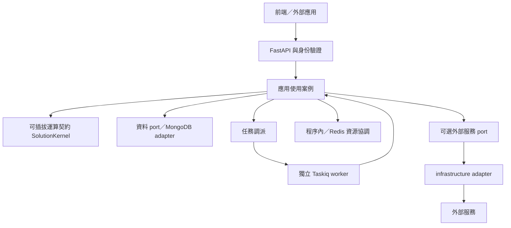

# 產品平台與部署

本版採 SVG 實體分層：`bootstrap/` 與 `src/{api,services,application,domain,plugins,infrastructure,config,utils,shared_models}`。新增應用沿各層以相同 capability 名稱協作；詳見 [模組功能規範](module-spec.md)。

此範本由共用平台、按需求加入的應用能力，以及可替換的 solution kernel 組成。共用平台處理 runtime、身份、資料權限、任務與運算資源；應用模型、政策、流程及外部整合由新增能力明確定義。`create_app()` 採用 Application Factory Pattern 建構 FastAPI application，詳細術語見 [術語與範圍](glossary.md)。

## 系統定位



API 與 worker 重用 application 使用案例，經 domain ports 存取外部資源。圖中的外部服務連線是可選擴充關係；新增整合時由應用定義請求／回應、授權、timeout、冪等、失敗恢復與清理契約，再於 infrastructure 實作 adapter 並由 bootstrap 注入。共通平台沒有固定的跨服務執行流程。

| 平台能力 | 初始狀態 | 擴充邊界 |
| --- | --- | --- |
| API／lifespan、日誌、錯誤、健康檢查 | 啟用 | 通用 runtime |
| Async 任務與背壓 | memory；空 registry；可明確 disabled | 模組註冊具名 handler；共享工作選 distributed |
| MongoDB async client | 本機預設關閉；Compose 啟用 | 模組 repository 依抽象 ports 接入 |
| 本地身份／JWT | 本機預設關閉；Compose 啟用 | 受控建帳、permission-based 授權 |
| Kernel 執行 | API 預設關閉；空 registry | 模組提供具版本的 kernel |
| 資料匯出 | API 預設關閉；空 registry | 模組提供受控 dataset |
| 應用模組／資料模型 | 空白 | 依應用契約明確加入 |

`src/application/hierarchy.py` 是可選且尚未實作的設定解析擴充點；範本不預設 scope、層級或合併規則，應用不需要依賴此模組。`src/plugins/inference`、`heuristics`、`interceptors` 目前均為空擴充 package；保留目錄不表示已有演算法、hook 契約或執行鏈。

## 本地使用者與 JWT

第一版採本地帳號、Argon2 密碼雜湊與 JWT Bearer。JWT 預設 900 秒，簽章 secret 不提供預設值。token 包含 session 識別，每次受保護請求讀取 MongoDB session 與 user；有效權限來自當下 user，使用者停權、權限異動與 logout 於後續請求生效。

密碼與 JWT 使用方式參考 [FastAPI 官方安全文件](https://fastapi.tiangolo.com/tutorial/security/oauth2-jwt/)；本平台另外保留 MongoDB session 及即時 permission 查詢。

| API | 輸入／回應 | 要求 |
| --- | --- | --- |
| `POST /api/v1/identity/login` | JSON：`tenant_id`、`username`、`password`；回傳 `access_token`、`token_type: bearer`、`expires_in` | 未登入可用 |
| `GET /api/v1/identity/me` | `user_id`、`tenant_id`、`username`、`permissions` | 有效 Bearer |
| `POST /api/v1/identity/logout` | 撤銷目前 session，204 | 有效 Bearer |
| `POST /api/v1/identity/register` | `username`、`password`、選用 `permissions`；201 user | `identity.users.create` |
| `GET /api/v1/identity/users?limit=100` | 同租戶 user 清單，最多 100 | `identity.users.read` |
| `PATCH /api/v1/identity/users/{user_id}` | `active`／`permissions` | `identity.users.manage`；不可改自己 |

註冊屬管理員受控建帳，不開放公開 signup。tenant 由管理員 principal 決定，註冊 body 不接受 tenant。管理員不能授予自己沒有的 permission。密碼長度 12–128，username 為 3–64 字元 ASCII 名稱，大小寫正規化；回應不包含密碼或雜湊。

建立第一個管理員使用受控 CLI，沒有 seed 帳密：

```bash
python manage.py create-admin --tenant-id TENANT --username USERNAME
```

命令互動讀取並確認密碼；自動化環境可用 `--password-stdin` 從受控 stdin 讀取一行。不要將密碼放在 shell history 或 `--password` 參數，該參數不存在。

第一版的 permission 集合提供最小存取基礎，尚未實作完整角色階層、ABAC、refresh token、SSO、MFA、密碼重設或跨租戶管理。token 到期後重新登入。

重新授權發生在每次新請求及背景 kernel 工作開始時；已開始的串流／工作不會因登出自動終止。停權期間拒絕該使用者的 session，重新啟用後尚未過期且未登出的 session 可再次使用；本版沒有一鍵撤銷該使用者全部 session 的管理 API。

新增模組自訂 permission 時，受控 CLI 可用重複的 `--permission <module_name>.<action>` 明確授予新管理員，再由該管理員分配給同租戶使用者。平台不使用隱含的萬用權限，HTTP 管理員仍不能授予自己沒有的 permission。

## 前後端整合

`frontend/auth-client.ts` 是沒有 UI 框架依賴的 TypeScript client，包含 login、me、logout、受控 register 與 user 管理。它只向同源 API 附帶 Bearer，token 留在 instance 記憶體，不寫 localStorage／sessionStorage，不自動 refresh。

```typescript
import { AuthClient } from "./auth-client";

const auth = new AuthClient("/api/v1", () => {
  // 由前端切換到登入畫面。
});

// 登入表單取得的資料：tenant_id、username、password。
const principal = await auth.login(formInput);
// 畫面可以依 principal.permissions 顯示功能；API 仍會重新授權。
await auth.logout();
```

前端與 API 以同源 reverse proxy 提供；client 不建立跨來源 CORS 政策。401 會清除記憶體 token 並通知 UI，403 表示目前權限不足。重新整理頁面後重新登入。logout 網路失敗時本地 token 仍會清除，遠端 session 可能持續有效至到期。

啟用 identity 後，application 模組的 router 預設要求有效 JWT。只有 manifest 明確設 `allow_anonymous=True` 才允許匿名存取；各 endpoint 仍需依使用案例檢查 permission 與資料範圍。此 client 是前端整合程式碼，未包含登入頁面或使用者管理 UI。

透過 `authorizedFetch()` 呼叫模組 API 或串流匯出；回應可用 `response.body` 串流讀取。大型匯出不要一律轉成記憶體 Blob。client 的 `hasSession` 只供 UI 顯示，不能代替伺服器驗證。

## 資料權限與 NoSQL

MongoDB 使用 PyMongo `AsyncMongoClient`，每個 API／任務程序一個 client／pool，由 runtime 建立與關閉。bootstrap initializer 從 runtime 資源取得連線能力，建立 infrastructure repository adapter 並注入 application；不在每個 request 建立 client，不將 Mongo collection 暴露給 HTTP 用戶。

Async client 留在建立它的 event loop，不能跨 thread／event loop 共用。這項限制見 [MongoDB 官方 PyMongo Async 文件](https://www.mongodb.com/docs/languages/python/pymongo-driver/current/reference/migration/)。

資料 repository 以已驗證 `Principal` 的 tenant 作強制隔離。需要擁有權的資料契約使用 `tenant_id`、`owner_id`；一般使用者只讀自己資料，`data.read_all` 可擴大為同租戶資料，不能移除 tenant 限制。`tenant_id` 是身份與資料隔離範圍，不自動代表應用實體；新增能力需自行定義應用識別及其授權映射。模組依資料契約建立索引、schema 版本與授權測試。

這個通用過濾機制不是 MongoDB 自動 row-level security。自訂 repository 若跳過平台 policy 仍可能違反隔離，新增 adapter 必須驗證跨租戶、跨擁有者與停權情況。框架不預設應用 collection、資料 schema、seed 或 migration。

## 受控資料匯出

匯出資料源由模組 `ModuleExports.datasets` 明確註冊，框架加上 `<module_name>.<source_name>` namespace。API 需要 identity，來源清單與下載需 `data.read`、`data.export`，並套用欄位 permission。

| API | 用途 |
| --- | --- |
| `GET /api/v1/exports/sources` | 列出目前可見的具名來源與允許欄位 |
| `GET /api/v1/exports/{source_name}?format=csv&limit=1000` | 受限 CSV 串流 |
| `GET /api/v1/exports/{source_name}?format=jsonl&limit=1000` | 受限 JSONL 串流 |

匯出只接受註冊來源、格式及筆數，不接受任意 collection、MongoDB query 或任意欄位。Mongo 來源強制 tenant／owner 過濾，欄位使用白名單；CSV 對可能被試算表當作公式的字串加以處理。來源預設空白，啟用開關不會產生任何預設資料集。

`limit` 範圍為 1–10,000，預設 1,000。adapter 必須把 ObjectId、日期等轉為契約允許的 JSON 值；服務會拒絕不相容值。下載採串流，開始後的資料源錯誤會中斷傳輸，客戶端應視未完成檔案為無效並重新下載。

## Solution kernel 與資源

`SolutionKernel` 是通用可插拔運算契約，以具名、具版本介面提供輸入與輸出。執行 context 帶入有效 principal、request ID 與資源 fencing token；模組可實作不同運算策略。平台不內建解法或任意模型載入入口。

同一個 kernel namespace 在目前部署固定一個版本，client 必須明確指定版本；實際輸入 schema 與演算法由註冊 kernel 定義。

| API | 權限／契約 |
| --- | --- |
| `GET /api/v1/kernels` | `kernel.read`，列出具名 kernel 與版本 |
| `POST /api/v1/kernels/{name}/execute` | `kernel.execute`；body 為 `{"version":"<version>","input":{}}`，有界 HTTP 執行 |
| `POST /api/v1/kernels/{name}/runs` | 同一 body／權限，202 回傳背景 job |
| `GET /api/v1/jobs/{job_id}` | `jobs.read`；tenant／owner 必須相符，`jobs.read_all` 可讀同租戶他人 job |

kernel API 需要 identity，啟用後自動開放受保護的 job 查詢。長工作使用 runs 進入 Taskiq，任務保存 tenant／owner metadata；worker 重新讀取目前的使用者與權限，不將 JWT 放入訊息。worker 的共通處理只解碼任務 envelope 並查找已註冊 handler；新增 handler 須定義自身 payload schema 與語意驗證，再委派使用案例。不要把 HTTP 連線長度當作工作保存機制。

資源容量由 `APP_RESOURCE_LIMITS` 統一控制，thread pool 另有程序內執行／等待上限：

| 設定 | 用途 |
| --- | --- |
| `APP_THREAD_WORKERS`／`APP_THREAD_QUEUE_SIZE` | 每程序阻塞工作執行數／等待容量 |
| `APP_KERNEL_TIMEOUT_SECONDS` | kernel 容量等候＋執行的 cooperative timeout |
| `APP_RESOURCE_BACKEND` | `memory` 或 `redis` |
| `APP_RESOURCE_LIMITS` | JSON 物件，資源名稱對應允許容量 |
| `APP_RESOURCE_LEASE_SECONDS` | Redis lease 期限，執行時由 heartbeat 續期 |

development／test 單程序可用 memory。production 無背景工作可用 disabled，開啟 kernel API 時仍須 Redis 容量協調；disabled 僅掛同步 kernel 入口，無 /runs 或 job 查詢。多個 API worker 且開啟 kernel API 時必須用 Redis；直接啟動 Uvicorn 仍需自行確保設定與實際程序數一致。API 與 worker 共享資源時需使用相同 Redis namespace 與容量。

失去 lease 會回報失效、取消可協作的 async 工作並等待清理；Python 無法強制終止已執行 thread，遠端請求也可能已產生副作用。外部 adapter 需驗證 fencing token，避免舊持有者繼續操作受保護資源。需強隔離的 CPU／GPU 工作使用專用 process／remote kernel，避免每個 API worker 載入一份大型模型。

kernel timeout 自取得容量 lease 前起算，涵蓋等候與執行；job timeout 只涵蓋 handler，不包含排隊與終態保存。timeout 為協作式限制。bounded thread runner 在取消後仍等待實際函式結束，避免工作尚在執行就釋放資源；阻塞 SDK 必須設定自己的連線／讀取 timeout。無法取消的函式可能讓回應或 shutdown 超過設定時間，這類工作應移到可終止的獨立程序。

## Compose 部署流程

先複製 `.env.example`，使用兩個獨立的 `openssl rand -hex 32` 結果設定 JWT secret 與 MongoDB 密碼，再執行：

```bash
docker compose up --build -d
docker compose exec api python manage.py create-admin \
  --tenant-id TENANT --username USERNAME
```

Compose 包含 API、Taskiq worker、RabbitMQ、Redis、MongoDB 8，所有對外服務埠綁定本機。MongoDB 啟用帳密與 named volume；API／worker 透過容器網路連線，共用同一身份資料與 session。

預設 1 個 API 程序、2 個任務 worker。調整程序數與選用 API：

```bash
APP_WORKERS=4 APP_KERNEL_API_ENABLED=true APP_EXPORTS_API_ENABLED=true \
  docker compose up -d --build api worker
```

這只啟用平台入口，kernel／資料源仍須由模組註冊。Compose 固定使用 Redis 資源協調，並明確把 Taskiq worker 數及 async 並行傳給 CLI。

`.env` 中的 `APP_MONGO_URI` 供本機執行；Compose 會覆寫為內部主機名。若要在 host 執行 `manage.py` 或 API，請明確啟用 Mongo／identity 並設定含帳密的本機 URI 與相同 JWT secret。

MongoDB 初始化密碼只在空 volume 建立時套用。修改 `.env` 不會自動修改既有資料庫帳密，需以資料庫管理程序輪替。`docker compose down` 保留 named volume；刪除 volume 會移除身份與資料。

Compose 的 MongoDB root 帳號與單節點部署用於本地整合；正式環境以受限資料庫帳號、秘密管理、TLS、備份及還原程序取代。應用不內建帳密，JWT secret 輪替策略與對既有 session 的影響需納入部署流程。

## 產品化接入順序

1. 依 [模組規範](module-spec.md) 建立應用契約與公開 facade。
2. 選擇資料 schema、permission、tenant／owner 政策與 repository。
3. 定義 versioned kernel／資料源，決定 HTTP、背景工作、thread 或獨立 process 邊界。
4. 需要外部整合時，明確定義 port、請求／回應、授權、冪等與故障恢復，再實作 adapter。
5. 完成資料隔離、授權、冪等、lease 失效、startup 回滾及部署整合驗證。

這些步驟只在需求出現時加入具體模組；通用範本維持空白的應用註冊清單、kernel 與資料來源，具體規則留在各應用能力中。

完整的責任分層、API／worker、失敗與驗證對照見 [軟體架構設計規格](software-design.md)。原稿採納與限制見 [架構比對](design-review.md)。
