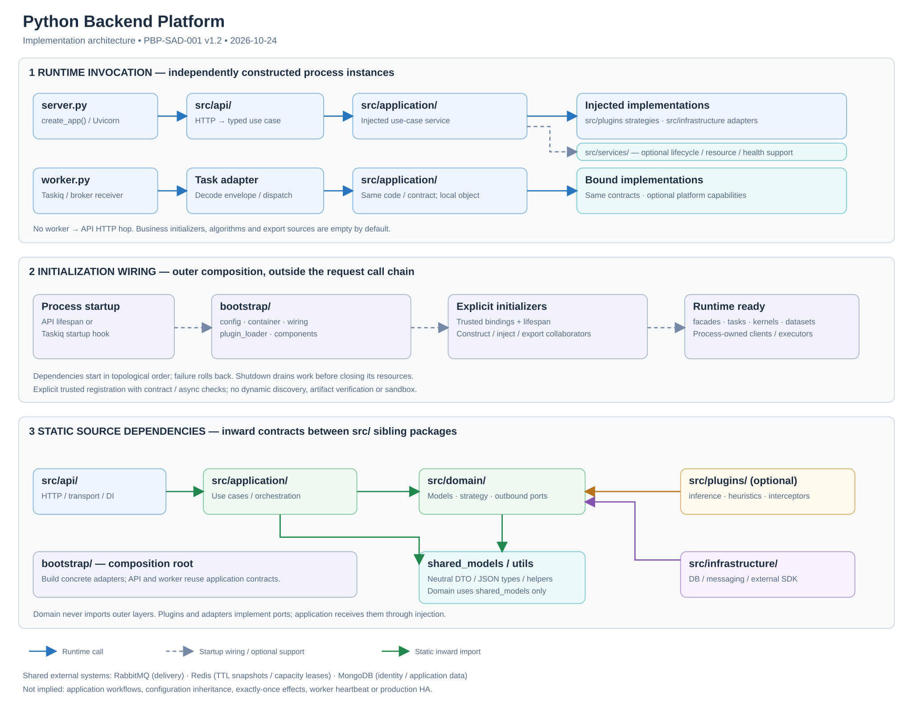
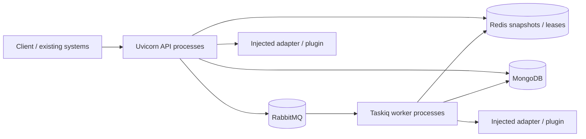
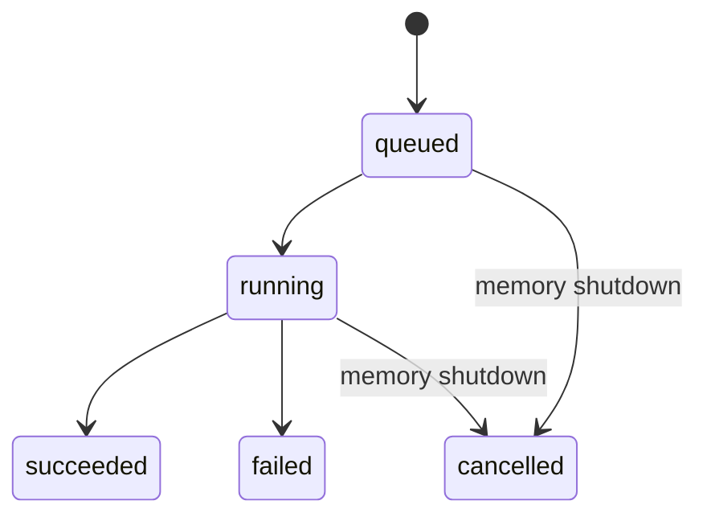

# Python Backend Platform 軟體架構設計規格

| 文件控制 | 內容 |
| --- | --- |
| 文件編號／版本 | PBP-SAD-001／1.1 |
| 基線日期／驗證更新 | 2026-10-23／2026-10-24 |
| 狀態 | 工程交付基線；組織架構、安全與生產驗收仍待指定責任人審查 |
| 適用對象 | 系統架構、Backend、Solution／Data Science、Platform／IT、測試與維運團隊 |
| 適用程式 | 本專案 `server.py`、`worker.py`、`manage.py`、`src/`、`bootstrap/` 與部署／測試設定 |
| 參考資料 | 使用者提供的 [SVG 與設計原稿](references/README.md)，採納紀錄見 [design-review.md](design-review.md) |
| 配套規範 | [模組規範](module-spec.md)、[產品與部署](product-platform.md)、[ADRs](adr/README.md)、[驗證紀錄](validation.md) |

此文件描述**目前可核對的實作及明確標示的擴充契約**，不是已完成廠內生產認證的聲明。程式與測試是行為證據；規格不一致時必須修訂程式或文件並重新驗證，不能只改圖。版本號是文件版本，獨立於 Python package 的 `0.1.0`。

## 1. 目的、範圍與品質目標

本版依使用者指定 SVG 重構實體 package 與功能責任，保留既有 HTTP／任務行為；舊 Python import 路徑為有意的破壞性變更，見 [搬移對照](package-migration.md)。

本平台作為廠內自動化生產系統的上層協調、決策與資料服務基礎，讓各工廠應用沿用共用 runtime、安全與技術能力。設備控制層負責實際動作、硬即時控制與安全連鎖；本平台不提供此類保證。

共用能力包含 FastAPI API、程序 lifespan、async 任務調派、有界執行緒、跨程序資源容量協調、本地使用者與 JWT/session、MongoDB 連線、受控匯出、AI/ML/rule solution kernel 契約。正式業務註冊清單與 plugins 預設空白；無製程、設備、PdM 模型、資料集、業務流程或演算法。

| 品質目標 | 實作手段 | 可接受證據與界線 |
| --- | --- | --- |
| 可擴充 | SVG 的分層 packages、Protocol、明確 initializer 與公開 use-case facade | 新應用不修改通用 executor；需契約與 lifecycle 測試 |
| 可維護 | domain/application/api/infrastructure/plugins 責任分離 | AST import 檢查、型別檢查與 code review；不宣稱自動證明全部 SOLID |
| 可靠執行 | 背壓、timeout、取消、成對 cleanup、shared job state | 單元／adapter／失敗路徑測試；正式 broker、負載與故障演練另驗收 |
| 權限隔離 | authenticated Principal、permissions、tenant/owner repository policy | 平台政策有測試；每個自訂 adapter 仍需驗證隔離 |
| 可部署 | 同一程式映像、API/worker 分離、外部服務與設定 | Compose/CI 定義已有；不等同 HA、DR 或 production capacity 已驗證 |
| 跨團隊合作 | DS 策略、SE adapters、共同 domain contract | 契約版本與行為共同審查，實際人員及簽核由組織指定 |

## 2. 架構視圖與責任



本圖分開顯示執行呼叫、啟動組裝與靜態依賴。執行期呼叫注入的 adapter/plugin，不代表 application 的 import 可以依賴其具體類別。

| 範圍 | 責任 | 主要程式 |
| --- | --- | --- |
| Entrypoints | API lifespan、worker runtime、管理命令 | `server.py`、`worker.py`、`manage.py` |
| Bootstrap | 設定入口、容器與服務建構、可信插件驗證、跨層注入 | `bootstrap/config.py`、`container.py`、`plugin_loader.py`、`wiring.py`；其他明確 bootstrap initializer |
| API | HTTP schema、router、JWT 邊界、DI、錯誤映射 | `src/api/` |
| Services | 技術 lifecycle、資源池、健康、日誌、有界執行緒 | `src/services/` |
| Application | 共用使用案例、任務 registry、背景協調 | `src/application/` |
| Domain | 模型、純政策、策略與 outbound ports | `src/domain/` |
| Plugins | 可選 AI/ML/rule/hook 策略，預設無實作 | `src/plugins/{inference,heuristics,interceptors}/` |
| Infrastructure | persistence/messaging/locking/downstream/security adapters | `src/infrastructure/` |
| Support | runtime 設定、純 helpers、中性 JSON/DTO/protocol | `src/config/`、`src/utils/`、`src/shared_models/` |
| Frontend | 同源記憶體 Bearer client，無 UI | `frontend/auth-client.ts` |

本版採用使用者 SVG 的實體分層，取代 1.0 的 feature module 目錄。`src` 是本專案實際可匯入的 Python package（例如 `src.domain.strategy`），不是將多個頂層套件藏於 source-root 的另一種 src-layout。`bootstrap` 是外緣 composition root；技術 services 與 application 是同層不同責任，不構成固定呼叫鏈。

### 2.1 實體 package 與 module 功能

```text
server.py / worker.py / manage.py
bootstrap/
  config.py              # load_settings
  container.py           # Runtime 與通用服務建構
  plugin_loader.py       # 明確選入、契約與 metadata/async 驗證
  wiring.py              # 功能 initializer 清單、選擇 dispatcher
  components.py          # Module* 初始化契約與依賴拓撲
  identity.py / worker.py
src/
  api/                   # routers, schemas, dependencies, auth, exceptions
  services/              # lifecycle, resource_manager, health, observability, concurrency
  application/           # use_cases, registry, hierarchy, orchestration；能力子 package
  domain/                # models, ports, strategy；能力子 package
  plugins/               # inference, heuristics, interceptors
  infrastructure/        # persistence, messaging, locking, downstream, security
  config/                # settings, environment, constants
  utils/                 # formatting, time_helpers, validation
  shared_models/         # dto, schemas, types
```

新增能力應在相關層下使用相同 capability 名稱協作，如 `src/domain/<name>/`、`src/application/<name>/`、`src/api/<name>/`。演算法放 plugins，外部整合放 infrastructure；bootstrap 建立物件及注入。`ModuleDefinition` 等名稱保留為 Python 初始化契約，不再代表舊 `backend/modules/<name>/` package。詳細功能規範與可複製骨架見 [module-spec.md](module-spec.md)。

`application/use_cases.py` 是四個既有 Service 與 KernelJobHandler 的公開入口；registry 是 task lookup，orchestration 持有背景 kernel 協調；hierarchy 目前只是明確擴充位置，沒有預設工廠階層或合併政策。domain/models.py、ports.py 公開既有穩定契約，strategy.py 實際定義 SolutionKernel。其餘能力子 package 用於避免單一 models/service 檔過大，不改變頂層責任。

### 2.2 依賴政策

| 匯入者 | 允許的內部依賴 | 主要禁止 |
| --- | --- | --- |
| domain | domain、shared_models | 所有外層、framework／SDK |
| application | application、domain、utils、shared_models | api/services/plugins/infrastructure/bootstrap/config、framework／SDK |
| plugins | plugins、domain、utils、shared_models、審查過的科學套件 | application/api/services/infrastructure/bootstrap/config、已知 HTTP/DB/runtime 套件 |
| infrastructure | infrastructure、domain、config、utils、shared_models、整合 SDK | api/application/plugins/services/bootstrap |
| services | services、domain、infrastructure、config、utils、shared_models | application/api/plugins/bootstrap；不得選擇業務策略 |
| api | api、application、domain、services、utils、shared_models | 具體 infrastructure/plugins；只有 api/dependencies.py 可引用 bootstrap/container.py 的 DI 容器型別 |
| config | config、shared_models、設定套件 | domain 及其他行為層 |
| utils/shared_models | checker 指定的中性支援依賴、stdlib | 業務 domain 與外層、framework／SDK |
| bootstrap/entrypoints | 組裝所需各層 | 舊 backend package、嵌入業務演算法 |

新增 source 只能放已指定的頂層 package。checker 掃描 src、bootstrap 與三個進入點，拒絕舊 backend imports，涵蓋相對/絕對、函式與 TYPE_CHECKING 內 import。插件拒絕表與確切矩陣以 `scripts/check_boundaries.py` 為準；不驗證 dynamic import、re-export 內容、第三方轉依賴、執行期間 I/O 或全部 SOLID 語意。完整規則見 [模組規範](module-spec.md)。

## 3. 組裝、Scope 與 Lifespan

### 3.1 建構與啟動

`server.py::create_app(settings=None, *, modules=None)` 建立路由與 lifespan 定義，不建立網路連線或啟動背景工作。`worker.py` 提供 Taskiq broker 定義，連線 I/O 在 worker startup hook。各程序的生命週期如下：

| 階段 | API | Worker |
| --- | --- | --- |
| 驗證 | Settings、manifest 名稱／依賴、路由與身份設定 | Settings、相同正式 manifest 清單 |
| 共用資源 | HTTP client、有界 thread executor、選用 Mongo、capacity coordinator | store、HTTP client、相同共用資源 |
| 模組 | 依 `requires` 建立 facade、task handler、kernel、dataset | 相同契約，`role="worker"` 可選不同資源實作 |
| 平台綁定 | KernelService、ExportService、可選 generic kernel handler | 相同使用案例程式及抽象，程序內獨立物件 |
| 就緒 | dispatcher 啟動，Runtime 置入 app.state，lifespan yield | dispatcher／broker startup 完成後接收工作 |

`AsyncExitStack` 先登記 cleanup，再執行可能失敗的資源啟動；後續失敗反序回滾。模組內多資源也必須自行使用成對 context manager。模型載入、檔案開啟與第三方 client 應由所屬 bootstrap initializer lifespan 管理。

模組收到的 `ModuleContext.resources`、`dependencies` 與 `jobs` 只供組裝；不得把整個 Runtime/context 傳入使用案例當 service locator。由 bootstrap initializer 取出必要依賴，再以窄 Protocol 注入。初始化期間不可提交任務，完整 runtime 尚未就緒。

### 3.2 資源所有權

| Scope | 所有權與界線 |
| --- | --- |
| Process | event loop、HTTP/Mongo pools、thread pool、module facade、模型實例、memory queue/semaphore；不跨 worker 共享 |
| Request | 已驗證 Principal、request ID、HTTP 輸入／輸出；不得當成持久 session 或冪等鍵 |
| Job | payload、執行 context、lease、局部暫存；handler 負責 finally cleanup |
| Shared external | RabbitMQ queue、Redis job snapshots／leases、Mongo users/sessions/應用資料；由 adapter 存取 |

每個 API/Taskiq 程序各自執行 lifespan。migration、全域排程與一次性管理不得假設只執行一次；需獨立命令或另訂 leader/lease 契約。

### 3.3 關閉

API 由 ASGI/Uvicorn 控制停止接收與 HTTP in-flight；runtime 清除 app.state 後，依序關閉 dispatcher、kernel 執行、排空實體 thread、反序關閉模組、最後共用資源與 HTTP client。Worker 的 receiver 停止與等待由 Taskiq CLI 管理，再執行其 stack cleanup。啟動失敗同樣回滾。

`APP_SHUTDOWN_TIMEOUT_SECONDS` 管理 memory dispatcher 等待；Compose 也將它明確傳入 Taskiq 的 `--wait-tasks-timeout`。手動 Taskiq 啟動須自行帶入該 CLI 參數，環境變數不會自動設定其 receiver 等待。這些設定**不是所有程序活動都能強制終止的全域期限**。thread 已開始的函式必須等實際結束；SDK 自身需設定 timeout。Compose 的 30 秒 grace 是開發設定，生產需按最長可取消工作與部署策略調整。[FastAPI lifespan](https://fastapi.tiangolo.com/advanced/events/)

## 4. 執行、並行與部署



每個 API process 有自己的主 event loop 與 lifespan；多程序的父程序不持有一個供所有 worker 共用的 application lifespan。[FastAPI workers](https://fastapi.tiangolo.com/deployment/server-workers/)

| 執行機制 | 適用範圍 | 重要約束 |
| --- | --- | --- |
| async | 可等待的 HTTP/DB/broker 與協調 | async 函式內直接 CPU 迴圈仍阻塞 event loop |
| BoundedThreadExecutor | 阻塞 I/O SDK／同步函式 | workers＋queue 有入場上限，保留 contextvars；取消不等於殺死實體 thread |
| Uvicorn workers | 多個 API 程序利用 CPU 核心 | 不共享 Python 物件；連線池與模型記憶體按程序倍增 |
| Taskiq workers | 背景 async 任務，各程序有限並行 | handler 直接呼叫 application，不經 API HTTP；純 Python CPU 工作需明確委派隔離執行 |
| Process／remote kernel | CPU/GPU、強制終止或記憶體隔離需求 | 現有契約可接入；平台未內建通用 process pool、GPU scheduler 或模型服務 |

生產設定要求 distributed 任務。memory 僅單 API 程序，重啟可遺失工作。建議從 `python server.py --workers N` 啟動，由 CLI 將驗證過的覆寫傳給 child；直接使用 Uvicorn CLI 時需自行維持 `APP_WORKERS`、distributed 等設定一致，factory 不能可靠檢查外部 CLI worker 數。reload 與多 worker 互斥。

容量估算至少涵蓋 API/worker 程序總數 × Mongo pool（預設每程序 20）、thread 數、Taskiq async concurrency、HTTP pool、模型常駐記憶體、BLAS/native thread 與 GPU 配額。不能將預設值當成核准產能。大型模型宜由專用 worker/remote adapter 持有，API 可注入輕量 proxy 或 descriptor；尚無現成 remote model server。

## 5. API 與輸入邊界

預設只有健康端點及 FastAPI 文件；下表列出明確啟用後的能力。OpenAPI 路徑以啟動後實際 schema 為準。

| 介面 | 啟用／授權 | 行為 |
| --- | --- | --- |
| `GET /health/live`、`/health/ready` | 一律提供 | process responsiveness／本程序依賴 readiness |
| `POST /api/v1/identity/login` | identity | JSON tenant_id/username/password，成功回 access_token/expires_in |
| `GET /identity/me`、`POST /identity/logout`（同一 `/api/v1` 前綴） | 有效 Bearer/session | 目前身份／撤銷本 session（204） |
| `POST /identity/register`、`GET /identity/users`、`PATCH /identity/users/{id}` | 相應 identity permission | 受控同租戶管理，無匿名 signup |
| `GET /api/v1/jobs/{job_id}` | expose_job_api 或 kernel API | identity 啟用時 jobs.read，限定 tenant/owner；read_all 只放寬同租戶 owner |
| `GET /api/v1/kernels` | kernel API＋identity、kernel.read | 已註冊 kernel metadata |
| `POST /kernels/{name}/execute`（`/api/v1` 前綴） | kernel.execute | 明確 version＋input，等待完成 |
| `POST /kernels/{name}/runs`（同前綴） | kernel.execute | 驗證後提交 owned job，202＋Location；後續 job 查詢另需 jobs.read |
| `GET /api/v1/exports/sources`、`/exports/{name}` | exports API＋identity、data.read/export | 註冊來源、CSV/JSONL、limit 1..10000 |
| `/api/v1/<module_name>/...` | manifest router | identity 啟用時預設 JWT；匿名須 manifest 明確選入，使用案例仍需 permission |

目前無任意 task name 提交 API；應用自行提供具型別的業務入口。router 只做 transport validation、取得已注入 service、呼叫 application 與映射 HTTP。Domain 不拋 FastAPI HTTPException。已處理的錯誤由共用 handler 包裝為 `{"error":{"code":"...","message":"..."},"request_id":"..."}` 並提供 X-Request-ID，不向客戶端洩漏原始 SDK 例外或秘密；串流 headers 送出後的失敗無法再改寫成此 JSON 回應。

| HTTP status | 代表情況 |
| --- | --- |
| 400 | identity 語意輸入錯誤、未知內部 task 名稱 |
| 401／403 | 無效 credential/session／缺少 permission |
| 404 | 不存在或不可見的 user/job/kernel/source |
| 409 | 使用者已存在 |
| 413 | 匯出準備階段發現單列過大；中途才發現則中斷串流 |
| 422 | HTTP schema 驗證、無效 kernel JSON 輸入或 export 參數 |
| 500 | 一般 kernel 執行失敗或未預期錯誤 |
| 503 | thread/queue/resource 忙碌、lease 失效或依賴不可用 |
| 504 | kernel cooperative 執行期限超時 |


## 6. 身份、資料與信任邊界

使用者包含 user_id、tenant_id、username、active、permissions 與 Argon2 雜湊；session 保存 user/tenant/JTI/期限/撤銷狀態。JWT 固定 HS256，驗證 issuer、audience、必要 claims 與有效時間；secret 至少 32 bytes，無預設 key。Access token 預設 900 秒，範圍 60..3600 秒。登入有共享 Mongo 原子限制（5 次／5 分鐘視窗）與未知帳號 dummy hash；這不等於完整周界 DoS 防禦。

首位管理員用 `manage.py create-admin` 建立；密碼用互動或 stdin，不放 CLI。管理員只能建立同 tenant 使用者，不能授予自己沒有的 permission，不能透過管理 API 修改自己的 active/permissions。operator CLI 的額外權限授予屬部署管理權責。沒有預設應用帳號。

每次受保護請求重新查 Mongo session/user，使用目前 active/permissions；登出撤銷當前 session。停權後重新啟用時，未過期且未撤銷的舊 session 可再使用。權限是請求／背景執行開始時的快照，不會持續中止已在執行中的工作。背景 kernel 不帶可重用 JWT，執行前以 tenant/user 重新授權。

`tenant_id` 是授權邊界，**不自動等同工廠、Fab、Tool 或設定階層**。資料隔離必須在 repository 強制 tenant，必要時 owner；HTTP 傳入 tenant/filter 不可信。自訂模組查詢需自己的 policy 與契約測試。

前端 client 只向同源請求附 Bearer，token 留在記憶體，401 時清除；沒有完整 UI、refresh token、SSO、MFA、密碼復原、角色繼承或 ABAC。HTTPS、CORS/CSP、API gateway、secret rotation 與網路隔離由部署設計明訂。JWT/session 設計有狀態，Mongo 不可用時受保護操作不能保證可用。

可信 Python 插件不具 sandbox；不得按 HTTP 輸入 import 模組或載入 pickle。`artifact_digest` 只為宣告 metadata；要使用模型工件，產品應補 digest/簽章核對、可信儲存、存取政策及 provenance。現行 kernel registry 為部署共用，只有全域 kernel.read/execute，沒有逐 tenant/kernel entitlement。

## 7. 任務調派與失敗契約

`JobService` 驗證已註冊 handler，產生 job_id 並透過 `JobDispatcher` 提交。`TaskResolver` 只定義查找 handler，adapter 不依具體 application registry。TaskRequest 含 name/payload/時間與可選 tenant/owner（兩者須成對）；payload/result 必須 JSON object，不能帶 session、client、datetime、exception 或秘密。

### 7.1 本機與分散式

| 項目 | Memory | Distributed |
| --- | --- | --- |
| 適用 | 開發、單程序 | 多 API／worker 共享工作 |
| 容量 | 固定 queue＋並行數，snapshot TTL/最大紀錄數 | RabbitMQ quorum durable queue、persistent publish、consumer QoS；broker 儲存容量另管 |
| 狀態 | 程序內 snapshot，重啟遺失 | Redis JSON snapshot＋TTL，非永久業務歷史 |
| Shutdown | 先等待 queue，超時取消 coroutine | receiver/Taskiq 等待；取消不 ack，channel 關閉後可重送 |

`APP_TASK_QUEUE_SIZE`／`APP_JOB_MAX_RECORDS` 是 memory 機制，並非 distributed broker 的全域 queue 長度限制。需要 broker quota、超載拒絕與 DLQ 運作政策時另訂部署規格。

Memory 的 snapshot TTL 自終態 finished_at 起算，於提交、查詢或完成時清除過期項目；max_records 滿時可提前淘汰最舊終態，若全為 queued/running 則回 QueueFull。Redis 每次 save 重設 TTL，queued/running 也可能到期；長任務不會週期性續 snapshot TTL。兩種後端的保留語意不同，job retention 需大於實際排隊及執行窗口，仍不得用作永久結果。

### 7.2 狀態與確認



job timeout 從呼叫 handler 開始，不包含 broker 等待、結果保存與 ack；取消是 cooperative，序列化、阻塞程式與 cleanup 可能超出期限。worker 取件後先保存 running，呼叫 handler；正常結果 succeeded，普通例外或 timeout 記 failed（遮蔽敏感錯誤內容）。結果終態成功保存後才 ack。Redis 暫時不可用時保留未 ack delivery 並等待恢復；這會占用有限 worker 容量。普通業務失敗不自動 retry/backoff。分散式 shutdown 取消不保存 cancelled 終態，以容許重送；快照可能暫留 running，TTL 到期也可能查無資料。

已存在終態時重送可略過 handler，作用只涵蓋快照存續期。副作用完成但尚未保存終態時 crash，仍可能重複執行；同 job 的並發重複 delivery 也無原子執行鎖保證。正式 handler 必須依需求用持久冪等鍵、唯一約束或外部 fencing 防止重複副作用。

提交先寫 queued，再 publish RabbitMQ，二者非同一交易。publisher confirm timeout 可能已接收；平台回報含 job_id 的不確定提交錯誤，不能無條件重新提交新 job。需持久 reconciliation/outbox 的應用必須另訂，不能把 snapshot 當成已完成 outbox。[RabbitMQ confirms 與 consumer acknowledgements](https://www.rabbitmq.com/docs/confirms)

## 8. Kernel、插件與共享容量

`SolutionKernel` 是版本化、與場景無關的 `spec + async execute(payload, context)` Protocol。KernelSpec 包含 version、kind（ai/ml/rule/custom）、resource_group、可選 artifact_digest。initializer 以本地名稱輸出，runtime 加上 `<module>.<name>`；目前同 namespace 一個版本，不做模型發現、熱切換或訓練。`bootstrap/plugin_loader.py` 以明確 PluginBinding 驗證 `solution-kernel/v1`、namespace、KernelSpec、版本、kind 與 async execute；拒絕同步 execute，避免在 event loop 先阻塞才報錯。它不做動態發現、套件簽章或模型工件驗證。

KernelService 驗證權限、註冊版本、resource group 與 JSON 輸入，取得 lease 後呼叫 kernel，檢查輸出為 JSON object；輸入／輸出各有預設 1 MiB 編碼上限。HTTP 輸入大小仍應在 gateway 設限，service 檢查不是串流 body admission limit。kernel 必須自行驗證其版本化資料 schema、單位、時間與語意。

kernel timeout 從等待 capacity lease 前開始計算，涵蓋等待與執行；清理與無法中止的 thread 可能超過該期限。背景 job 另有外層 job timeout，應按使用案例配置兩者與 adapter 的 deadline。執行 context 提供 Principal、request_id 與 fencing_token。同步呼叫與背景 handler 都使用相同 KernelService 程式；背景執行先重新查目前 Principal。模型初始化與釋放在 bootstrap initializer lifespan，application 透過 domain 策略決定使用方式，不直接 import 具體模型。

### 8.1 容量 lease

Memory 使用程序內限制；Redis 以 queue namespace＋resource group 建立容量鍵，使用 Lua 原子取得、Redis time、唯一 owner、TTL、heartbeat 與 fencing counter，釋放只刪本 owner。參與同一共享資源的程序必須使用相同 Redis、queue namespace、group 與容量設定；平台尚未自動偵測不同程序的容量配置不一致。

lease 失效會取消 cooperative async 執行並回錯；thread/remote 副作用可能繼續。fencing token 必須由受保護 adapter/外部系統驗證，不能只記在 log。Redis failover、資料遺失與 counter 回退的安全性未由本平台保證；此實作不是 Redlock，也不是設備業務互斥協定。[Redis distributed lock 的故障模型說明](https://redis.io/docs/latest/develop/clients/patterns/distributed-locks/)

### 8.2 未來應用的契約

若採用原稿的階層設定與 pipeline，應在具體 module 明訂 configuration version/merge/conflict、領域策略、可選 interceptor 的順序與不變性、資料取得 provenance、repo/lock/publisher 的 timeout/error/idempotency、部分成功的補償與發送結果。框架不提前指定 Lock→Fetch→Evaluate→Publish 為所有產品流程。

## 9. 儲存與資料匯出

MongoResource 每程序建立一個 async PyMongo client，預設 pool 20；連線選擇 5 秒、socket 10 秒，startup ping，失敗清理並遮蔽連線秘密。不得在每請求建 client，也不得跨 event loop/thread 重用 async client。平台啟用 identity 時建立帳號、session、登入嘗試相關 indexes；應用資料模型與 migration 自行管理。

ExportSource 以 columns 白名單及 async rows(Principal, limit) 提供資料。ExportService 檢查 data.read/export、欄位 permission、敏感欄位、單列大小、深度、列數、JSON 相容與 CSV 公式字串，串流輸出 CSV/JSONL，下載標頭 no-store。HTTP 只能選註冊來源、format、limit，不能選任意 collection/query/欄位。

MongoExportSource 查詢固定 tenant；沒有 data.read_all 時固定 owner。自訂來源必須實現相同隔離，Protocol 不能證明實際 query 安全。Mongo 特有型別由 adapter 轉成 JSON 相容值。串流先取一列使初始來源錯誤能在 response headers 前回報；中途失敗則中斷，客戶端應丟棄不完整檔案。沒有持久 export job/artifact 下載服務，也不保證長串流中的一致快照或即時撤權。

## 10. 設定、健康與可觀測性

設定使用 APP_ 環境變數與 .env，環境變數優先；CLI 覆寫 host/port/workers/reload。SecretStr 與錯誤遮蔽降低洩漏，不能取代外部 secret 管理。選用能力的啟用矩陣與完整參數見 [.env.example](../.env.example) 及 [產品平台說明](product-platform.md)。

| 部署模式 | 基線 |
| --- | --- |
| 空白本機 | development、memory、1 API，Mongo/identity/kernel/export/job API 關閉 |
| Compose 開發 | distributed、RabbitMQ/Redis/Mongo、identity、Redis resource coordinator；kernel/export API 仍需明確打開 |
| 生產 | distributed；identity 啟用時須 Mongo＋有效 key；受保護 application/job API 必須有 identity；kernel/export API 需 identity |

readiness 在 3 秒內檢查本程序 dispatcher 與已啟用 Mongo/coordinator；失敗 503。liveness 僅表示 HTTP process 可回應。沒有獨立 worker readiness/heartbeat，不能從 API ready 推論有 worker 消費、模型可用或下游可完成工作。

JSON logger 管理 `src` 與 `bootstrap` 兩個 application roots；JSON log 包含時間、level、logger、request ID、process ID；HTTP middleware 驗證/產生 X-Request-ID，kernel 記錄版本、actor/tenant、結果與時間，不寫 model input/output。沒有 metrics/tracing exporters、不可變 audit ledger 或所有通用 task 的自動 correlation context。需要完整端到端追蹤時，另訂版本化 job context 與敏感資料規範。

## 11. 部署與維運基線

開發啟動、admin 建立、多程序命令與 API 範例見 [README](../README.md) 及 [product-platform.md](product-platform.md)。Dockerfile 與 Compose 為可審查的部署定義；現有 Compose 使用單實例基礎服務、開發 RabbitMQ credentials、Mongo root 帳號與 Redis 開發網路設定，不是生產安全／HA 拓撲。

| 狀況 | 目前行為 | 維運處置與產品責任 |
| --- | --- | --- |
| API 不 ready | 503，外部服務故障依 adapter 回報 | 查 JSON log、DB/broker/Redis；不可只反覆重啟掩蓋依賴故障 |
| Redis 中斷 | 無法更新/查詢 snapshot，worker 可保留未 ack 工作；lease 可能失效 | 修復 Redis、觀察 backlog與重送；關鍵副作用需冪等/對帳 |
| broker 提交不確定 | queued snapshot 可能存在，回錯含 job_id | 保留 job_id，依應用確認狀態；無通用自動重提政策 |
| worker crash | 未 ack 工作可重送，可能重做副作用 | 依 job/domain 結果與冪等紀錄對帳；不能只以 snapshot 判定唯一執行 |
| Mongo 中斷 | 身份/資料服務不可用；不降級繞過認證 | 恢復受控 DB 連線與備份；migration/資料修復由 owner 管理 |
| 長工作無法停止 | thread SDK 或 remote operation 可能持續 | SDK timeout；需硬截止時改獨立 process/remote 協定 |

交付物回滾需使用已驗證的相容映像與設定、保留資料 volumes，先停止新提交並處理 in-flight。沒有通用 DB downgrade 或自動 queue schema migration；產品變更前必須定義新舊 payload/契約並存與資料遷移策略。備份恢復、HA、憑證輪替、SLO、RPO/RTO、容量與告警閾值由廠內部署驗收決定。

## 12. 實作與驗證可追溯性

| 需求／原稿原則 | 實作依據 | 驗證依據／狀態 |
| --- | --- | --- |
| lifespan、process ownership、rollback | server.py、bootstrap/worker.py、bootstrap/components.py | test_api.py、test_modules.py、test_distributed.py |
| inward dependency、public contract、plugins | scripts/check_boundaries.py、src/domain/jobs/ports.py、src/domain/exports/policy.py | test_boundaries.py、Mypy、boundary scan |
| API/worker 共用使用案例 | manifest tasks、KernelJobHandler、execute_request | test_kernels.py、test_distributed.py；真 broker 多程序測試另列 |
| 有界執行、async、取消 | src/services/concurrency.py、src/infrastructure/messaging/memory.py | test_execution.py、test_memory_dispatcher.py |
| 資源容量與 fencing context | src/infrastructure/locking/resources.py、KernelService | test_execution.py、test_kernels.py；含隔離真 Redis 測試 |
| 使用者、JWT、session、tenant/owner | identity capability、manage.py、jobs/export policy | test_identity.py、test_identity_integration.py、test_exports.py |
| Mongo lifecycle | src/infrastructure/persistence/mongo.py | test_storage.py；真 Mongo identity/export 整合 |
| 匯出與空資料源 | exports capability、bootstrap.components.ModuleExports.datasets | test_exports.py，無業務來源 |
| Kernel 版本與空 registry | kernels capability、bootstrap.components.ModuleExports.kernels | test_kernels.py，只有 tests 技術 fixture |
| 部署、多 API/worker | compose.yaml、Dockerfile、CI workflow | Dockerfile image 實跑及 validation Compose 真 RabbitMQ 多程序通過；正式 Compose config 通過，詳見 validation |
| 工廠設定、診斷 domain/pipeline | 尚無，屬未來 module | 不列為已實作／已驗證 |
| HA/DR、SLO、audit、model governance | 待部署／應用規格 | 待決事項見 ADR 與正式驗收 |

實際測試總數、環境、版本與未執行項目唯一彙整於 [validation.md](validation.md)，避免多份文件各自複製數值而失去同步。CI 已定義不表示遠端執行已通過。

### 12.1 交付及後續驗收

工程交付包含可執行原始碼、鎖定依賴清單、部署定義、測試、更新 SVG、設計／模組／部署文件、原稿與雜湊、比對及決策紀錄。本次 Linux arm64 Docker image 與真 RabbitMQ 多程序已完成工程驗證，證據見 [Docker 紀錄](evidence/docker-2026-10-24/README.md)。組織後續審查仍應指定 architecture/security/operations owner，按正式拓撲完成實際應用、負載、故障演練、SLO 與復原驗收；目前結果不代表生產釋出核准。
